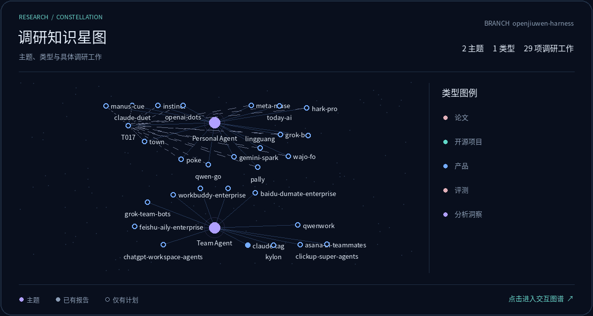

# openJiuwen Harness 调研工作

本分支归纳 openJiuwen Harness 组织内部的调研计划、报告与后续工作。

## 使用、贡献与维护

首次使用、开展调研、贡献报告或维护技能与图谱，请阅读[仓库使用、贡献与维护指南](docs/repository-guide.md)。项目规则见 [AGENTS.md](AGENTS.md)。

对象调研从 [research](.agents/skills/research/SKILL.md) 进入，报告保存到 [research-reports](research-reports/README.md)；基于已有成果的主题分析从独立的 [research-analysis](.agents/skills/research-analysis/SKILL.md) 进入，报告保存到 [analysis-reports](analysis-reports/README.md)。两者可共用成稿、证据与提交能力。

两个入口共用 [主题注册表](themes.yaml)，主题层次通过统一名称体现；具体报告目录追加创建或最近修订的北京时间，报告 ID 保持稳定。

<!-- research-graph:start -->

## 调研图谱

**0 个调研主题 · 0 种类型 · 0 项调研工作**

[打开交互图谱](https://technologyhu.github.io/research/) · [本地页面](docs/research-graph/index.html) · [静态预览](docs/research-graph/preview.png) · [生成与维护说明](docs/research-graph-guide.md)

数据分支：`openjiuwen-harness`。只索引已纳入 Git 的调研内容；技能资料不进入总览。

主题命名统一维护在 `themes.yaml`，主题层次压成一个目录名。调研报告：`research-reports/<主题名>/<type>/<target>-YYYYMMDD-HHmmss/`；分析洞察：`analysis-reports/<主题名>[-<专题>]-YYYYMMDD-HHmmss/`。时间采用北京时间，记录创建或最近修订时间。

当前计划：调研使用 `research-reports/<主题名>/plan.md`，分析洞察使用 `analysis-reports/<主题名>.plan.md`。报告按主题层次聚合，同主题内按最近修订时间倒序。

图谱按实际关联自由布局：主题与具体调研工作连接，类型通过颜色、标签和筛选体现。

主题状态取自计划；报告旁标注其自身完整度。下一步取自计划记录，未记录时不自动推断。

## 调研与分析计划总览

| 类别 | 主题 | 状态 | 当前计划 | 更新日期 |
| --- | --- | --- | --- | --- |
| 调研 | 暂无调研计划 | — | — | — |
| 分析洞察 | 暂无分析洞察计划 | — | — | — |

## 调研报告总览

| 主题 | 状态 | 计划 | 报告 | 下一步 |
| --- | --- | --- | --- | --- |
| 暂无调研主题 | — | 暂无计划 | 暂无报告 | 暂无下一步安排 |

## 分析洞察报告总览

| 主题 | 状态 | 计划 | 报告 | 下一步 |
| --- | --- | --- | --- | --- |
| 暂无分析洞察主题 | — | 暂无计划 | 暂无报告 | 暂无下一步安排 |

当前纳入总览：调研报告 0 份，分析洞察报告 0 份。暂无数据时显示空状态，不添加演示节点。

<!-- research-graph:end -->
