# Claude Mods 深度技术调研

> 调研日期：2026-10-12（Asia/Shanghai）  
> 调研方式：使用本机 `research` 技能及其项目技术调研模板，结合官方文档、官方博客、固定提交源码进行分析。  
> 保存位置：`D:\code\personal\research\agent-framework\product\claude-code\claude-mods\`，已获用户确认。  
> 对象性质：Claude Code 的产品扩展能力，包含公开可读的内置 mod 源码与 Apache-2.0 官方示例。不能把它整体称为开源 Claude Code 引擎。  
> 资料限制：用户提供的四篇微信文章均被环境验证页拦截，未取得正文；不把它们计入已验证证据。没有安装或执行下载的 mod。

<!-- structure-version:2 -->
<!-- prose-revision:2026-10-12 -->
<!-- system-overview-revision:2026-10-12 -->
<!-- chapter-two-readable:2026-10-12 -->

## 阅读指南

技术主线依次回答：**是什么 → 如何载入 → 如何执行 → 如何控制工具 → 如何交互 → 源码怎样实现 → 怎样开发 → 如何验证 → 是否适用**。

阅读时无需先记住所有英文名。概念在首次出现处解释，难懂机制配有具体过程；需要快速回查时可打开 [术语速查](glossary.md)。文中的类比和情景例子用于理解已有资料，不代表新增的宿主实测结果。

| 阅读目的 | 建议路径 |
| --- | --- |
| 首次理解整体机制 | 第 2 章总览 → 2.1 编号架构图与 Read 例子 → 2.3 注册加载 → 第 3 章执行总流程；再按分节深入 |
| 重点理解 next 与 next.to | 第 3.4–3.6 节；结合第 4 章和第 6.6 节看组织策略的实际用法 |
| 对照源码学习实现 | 第 6 章按案例复杂度递进；术语不熟时返回第 2–5 章 |
| 开发与验证自己的 Mod | 第 7 章 Tool Tally → 第 8 章检查工具、证据分层与待验证矩阵 |
| 复查版本、来源或交付文件 | 附录 A–C；精确源码锚点见正文与附录 C 的固定版本链接 |

正文区分当前文档、固定提交实现、旧类型契约、历史设计与研究者模型。原始架构 PDF 是 2026-08 的设计资料，不能将其直接当作当前运行时实现。

**一图速查。** 下图将函数钩子、`next` 调用、五个层级、`$` 接口、事件和 UI 汇总在一张图中。可先浏览整体，再对照第 2–5 章查阅具体机制。

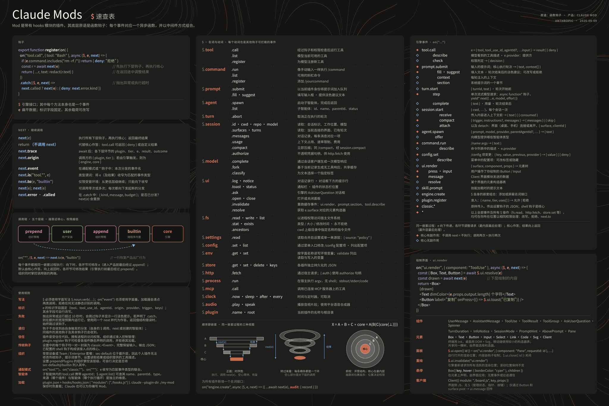

*速查图：用户提供的中文 SVG，图内标注日期为 2026-09-09；[打开矢量原图](assets/diagrams/claude-mods-cheatsheet-zh.svg)可放大阅读。图中的接口与规则需结合正文所区分的版本理解。*


- [1. 理解 Mods：定位、概念与证据边界](#1-理解-mods定位概念与证据边界)
- [2. 运行架构：从插件文件到宿主能力](#2-运行架构从插件文件到宿主能力)
- [3. 事件执行机制：中间件、continuation 与控制流](#3-事件执行机制中间件continuation-与控制流)
- [4. 工具与权限：一次调用贯穿哪些控制层](#4-工具与权限一次调用贯穿哪些控制层)
- [5. UI 与状态：绘制、交互到生命周期](#5-ui-与状态绘制交互到生命周期)
- [6. 官方代码解析：从观察面板到内置机制](#6-官方代码解析从观察面板到内置机制)
- [7. 开发实践：完成一个可检查的 Mod](#7-开发实践完成一个可检查的-mod)
- [8. 验证与性能：哪些结论已经成立](#8-验证与性能哪些结论已经成立)
- [9. 技术评估：成熟度、适用场景与试点](#9-技术评估成熟度适用场景与试点)
- [附录 A. 官方来源、版本与代码快照](#附录-a-官方来源版本与代码快照)
- [附录 B. 四篇微信文章的获取状态](#附录-b-四篇微信文章的获取状态)
- [附录 C. 交付、来源追溯与复现](#附录-c-交付来源追溯与复现)

## 1. 理解 Mods：定位、概念与证据边界

**Claude Mods 让开发者通过代码定制 Claude Code 的部分运行过程和界面。** 例如，在工具执行前展示确认面板，在执行后记录结果，或在输入框上方持续显示会话状态。这些代码作为插件的一部分加载，接入 Claude Code 提供的事件和界面接口。[官方发布文章][S1]、[官方示例实现][S9]

报告中把 Claude Code 本体称为**宿主（host）**。它负责运行智能体（Agent）、执行工具和显示界面；mod 是接入其中的扩展。发生工具调用、回合结束或界面绘制时，宿主会触发对应的**事件（event）**；mod 注册的函数负责处理事件，这个函数叫**处理器（handler）**。

本报告统一把 Agent 称为**智能体（Agent）**：它围绕模型建议，持续管理上下文、调用工具并推进任务。负责当前用户任务的是**主智能体**，由它启动、承担分工任务的是**子智能体**。下文简称“智能体”，与网络中的 Proxy 不混用。

多个处理器可以依次处理同一个事件。每个处理器既可以把事件交给后面继续，也可以修改输入、处理返回结果，或直接作出回答。这种能参与一次操作前后过程的函数，称为**中间件（middleware）**。第 3 章会用工具调用解释它的执行顺序。

这里的 **Harness** 指围绕模型的一套运行系统：保存上下文、调用工具、处理权限、推进任务并向用户展示结果。模型负责产生下一步建议，Harness 负责把建议变成受控制的实际操作。

因此，本报告的判断是：Mods 的主要价值在于定制这套运行系统和用户工作环境。它改变工具调用如何经过检查、上下文如何提供、用户如何参与操作；这些扩展无需修改模型权重。

### 1.1 为什么需要 Mods

现有扩展通常解决局部问题：Skills 提供任务知识，MCP 提供外部工具，设置型 Hooks 在某些生命周期节点运行操作。但“换一种审查界面”“给正在执行的智能体增加可交互面板”“把内置功能换成自己的实现”需要更接近宿主的扩展面。

官方给出的动机是让开发者获得更多控制，不必等待产品团队逐个实现功能；同时让团队能够定制自己需要的规则和工作方式。[官方发布文章][S1]

**研究判断**：其产品方向是从固定编码助手走向用户可塑造的工作环境。一个重要指标不是有多少娱乐插件，而是常用功能能否用公开、可测试的扩展契约实现，并保持可组合性。

### 1.2 Plugin、Mod、Skill、Hook 与 MCP 的层级

**Plugin 是安装包，Mod 是包内的一种扩展能力。** 可以把 plugin 理解为包含名称、版本、配置和代码的文件夹；其中的 hooks module 是注册事件处理器的代码模块。一个 plugin 可以同时装入 Skills、MCP 配置、传统 hooks 和 mod。[Token Weather 配置][S27]、[内置目录说明][S8]

**Hook** 的原意是“挂接点”：宿主在某个节点调用扩展代码。传统设置型 Hook 通常在配置指定的节点运行外部脚本；本报告中的函数 hook 则是接入事件处理链的函数。**MCP（Model Context Protocol）** 是模型应用连接外部工具和服务的协议；**Skill** 则主要向模型提供任务方法与知识。这些机制各有分工，可以打包在同一个 plugin 中。

| 机制 | 首要作用 | 典型工程选择 |
| --- | --- | --- |
| Skill | 向模型提供任务方法与知识 | 代码审查规范、领域分析流程、交付要求 |
| 设置型 Hook | 生命周期节点上的外部操作与控制 | 提交前检查、格式化、通知、已有脚本复用 |
| MCP server | 提供外部工具 / 服务接口 | 查询数据库、连接协作平台、调用业务系统 |
| Mod | 改写宿主事件行为并扩展界面 | 交互式门禁、上下文面板、编辑回放、替换内置功能 |
| Plugin | 打包、安装和管理上述组件 | 团队分发、版本与依赖管理 |

该表对机制作用做概念归纳，依据[官方扩展机制对比][S3]；“典型工程选择”为本报告建议。

### 1.3 三个容易混淆的能力边界

1. **传统 Hooks 没有因此失效。** 设置型 Hooks 仍可以提供门禁、修改参数或上下文；Mods 的独特价值在于进程内中间件、更广的事件面和 UI。[组织治理指南][S7]
2. **Mod 可以调用模型，也可以完全不调用。** Token Weather 读取已有使用量数据并绘制界面；Replay Theater 在本地计算文件差异。这类功能本身不必增加新的模型推理请求。[Token Weather][S9]、[Replay Theater][S11]
3. **Mods 与 MCP 可以组合。** 外部系统负责业务工具，mod 负责呈现、事件联动与本地工作流；是否这么做取决于隔离、运维与可移植性要求。[Mods API][S21]

### 1.4 按需求所在层级选择扩展机制

工程上先问需求发生在哪一层：只是知识和流程，优先 Skill；只是一个已有脚本的确定性触发，优先设置型 Hook；需要外部服务工具，优先 MCP；需要宿主 UI 或深度行为控制，再采用 Mod。

这样选择是为了控制新增维护成本。一个只需要调用格式化器的需求，没有必要额外承担 UI、事件顺序和宿主版本兼容性。

### 1.5 哪些源码公开，哪些机制只能重建

```text
Claude Code 产品
├── 宿主核心：加载、事件分派、模型请求、工具执行等
│   └── 本次公开仓库不足以重建其完整实现
├── mods/：四个内置 mod、测试、公开契约
│   ├── agents-md
│   ├── diff
│   ├── sec-default
│   ├── telemetry
│   └── types/claude-code.d.ts
└── Playground：三个教学示例
    ├── token-weather
    ├── blast-radius
    └── replay-theater
```

第 2、3 章据此解释“外部可观察到的流程”和“接口允许的行为”，而不是还原宿主内部每个函数的实现。报告所说的**契约（contract）**，就是宿主与扩展约定的接口规则：能接收哪些事件、使用哪些参数、返回什么结果，以及失败时怎样处理。公开契约和 mod 源码能帮助理解机制，但不足以重建未公开的加载器和通信代码。

### 1.6 阅读技术实现前应记住的六点

| 判断 | 证据与含义 |
| --- | --- |
| Mod 是 plugin 的一种能力形态 | 通过普通 plugin manifest 与 `hooks.json.modules` 接入；没有另造独立安装体系。[Token Weather 配置][S27] |
| 扩展面从外部脚本进入宿主行为链 | 能包装事件、改写数据、返回替代结果；也能操作 UI。这比单纯向模型添加提示词深入。[发布文章][S1] |
| 内置功能也在采用相同机制 | `/diff`、项目指令加载、组织默认 guard、遥测均有公开 mod 实现。[内置目录说明][S8] |
| “运行环境受限”不等于“权限隔离” | 模块没有 Node/DOM，但宿主 API 可读文件、启动进程、访问网络；mod 并未因此成为低权限代码。[类型契约][S15]、[组织管理文档][S7] |
| 官方示例与当前契约有版本差异 | Playground 的 Token Weather 用模块变量及旧 UI 字段；当前文档推荐宿主状态并使用 `e.props`。不能把不同时间的教程拼成可运行代码。[示例源码][S9]、[界面指南][S5] |
| 默认失败语义需要特别审查 | 一个门禁在 `next` 前失败，默认可能被跳过；安全控制需要明确错误策略，并验证自身错误处理失败的情形。[事件指南][S4] |

### 1.7 本报告的事实、推断与未验证项

- **已核验事实**：直接读取的官方文档、GitHub API 元数据、固定提交代码中的行为。
- **设计分析 / 工程建议**：从这些事实推导的可借鉴设计、风险、试点方案；明确以“判断”“建议”“推断”表述。
- **未验证**：实际安装效果、运行延迟、费用变化、社区项目成功率、四篇微信文章的具体观点。

没有把演示截图当成本次运行结果，没有把公开类型声明当作闭源引擎的完整实现，也没有把仓库总 Star 数当作 Mods 的独立用户数。

## 2. 运行架构：从插件文件到宿主能力

**这一章只沿一个例子理解架构：Claude Code 读取 README，Tool Tally 记录这次成功调用，并把计数显示出来。** 先弄清“文件里的代码怎样被装进去”和“装进去后怎样参与操作”，再看配置、线程和能力接口。

读本章时先记住四件事：**Claude Code 推进任务；mod 提供处理函数；next 继续当前操作；$ 用于请求宿主提供的其他能力。** Worker 只是这些扩展函数运行的工作线程，第一次阅读不需要先了解线程通信细节。

| 你想弄清的问题 | 阅读位置 |
| --- | --- |
| 哪几个参与者在协作，谁调用谁？ | 2.1 架构图、Read 请求与独立绘制路径 |
| 磁盘上的配置和代码各做什么？ | 2.2 三个文件的关系 |
| register、on 和初始化有什么区别？ | 2.3 装载过程与注册示例 |
| next 与 $ 分别通向哪里？ | 2.4 当前操作与额外能力请求 |
| $ 中的方法从哪里来？ | 2.5 能力准备；普通 mod 先理解默认接口即可 |

本章讲的是公开接口能确认的协作关系。宿主内部完整实现未公开，因此“加载逻辑”“调度逻辑”“工具后端”按职责命名，不代表已发现同名类或服务。技术细节放在可展开的说明中，便于先读完整过程，再按需深入。[创建指南][S22]、[事件指南][S4]

### 2.1 总体架构与模块交互

**先看“如何接入”，再看“如何参与一次操作”。** 插件文件夹提供配置和代码；宿主检查并加载代码后，登记其中的处理函数。事件发生时，宿主调用这些函数；函数可以继续、改写或接管事件，实际读取文件和显示界面由对应宿主能力完成。

下图分成三个区域，按 **A → B → C** 阅读。A 表示加载时的登记关系，B 放大一次工具请求与结果返回，C 展开计数变化后的刷新请求、绘制安排与事件分派。**B 的工具事件和 C 的绘制事件都由宿主组织处理。** 图中分别标出两条路径的分派职责，便于跟踪各自的输入和结果；公开资料没有说明它们是否共用同一个内部调度模块。方框按职责分组，箭头说明调用或数据流向，不是所有动作严格串行发生的时间轴。

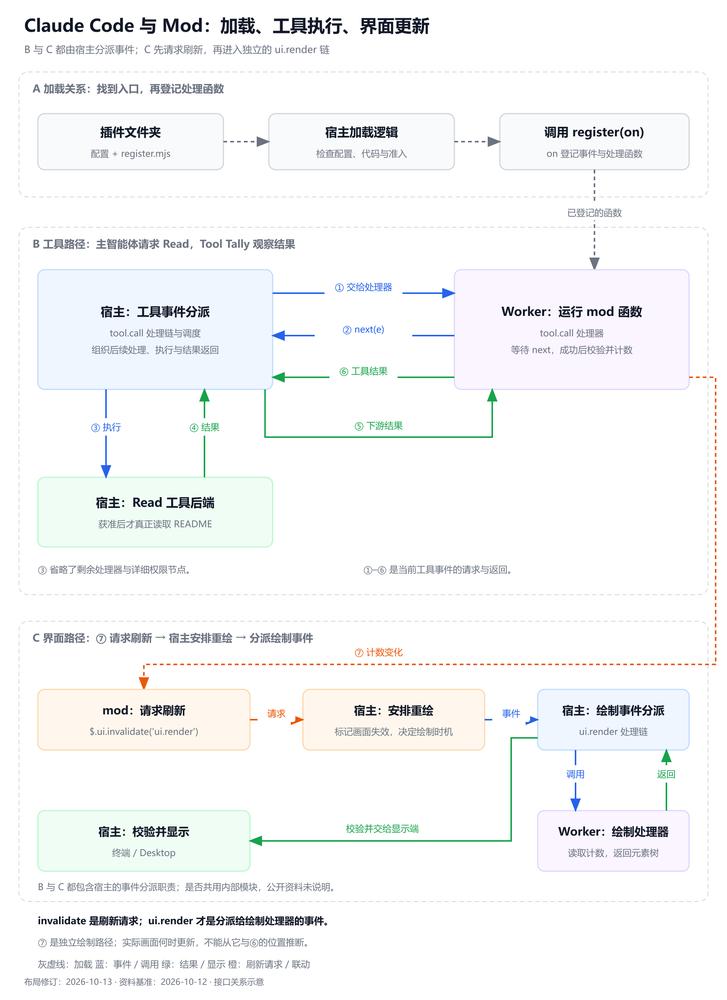

*图 1：A 为加载关系；B 的①–⑥为工具请求与返回；C 的⑦展开独立绘制路径，并显式画出宿主安排重绘与分派 ui.render。灰色虚线表示加载关系，蓝色表示事件与调用，绿色表示结果与显示，橙色表示刷新请求与联动。省略其他 mods、完整权限路径及通信细节。*

#### 2.1.1 跟着图走：读取 README 并显示计数

**A 区先完成准备：** 宿主从配置找到入口代码，检查是否允许加载，再调用 register(on)，让模块用 on 登记事件与处理函数。灰色虚线连向 Worker，表示这些函数以后在扩展运行环境中被调用；它不表示每次 Read 都重新注册插件。

再看 **B 区的工具路径**。这里假设 Tool Tally 已允许加载，主智能体请求读取 README，后续权限允许读取，且没有其他 mod 替换结果。①–⑥沿着当前工具事件往返：

1. **宿主把请求交给 mod。** Claude Code 收到读取 README 的请求，在 tool.call 路径调用匹配的处理函数，把工具名、路径等事件数据交给它。
2. **mod 调用 next，继续这次读取。** Tool Tally 的处理函数暂时停在 await next(e)，等待后面的处理完成。next 继续当前事件的剩余链，后面可能还有其他 mods。
3. **宿主真正执行读取。** 后续处理与权限检查通过后，Read 后端读取文件。mod 已经收到事件，不等于文件已经读完。
4. **读取后端返回结果。** 内容或错误结果先回到宿主的处理路径。
5. **等待中的 mod 拿到下游结果。** await next(e) 完成，Tool Tally 检查成功状态、主智能体身份和任务代次，满足条件才更新计数并发出重绘通知。图中绿色折线回到 Worker，表示结果回到了等待中的处理函数。
6. **mod 把工具结果原样交回。** 计数是它的附加工作；工具结果继续返回宿主，供模型使用。换成其他 mod，也可能在这里改写返回值。

**C 区展开⑦：先请求刷新，再分派绘制事件。** `$.ui.invalidate('ui.render')` 是 mod 向宿主发出的刷新请求；参数中的 `ui.render` 指明需要失效的绘制事件，但这个调用本身不等于立即执行一次绘制。宿主安排重绘时，才发起 `ui.render`，沿匹配的处理链调用绘制函数。

```text
mod 更新计数
→ invalidate 请求刷新
→ 宿主标记画面失效并安排重绘
→ 宿主分派 ui.render，调用匹配的绘制处理器
→ 处理器返回含最新计数的元素树
→ 宿主校验并显示
```

| 图中的界面环节 | 对应动作 | 产生什么 |
| --- | --- | --- |
| mod 请求刷新 | 调用 $.ui.invalidate('ui.render')，通知旧画面需要更新 | 向宿主提出刷新请求 |
| 宿主安排重绘 | 标记相关画面失效，决定何时重新计算 | 待更新的画面及绘制时机 |
| 宿主绘制事件分派 | 发起 ui.render，沿匹配的处理链调用绘制函数 | 绘制事件及对应处理器调用 |
| Worker 中的绘制处理器 | 读取计数，组合已有内容，返回元素树 | 返回宿主的界面描述数据 |
| 宿主校验显示 | 校验描述，再交给终端或桌面绘制 | 用户可见的计数界面 |

**⑦是另一条路径的编号，不是“必须等⑥结束才执行”的第七个同步步骤。** Tool Tally 源码在更新计数后先调用 invalidate，再 return 原工具结果；实际画面何时更新由宿主安排，不能仅凭图上的上下位置确定它与⑥的先后。橙色虚线表达“计数变化引出刷新请求”，不代表 Worker 直接修改屏幕。[Tool Tally 行为说明](#71-完整例子tool-tally-的行为与文件)

**B 与 C 中的宿主分派职责。** B 的框专门展开 `tool.call`，C 的“宿主：绘制事件分派”专门展开 `ui.render`；两处都表示宿主的事件分派职责。它们分别画在各自路径中，便于看清不同事件的处理过程。绘制仍经过宿主分派；这些职责框不代表两个独立调度服务。[事件指南][S4]、[界面指南][S5]

因此，B 回答“工具请求如何执行并返回”，C 回答“已有计数如何显示”。next 继续 B 中的当前事件；UI 方法用于请求 C 中的绘制，二者不能互相代替。工具成功返回也不自动证明画面已正确显示。完整开发例子见第 7.1 节。[Tool Tally 行为说明](#71-完整例子tool-tally-的行为与文件)、[工具事件顺序][S4]、[界面指南][S5]

#### 2.1.2 把图里的模块对应到代码

| 图中的参与者 | 在例子里做什么 | 应怎样理解 |
| --- | --- | --- |
| 插件文件夹 | 保存名称、入口路径和 register.mjs | 安装包与代码来源，自己不会推进智能体任务 |
| 宿主加载逻辑 | 找到模块、检查能否载入、组织登记与初始化 | 把文件变成可以参与运行的扩展 |
| 宿主工具事件分派 | 把 Read 请求交给处理器，继续 next 后面的链 | B 区的 tool.call 分派与调度职责 |
| Worker 中的工具处理器 | 等待 next 的结果，检查成功状态并统计 | B 区的 tool.call 函数；它不会直接绘制屏幕 |
| 宿主 Read 工具后端 | 在获准后读取 README | B 区实际完成读取的一侧 |
| 宿主安排重绘 | 接收失效通知，决定何时重新绘制 | C 区从刷新请求到绘制事件的安排职责 |
| 宿主绘制事件分派 | 发起 ui.render，调用匹配的处理链 | C 区同样包含宿主的事件分派职责 |
| Worker 中的绘制处理器 | 根据计数返回元素树 | C 区的 ui.render 函数，与工具处理器职责不同 |
| 宿主校验与显示环境 | 校验返回描述，交给终端或 Desktop 显示 | 界面描述最终变成画面的环节 |

图中 B 和 C 的 mod 函数属于同一个 Tool Tally 插件：一个观察工具调用，另一个生成界面描述。分成两个方框是为了说明职责，不表示启动了两个插件或两个独立 Worker。一次事件还可能经过其他处理器；加载、调度和后端的划分也不等于独立进程。[Worker 说明][S6]、[处理器顺序][S4]

<details>
<summary>展开：较完整的架构与三类消息交互</summary>

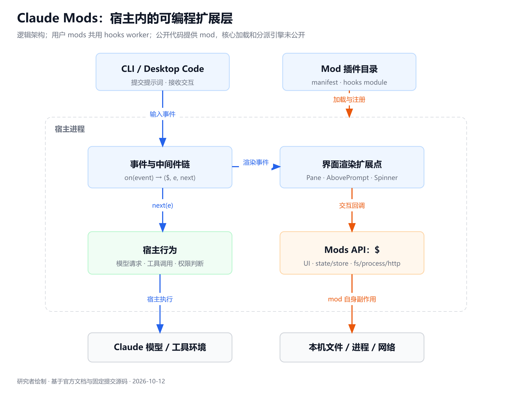

*图 2：本报告绘制的逻辑架构。蓝色表示主要事件/执行路径，橙色表示加载、交互及 mod 自身副作用。*

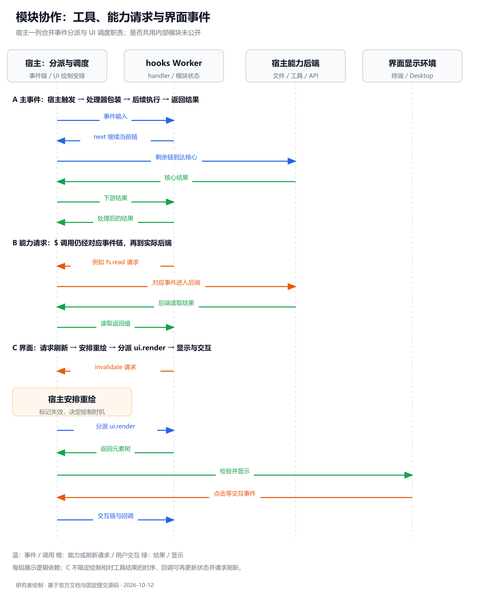

*图 3：模块协作示意。宿主一列合并事件分派与 UI 绘制安排职责，便于追踪消息；不宣称它们由同一个内部模块实现。C 区先展示 invalidate 刷新请求，再展示宿主安排重绘、分派 ui.render 和元素树返回。next 仍由宿主分派逻辑继续当前链；省略其他 mod 与完整通信细节。*

这两张图补充 mod 自身 API 请求和用户点击回传。先读完 B 的①–⑥和 C 的⑦，再用它们区分：宿主发起的事件、mod 发起的能力请求，以及界面交互事件。具体调用来源和重入机制见第 3.7 节。

</details>

### 2.2 插件文件如何声明入口

**文件可以按“说明书 → 路标 → 代码”理解。** plugin.json 说明这是哪个插件，hooks.json 告诉宿主到哪里找代码，register.mjs 声明要在什么事件上运行哪些函数。它们的关系是沿文件引用找到入口，不是三个文件各自启动一个服务。

```text
my-mod/
├── .claude-plugin/
│   └── plugin.json
└── hooks/
    ├── hooks.json
    └── register.mjs
```

- `plugin.json`：插件的说明文件，也称 manifest，记录名称、版本、描述、作者等信息。
- `hooks.json`：通过 `modules` 告诉宿主应加载哪个代码模块；路径相对于这个配置文件。
- `register.mjs`：导出 `register(on, options)`。`on` 用来声明“某事件发生时运行哪个处理器”，`options` 接收按插件配置整理好的选项。

这是官方 Token Weather 目录可直接验证的组织方式。[配置与入口][S27]。插件布局可按上述官方配置与入口链接复查。

比如，hooks.json 中的 modules 指向 ./register.mjs，宿主就到这个配置文件所在目录寻找 register.mjs。找到入口并不代表它已经生效，还要通过加载条件和登记过程。[文件参考][S23]

### 2.3 加载过程：发现、扫描、准入与注册

**加载阶段是在准备“以后怎样处理事件”，不是现在就执行一次工具。** 可以先把它理解成五项工作；下面是逻辑依赖关系，不是未公开的宿主内部调用栈。

| 工作 | 宿主在做什么 | 完成后多了什么 |
| --- | --- | --- |
| 找入口 | 读取插件说明和 modules 指向的文件 | 知道需要加载哪份代码 |
| 做检查 | 检查配置、源码接入规则、工作区信任和组织政策 | 确定这份代码是否可以进入 |
| 登记函数 | 执行模块并调用 register；模块使用 on 声明处理器 | 知道哪些事件由哪些函数处理 |
| 准备能力 | 为本插件构造正常处理器可用的 $ | 函数可以请求允许提供的宿主方法 |
| 做初始化 | 调用加载后的 session.start 等相应处理器 | 需要的命令、状态等准备好，等待后续事件 |

**最容易混淆的是第三步。** on('tool.call', handler) 的意思是“以后有相应工具调用时执行 handler”，不是“现在立即调用这个工具”。register 会随模块加载或重载执行；handler 则随匹配的事件执行。[创建指南][S22]、[注册契约][D-Register]、[能力接口说明][D-EngineInterface]

<details>
<summary>展开：完整加载图、检查环节与证据说明</summary>

**证据等级：当前使用契约 + 公开类型；宿主 scanner / loader 实现未公开。** 本节解释可确定的检查流程，不给未知内部模块虚构函数名。

**注册加载的目标，是把磁盘上的代码变成“宿主知道何时调用、能以正确能力运行”的处理器。** 整体上先发现入口并检查，之后执行模块和 register，准备能力与事件链，再做加载后的初始化。普通事件发生时，才进入业务处理。

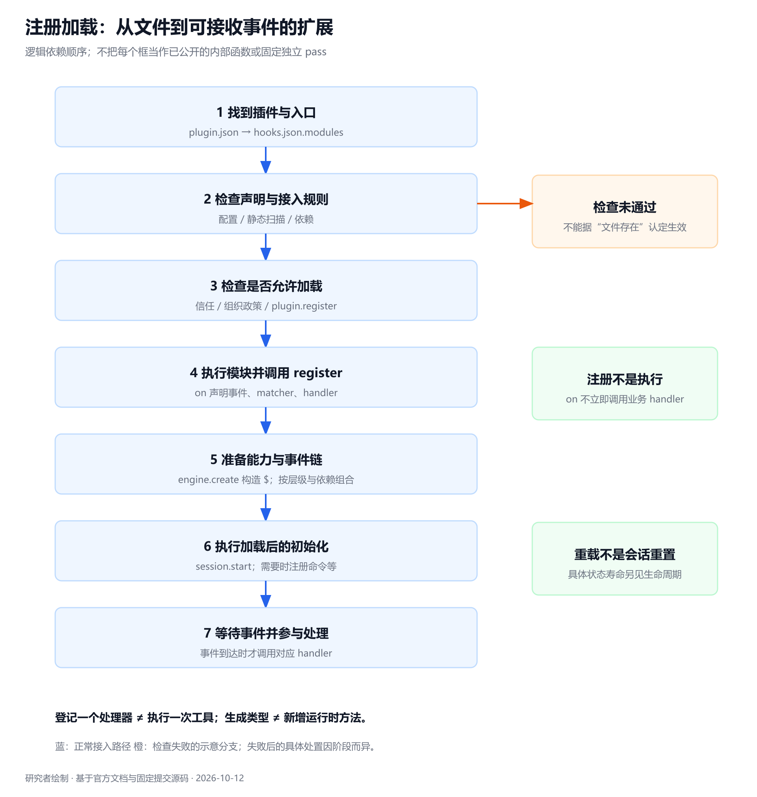

*图 4：注册加载的逻辑依赖顺序。能力构造针对具体插件展开；该图不宣称宿主按七个同名内部函数串行实现全部加载任务。*

可以沿一个普通插件理解这七步：

1. **发现入口**：从 plugin.json 和 hooks.json.modules 确定配置与代码位置。
2. **检查接入规则**：分析事件名、matcher 和能力调用，检查文件、导入和配置是否符合契约。
3. **判断能否加载**：结合工作区信任、功能条件与组织政策；plugin.register 可参与准入，它与入口导出的 register 函数不同。
4. **执行模块并登记**：执行模块顶层代码，调用导出的 register(on, options)，通过 on 声明 handlers。
5. **准备可用能力和组合关系**：按契约构造本插件的 $，并依据层级、依赖和登记顺序参与事件处理；engine.create 是能力构造事件。
6. **进行加载后的初始化**：session.start handler 可注册命令、初始化需要的运行状态等。
7. **进入事件驱动运行**：工具调用、回合变化或绘制等事件到达时，宿主执行对应 handler。

这是**逻辑依赖**：登记发生在正常 handler 使用 $ 之前，engine.create 在本插件其他 hooks 之前建立能力。多个插件之间的真实调度、内部缓存及构建批次未公开，不能从这七步推导出完整宿主调用栈。[当前入口指南][S22]、[注册与能力接口注释][D-Register]、[能力接口构造][D-EngineInterface]

加载可以分成三个问题：**找到了什么文件 → 这些代码是否允许进入 → 它们注册了什么行为**。其中，“模块求值”指执行文件顶层代码；“准入”指信任与组织政策是否允许加载。文件存在、代码能解析、插件被允许、处理器结果合法，是四件需要分别检查的事。

| 阶段 | 可核验输入 / 行为 | 出错后的典型表现 |
| --- | --- | --- |
| 发现 | 普通 plugin manifest、`hooks/hooks.json.modules`、插件名及来源 | 目录错误、同名插件占用、没有 module |
| 配置 | userConfig 的值与默认值作为 options，并检查类型与范围 | 选项不符合 schema（字段格式与取值约束） |
| 静态扫描 | 明确写出的事件名、筛选条件 matcher、完整 `$` 调用及允许的导入 | 校验命令报告未知事件、非法别名或导入 |
| 信任与政策 | 工作区信任、组织设置、`plugin.register` 准入、功能开关 | 插件已安装而 module 未载入 |
| 模块求值 | 插件内 ES modules，顶层代码、导出的 `register` | 顶层异常、依赖文件加载失败 |
| 注册 | 建立事件处理器集合；宿主准备 `$` 与生命周期事件 | 重复注册、入口不符合契约 |

表格用于区分问题发生在哪个环节。宿主可能把多个检查合在一起，具体版本也可能调整顺序；公开资料不足以确定它是否对源码执行多轮独立扫描。[创建指南][S22]、[加载失败说明][S6]

</details>

#### 2.3.1 为什么要求显式调用，而不是普通动态 JavaScript

**宿主需要在代码运行前看出：你监听什么事件，会请求什么能力。** 所以要求把事件名和 API 调用写清楚，例如直接写 on('tool.call', ...) 与 $.fs.read(...)。这样能检查接入方式，但不能据此证明所有业务逻辑都正确。[扫描要求][S22]

<details>
<summary>展开：合法与不合法写法、matcher 和扫描边界</summary>

**本机制先约束代码的表达方式，使宿主能在执行前识别事件和能力入口；然后再进行类型及运行时检查。** 下文先看显式写法，再看扫描能证明和不能证明什么。

**静态扫描**是在执行代码之前阅读源码，识别它监听哪些事件、会调用哪些宿主能力。为使这些信息容易识别，事件名要直接写成字符串，例如 `'tool.call'`；宿主 API 要写成完整的 `$.namespace.method(...)`。这里的 namespace 是一组相关方法的名称，例如 `$.fs` 放文件操作、`$.ui` 放界面操作。

入口可导入插件内允许的相对模块；动态 `import()` 和 Node 的 `require` 不属于允许的加载方式。[静态扫描要求][S22]、[模块环境声明][S15]

```javascript
// 可供静态识别的写法
on('tool.call', { tool: 'Bash' }, async ($, e, next) => next(e));
await $.fs.read('notes.md');

// 当前扫描契约拒绝的形式：不是推荐的“同义写法”
const ui = $.ui;
const eventName = 'tool.call';
on(eventName, handler);
await import('./dynamic.js');
```

上例中，`{ tool: 'Bash' }` 是 **matcher（筛选条件）**，表示只处理工具名匹配 Bash 的调用。`const eventName = 'tool.call'` 在普通 JavaScript 中可以使用，但在这个注册场景里，扫描规则要求 `on` 的位置直接出现事件名；“语言本身合法”和“宿主允许接入”需要分开判断。

明确拼写让宿主在运行 handler 前列出“监听哪些事件、使用哪些能力”。这也是用户审查和测试 mock 可以复用同一能力名称的前提。扫描结果与 TypeScript 类型检查关注点不同：前者检查代码如何接入宿主，后者检查输入/结果是否符合类型；两者都不证明业务逻辑正确。

**需要精确表述的边界**：`calls: $.http.fetch` 说明代码具有网络调用路径，不能证明实际目的域名、传输内容或调用频率。数据可动态构造；而 `$.process.run` 启动的程序还可能自己读文件或发请求。静态可枚举副作用入口，不等于完整的数据流或安全证明。

</details>

#### 2.3.2 类型检查与运行时校验是两道契约

**开发时检查“代码形状”，运行时再检查“实际交回的结果”。** 例如编辑器可提示字段类型错误；即使没有做 TypeScript 编译，宿主也会检查事件结果和 UI 描述。输入按只读数据处理，需要改参数时创建副本。[事件类型][D-Events]

<details>
<summary>展开：冻结输入、类型文件与未公开的扫描实现</summary>

**类型检查**在开发时检查参数和返回值是否符合约定；**运行时校验**在代码实际运行时检查提交的结果。公开 `Events` 声明把事件名对应到处理器签名，`Frozen<T>` 则把输入及其嵌套字段标成只读；运行时也会冻结这些数据。因此，修改输入应创建副本，而不是直接给 `e` 的字段赋值。

即使用 `.mjs` 编写、没有 TypeScript 编译，宿主仍会校验事件结果和界面描述。`.d.ts` 是类型声明文件，它描述接口而不执行操作；本报告引用的声明为 v2.1.277，与当前文档已存在差异，所以开发时要核对目标宿主版本。[事件类型与 Frozen 定义][D-Events]

读取源码通常需要解析语法结构，即 AST（抽象语法树）；代码转译器则把一种代码形式转换成另一种。现有资料没有公开这里实际使用哪种解析器、如何分析分支和调用、或如何实现 JavaScript 运行环境。因此，不能把这些组件直接认定为 Babel、SWC 或某种 VM（虚拟机）。

</details>

#### 2.3.3 register 与 on：登记阶段到底保存了什么

**register 是宿主调用的入口；on 是入口用来登记处理函数的工具。** on 的声明包含事件名、可选筛选条件和函数。宿主保存这些声明后，才能在相应事件到达时调用函数；$、e、next 则是执行处理函数时传给它的参数。

下面第一项声明是“初始化时增加 inspect 命令”，第二项声明是“遇到 Read 时继续并等待结果”。载入时只登记这些回调，回调中的命令操作和读取要等对应事件发生。代码用于解释登记与执行，未在本机宿主验证。[On 契约][D-On]、[注册入口][D-Register]

```javascript
export function register(on, options) {
  // 载入时登记；这段回调要等加载后的初始化事件才执行。
  on('session.start', async ($, e, next) => {
    await $.command.register({ name: 'inspect', description: 'Inspect the mod' });
    return next(e);
  });

  // 登记 Read 的处理器，不会在此处立即读取文件。
  on('tool.call', { tool: 'Read' }, async ($, e, next) => {
    const result = await next(e);
    return result;
  });
}
```

把三个相似名字分开记：

| 名称 | 谁调用、何时调用 | 做什么 |
| --- | --- | --- |
| register(on, options) | 宿主在加载模块时调用 | 让模块声明 handlers |
| on(event, matcher?, handler) | 模块在 register 中调用 | 登记事件与处理函数的对应关系 |
| $.command.register(...) | 已获得 $ 的处理器在运行时调用 | 请求宿主增加一个命令 |

plugin.register 又是一个事件名：在模块将要载入时，其他有资格参与的处理器可检查是否允许进入。它不是上面 register 函数的另一个写法。[准入事件][S23]、[恢复注册契约][D-Registration]

#### 2.3.4 从登记完成到生效：能力、初始化与重载

**登记使宿主知道“什么时候调用你”，能力与初始化让函数具备预期行为。** engine.create 参与准备 $；session.start 适合加载后的命令注册等操作。加载结束之后，mod 通常等待事件触发，而不是自己持续执行整个智能体循环。

改代码触发重载，会重新执行模块和 register。普通模块变量可能重建；保存到会话 state 或持久 store 的数据则有各自寿命。先区分“插件模块重载”和“会话上下文重置”，具体状态规则见第 5.5 节。

<details>
<summary>展开：配置、入口返回值、能力准备及重载限制</summary>

**登记完成之后，还要建立可用能力并完成需要的初始化，扩展才具备预期行为。** engine.create 用下层已有接口组合本插件可用的 $；随后普通 hooks 才能使用相应方法。session.start 则适合模块加载后的命令注册等工作，具体能力构造见第 2.5 节。[能力接口][D-EngineInterface]、[加载生命周期][D-SessionStart]

options 是按 userConfig 整理、填入默认值的配置对象。固定提交的 Register 注释说明，它针对这次激活固定；配置变化会重载插件并重新运行 register。register 的普通返回值不是一份业务结果，宿主不把它当工具答案；该旧契约还说明，若入口返回 Promise，宿主会等待它。开发时仍应以目标宿主生成的类型为准。[当前配置参考][S23]、[固定 Register 注释][D-Register]

开发重载会重新求值模块、重新登记处理器，因此模块变量与闭包也可能变成新实例。它与 clear/resume/branch 的会话重置不是同一个动作；失败时还可能保留此前成功版本。生命周期和迟到结果的处理统一在第 5.5 节展开，不在这里假设“所有状态都会清空”或“所有动作都会重复”。

</details>

### 2.4 运行时：处理器、next 与宿主 API

**一个处理器运行时，最需要区分的是“继续眼前这次事件”和“另外请求宿主做一件事”。** 前者使用 next，后者使用 $；它们都由宿主组织处理，却不是同一条调用。

| 在代码里看到什么 | 在 Read 例子里是什么意思 | 会发生什么 |
| --- | --- | --- |
| e | 当前 Read 请求的工具名、文件路径等数据 | 处理器据此判断要做什么 |
| await next(e) | 把当前读取交给剩余处理链，等待它的结果 | 经后续处理和权限检查后，可能到达 Read 后端 |
| await $.fs.read('notes.md') | mod 自己另行请求读取 notes.md | 发起文件 API 事件，不等于继续当前 Read 请求 |
| 返回 result | 处理器把这次事件的结果交回上一层 | 宿主继续处理，最终交给相应调用方 |
| $.ui.invalidate(...) | 请求宿主刷新相关画面 | 宿主安排重绘后分派 ui.render；请求不等于立即绘制 |

因此，Tool Tally 用 next 等待主智能体的工具结果，之后只做统计；如果 mod 自己需要读配置文件，才另行使用文件 API。不要把 $ 理解成“当前工具”，也不要把 next 理解成“直接执行所有工具的万能函数”。详细嵌套见第 3.6 节，额外 API 调用见第 3.7 节。[处理器参数][S23]、[Next 契约][D-Next]

**Worker 的作用，是运行这些扩展函数。** 模块变量和按钮回调留在扩展运行环境里；真实文件、进程等操作通过宿主 API 完成。这个分工解释了为什么扩展代码不能随意拿浏览器 DOM 或 Node 对象来使用，也解释了为什么“代码运行在工作线程”不等于“文件权限自动变小”。

<details>
<summary>展开：Worker、数据传递与宿主能力桥接</summary>

**运行边界的整体分工是：Worker 执行扩展函数，宿主提供真实能力，两侧交换事件与结果。** 下面分别解释工作线程、通信数据、来源身份和资源权限。

**Worker** 是执行扩展代码的工作线程。它与宿主主流程分工，但线程分开不自动意味着权限更低。这里的“受限”主要指模块不能直接使用 Node 或浏览器环境中的全部对象；需要通过 `$` 请求宿主完成文件、进程等操作。写文件、启动程序、发请求这类会影响外部世界的操作，统称**副作用（side effect）**。

**证据范围：历史设计、公开接口和当前故障说明；下面的通信过程是逻辑模型。** 历史设计提出通过消息在 Worker 与宿主之间传数据。structured clone 指复制可传输的数据结构，MessagePort 指收发消息的端点；它们帮助理解两个运行环境如何交换数据。公开 Next/Origin 注释说明，宿主根据消息来源和插件层级设置调用身份；当前故障文档说明已安装 mods 共用 hooks worker。[原始设计 §4、§6.5][S28]、[来源契约][D-Next]、[当前 worker 说明][S6]

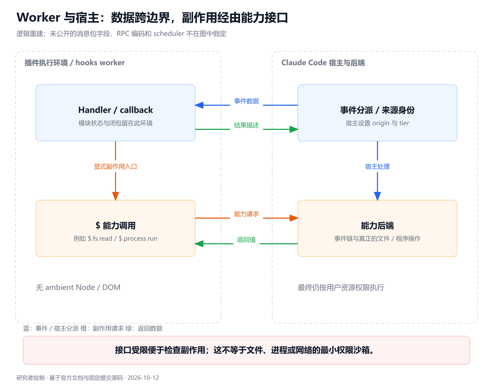

*图 5：逻辑边界图。箭头表达事件、结果与能力请求，不表示已核实的具体消息包格式。*

需要区分三个对象：

- **插件环境中的函数与闭包**：handler、局部变量、按钮回调在自己的模块环境中运行。
- **可跨边界的普通数据**：事件输入、结果、渲染描述与接口描述；不能把 Node 对象或 DOM 节点当作任意可携带对象。
- **宿主执行的能力**：文件、进程、网络、模型等通过 `$` 请求，按对应事件链处理；宿主才拥有实际后端实现。

以 `$.fs.read(path)` 为例：mod 请求读取文件，宿主识别是谁发起请求，把它放入相应事件链，经过其他处理器后由文件后端执行，最终把结果返回给等待中的 mod。

这类“把请求送到另一运行环境，再收回结果”的方式可称为 RPC。具体消息包含哪些字段、如何关联请求与响应、怎样排队和传输，均没有完整公开。报告只能解释请求与结果的逻辑关系，不能据此给出已验证的通信协议。

</details>

#### 2.4.1 谁提供身份，谁提供数据

`e` 回答“正在处理什么数据”，`next.origin` 回答“谁发起了这次事件”。origin 由宿主设置，`next.to` 跳层也不会改变它。判断调用身份时应使用宿主提供的来源，不能信任事件里自行写入的 `e.plugin = 'trusted'`。[Origin 定义][D-Origin]

还要区分三种身份：**谁发起请求、谁正在处理请求、谁提供被调用的工具**。例如，插件 A 发起调用，插件 B 检查权限，工具由插件 C 提供；三者可以完全不同。`next.origin` 描述发起者，当前 handler 属于处理者，部分事件的 `e.provider` 描述提供者。把它们混为一谈，会导致授权或工具来源判断错误。

#### 2.4.2 为什么这仍不是最小权限沙箱

模块不能直接使用 Node 的全部接口，也不能访问浏览器 DOM（网页对象树），使外部操作集中经过宿主 API，方便检查和拦截。但 API 后端仍可能使用当前用户的文件和进程权限。**沙箱**通常用于限制代码能访问的资源；仅仅换成受限的 API 调用方式，并没有证明操作系统也限制了资源访问。

共享 Worker 也带来共同故障风险。如果某个 mod 持续执行死循环，线程无法及时处理其他任务，其他 mods 也可能受到影响。宿主的超时、卸载和恢复机制可以缓解故障，但不等于每个 mod 都拥有独立的故障隔离环境。

当前故障指南还描述：宿主可以定位并卸载问题 mod；无法定位且连续崩溃时，可能停用该会话中的非内置 mods。[worker 故障说明][S6]

### 2.5 能力构造：engine.create 如何形成 $

**先把 $ 理解为宿主交给 mod 的一组可调用方法。** 例如 $.fs 下是文件方法，$.ui 下是界面方法。普通 mod 使用它们就能请求操作，一开始不必自己实现 engine.create。

只有需要理解“接口从哪里来”，或开发新增能力的 mod 时，才需要继续看能力构造。其整体过程是：内层先给出已有方法，外层按契约组合或限制方法，宿主再把形成的接口交给普通处理器。

例如，telemetry mod 可以在已有能力上加入遥测方法；类型声明告诉编辑器这些方法的参数，实际运行实现才让调用真的生效。这里的 fold 就是逐层把已有接口组合成新接口，不是每次调用 $.fs.read 都重新造一遍整个 $。[能力构造契约][D-Engine]、[遥测实现][C-TelemetryFold]

<details>
<summary>展开：engine.create 的返回顺序、fold 图与契约细节</summary>

**能力构造先取得内层已有接口，再逐层增加或按契约限制方法，最终形成普通 handler 使用的 $。** 下面先讲 fold 的返回方向，再区分“方法存在”和“方法被调用时怎样处理”。

**证据等级：公开 EngineCreate 契约 + telemetry 实际源码；宿主 descriptor 编译与路由实现未公开。**

普通处理器调用 `$` 来使用已有能力，例如 `$.fs.read`；`engine.create` 更早一步，参与建立这份能力接口。此时传入的 `$` 还是空接口，不能像普通处理器那样直接使用它。处理器先通过 `await next(e)` 取得内层已经构造的能力，再加入自己提供的一组方法，或按契约限制哪些能力可见。[EngineCreateInput / Result][D-Engine]、[EngineInterfaceBuilt][D-Built]

**fold** 在这里指“逐层把已有结果组合成新的结果”。可以想象内层先交出文件、进程等能力，外层在这份接口上补上 telemetry 方法，再把组合结果交给更外层。最后形成普通 handlers 使用的 `$`。这只是帮助理解返回顺序的模型，具体组合仍要看各个 mod 的实现。

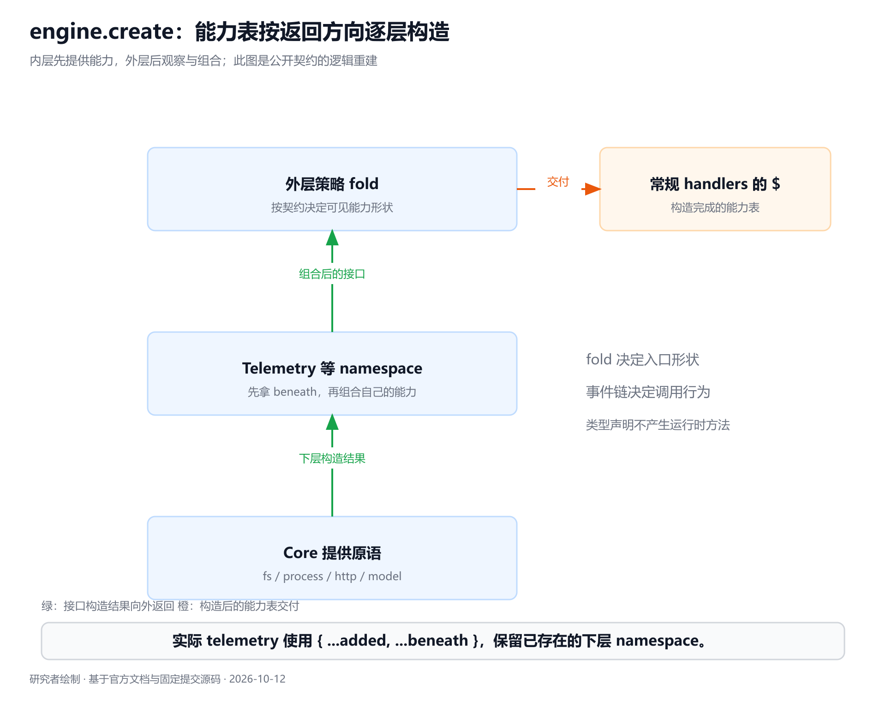

*图 6：这里主要观察返回方向。内层先提供能力，外层后取得组合结果；图示不是公开宿主初始化函数的真实调用栈。*

一个教学抽象是：

```text
Core 提供原语
    → 内置/依赖提供自己的 namespace
    → 上层 mod 添加自己的 namespace
    → 外层策略决定可见能力形状
    → 构造结果成为常规 handlers 的 $
```

</details>

#### 2.5.1 能力构造与事件拦截分别控制什么

能力构造回答“有没有这个方法、由谁提供”，事件拦截回答“有人调用它时，怎样处理”。例如，加入 telemetry namespace 才能提供相应入口；监听 telemetry 事件则是在入口被调用时检查来源或调整行为。上层政策可以限制可见的方法，也可以检查一次具体调用，两者应分别分析。

**研究判断**：方法的提供者、允许的参数和调用事件都明确时，更容易检查多个扩展能否组合。这里还涉及 descriptor，即描述“有哪些方法、怎样调用”的接口数据。仅凭 telemetry 源码，不能确定宿主怎样检查同名方法冲突、怎样传输这些描述、或怎样防止运行时绕过。

**读完本章应能复述这样一个过程：** 配置指向代码 → 宿主检查并加载 → register 用 on 登记 → 宿主准备能力并初始化 → 事件到来时调用 handler → handler 用 next 继续或用 $ 请求能力 → 结果交回，界面按自己的事件更新。下一章把其中“一个事件经过多个处理器”的部分放大，解释顺序、跳层、重入与失败。

## 3. 事件执行机制：中间件、continuation 与控制流

**运行时的整体过程，是宿主推进智能体任务，并在相关节点让已加载的处理器参与。** 模型请求、工具执行、结果返回和界面绘制并非同一个事件；每项行为进入相应链，mod 决定继续、改写还是接管。先看一次任务的全貌，再展开每条链的内部机制。

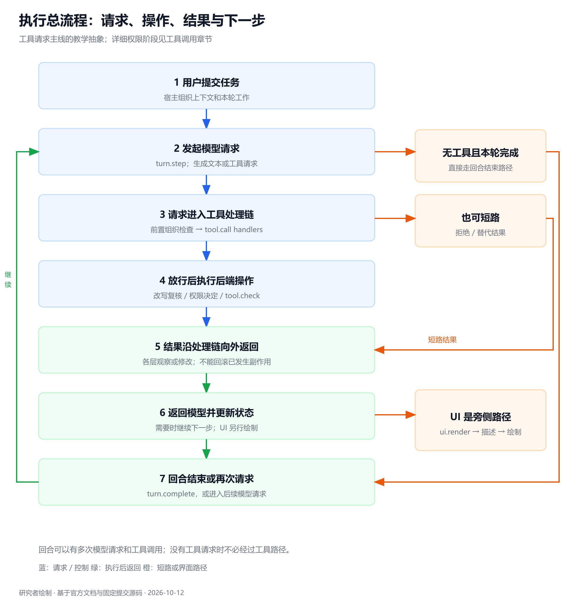

*图 7：包含工具请求的回合主线。界面更新是相关事件和状态驱动的路径，不表示每次工具调用都必定新增一张界面；省略取消、恢复与并发细节。*

主线可以这样读：用户提交任务，宿主组织上下文并发起模型请求；模型可能输出文本，也可能提出工具调用。工具请求经过 tool.call 和权限相关处理后，获准才执行后端；结果再经过各层后置处理返回模型，模型据此继续或结束回合。一个回合可重复多次模型请求与工具调用；不存在工具请求时，也不必走完工具路径。[事件指南][S4]、[模型步骤契约][D-Events]

**把任意一条普通事件链再放大看，就是“分派 → 进入处理器 → next 或短路 → 返回 → 校验和后续行为”。** 分派先确定事件、来源和参与处理关系；handler 获得 ($, e, next)；调用 next 继续剩余链，直接回答则短路。宿主行为完成后，结果反向经过等待中的 handlers，各层可以观察或改写。实际 matcher 评估细节和链缓存算法并未公开。

| 总流程中的问题 | 后续分节 |
| --- | --- |
| 单个 handler 如何获得输入与继续函数？ | 3.1 参数、3.2 事件族 |
| 它可以怎样改变本次行为？ | 3.3 观察 / 改写 / 接管 |
| 多个插件的先后关系怎样确定？ | 3.4 层级、3.5 next 与跳层 |
| 输入和返回为什么是嵌套关系？ | 3.6 continuation 与 trace |
| 执行中再调用宿主 API 会怎样？ | 3.7 重入 |
| 连续输出与最终结果怎样传递？ | 3.8 流式处理 |
| 失败、超时和取消怎样影响执行？ | 3.9 错误与预算 |

以上先给出共同模型；第 4 章把工具权限阶段展开，第 5 章把 UI、状态与重载展开，第 6 章再对照真实源码。

### 3.1 单个 handler：$、e 与 next

下面是研究者编写的概念示例，用来说明包装关系，不是本次运行验证过的插件：

```javascript
export function register(on) {
  on('tool.call', { tool: 'Read' }, async ($, e, next) => {
    const result = await next(e);
    // 在这里观察结果；原样返回则不改写模型所见。
    return result;
  });
}
```

| 参数 | 理解方式 | 工程含义 |
| --- | --- | --- |
| `$` | 宿主暴露的能力对象 | 读状态、画 UI、调用工具、访问文件与网络 |
| `e` | 当前事件的输入数据 | 输入及其嵌套字段被冻结；改写应创建副本 |
| `next` | 继续执行当前事件后续处理链的函数 | 后面可能还有其他 mod；调用者等待这条链的结果 |

签名在官方示例与内置 mod 中都有体现。[Token Weather][S9]、[sec-default 注册入口][S14]

上面的 `on` 订阅 `tool.call`，matcher 只选 Read 工具。事件到达后，`await next(e)` 把原输入交给后面，暂停本函数等待结果；拿到结果后，再运行注释所在的后置逻辑并返回。**Continuation（后续计算）**就是这里的 `next`：它把“当前步骤之后还需要做什么”封装成一个可调用函数。

### 3.2 事件族：各能力在哪些节点接入

这里选择最有解释力的一组事件，完整列表以目标版本类型为准。

先区分三个时间范围：session 是一段会话，turn 是其中一次回合，step 是回合中的模型请求步骤。一个回合可能包含多次模型请求和工具执行。权限结果中的 allow、ask、deny 分别表示允许、需要询问和拒绝；这些名称要结合所在事件来读。[事件与 API 参考][S23]

| 事件 | 典型用途 | 本报告关注点 |
| --- | --- | --- |
| `tool.call` | 执行前门禁、包装执行和结果 | 在 `next` 前拒绝与在执行后遮蔽结果不同 |
| `tool.check` | 修改工具权限决定 | 与拒绝规则、组织管理政策的组合 |
| `prompt.submit` | 改写用户提交的提示词 | 不可把静默改写当作用户真实原话 |
| `prompt.context` | 项目指令与上下文装配 | `agents-md` 的主要接入点 |
| `turn.start / complete` | 维护回合级数据 | 需要区分主会话与子智能体 |
| `turn.step` | 包装一轮内的模型请求 | 采用流式 / async-generator 契约 |
| `session.start / end` | 初始化、清理 | 重载与 clear 的语义不同 |
| `command.run` | 实现自己的 slash command | Replay Theater 的 `/replay` |
| `ui.render` | 增加或包装界面 | 显示环境和界面组件不同，字段也不同 |
| `plugin.register / engine.create` | 准入与能力扩展 | `sec-default`、`telemetry` 的系统级用途 |

对应代码：[Token Weather][S9]、[Blast Radius][S10]、[Replay Theater][S11]、[agents-md][S13]、[telemetry][S12]；补充语义依据[API 参考][S23]。

上表是核心事件的阅读入口，完整说明见 [Claude Code 事件详解与触发关系](event-catalog.md)。该文按 17 个用途分组，逐项解释 128 个固定类型事件与 13 个当前文档补充名称的作用、触发条件、处理流程、输入输出和边界，并展开前端、回合、工具、子智能体、UI、压缩与收尾的关系。它覆盖本次已确认的公开契约，不把全部事件强行串成一个固定顺序，也不冒称是闭源宿主的完整内部 trace。

### 3.3 三种操作：观察、改写与接管

| 方式 | 执行模式 | 应用示例 |
| --- | --- | --- |
| 观察 | 保持输入与结果，包装 `next` | Token Weather 在回合结束后采样 |
| 改写 | 传递新的事件，或改写返回结果 | 增加工具上下文、调整渲染树 |
| 接管 | 不调用 `next`，直接给出事件结果 | Blast Radius 取消时返回拒绝 |

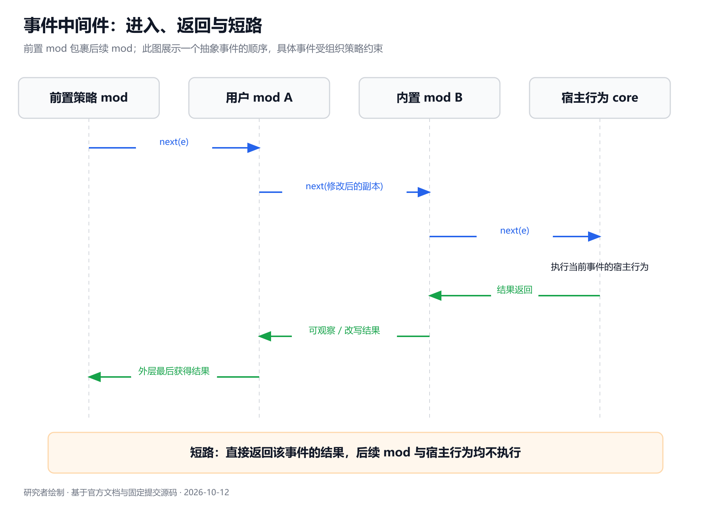

*图 8：事件进入顺序与结果返回顺序相反。图示省略可选 append 层，只展示嵌套原理。*

这里每一层都决定是否把操作继续交下去。**短路（short-circuit）**指某层直接返回，后面的处理器和核心操作不再沿这条路径执行。例如，前置确认 mod 返回拒绝，就不会继续调用工具；如果外层已经短路，位于其后的日志 mod 也不会看到这次事件。

因此，不能把它简单当成 event bus（事件广播总线）：广播通常让多个订阅者各自收到通知，而这条中间件链还要组合它们的输入、返回值和是否继续的决定。

### 3.4 处理器顺序与组织策略层

**tier（层级）**把处理器按来源和管理角色分组。`prepend` 表示放在用户 mods 前面的层，`user` 是用户扩展层，`append` 位于其后，`builtin` 是其他内置扩展，`core` 是宿主核心。**guard** 是执行保护检查的处理器；**managed** 表示由组织管理的配置或扩展，而不是某个用户随意修改的设置。具体层级仍受当前契约与组织配置约束。

当前指南给出的链顺序概括为：组织 guard / prepend 与其他组织层 → 用户 mods → append → 其他内置 mods → 宿主。用户 mod 的依赖关系及模块中 `on` 的注册顺序也参与排序。[事件处理顺序][S4]

`sec-default` 通过 `next.to(e, 'append')` 跳过 user tier，保护不应被用户 mod 改写的组织控制；这在实际注册源码中可见。[sec-default][S14]

**工程建议**：测试时要记录这个 mod 前后还有哪些处理器。前面的 mod 可能改输入或直接短路，后面的 mod 可能改结果；单独运行通过，不代表安装多个 mods 后仍有相同行为。

### 3.5 next(e) 与 next.to(e, tier)：继续和跳层

**`next(e)` 按剩余中间件链继续；`next.to(e, tier)` 跳过部分下游层，从指定层继续。** 两者处理的仍是当前事件，都将下游结果返回调用者；`next.to` 不是重新发出事件，也不是让当前 hook 立即结束。[当前官方契约][S23]、[公开 Next 类型][S15]

假设当前 hook 位于 `prepend` 层，后面的匹配处理器如下。此处只展示抽象层级，实际会话可以有更多 handlers：

```text
当前 hook → 用户 mod A → 用户 mod B → append → builtin → core
```

| 调用 | 从当前 hook 继续的路径 | 典型用途 |
| --- | --- | --- |
| `next(e)` | 用户 mod A → 用户 mod B → append → builtin → core | 普通观察或改写，让其余处理器照常参与 |
| `next.to(e, 'append')` | append → builtin → core | 在获准的前置层跳过用户 mods |
| `next.to(e, 'builtin')` | builtin → core | 在获准的层级跳到内置处理器 |
| `next.to(e, 'core')` | core | 在获准的层级跳过后续 mod 处理器，由宿主处理当前事件 |

**调用限制**：当前文档规定，只有位于 `prependPlugins` 或 `appendPlugins` 的 mod 可以调用 `next.to`。可指定的目标还受当前层级和宿主契约限制，不能把表中的所有目标视为每个 mod 都可用；普通用户 mod 不能借此跳过组织控制。公开类型中的示例规则为 prepend 可跳到 append、builtin、core，append 可跳到 core；该公开声明较旧，实际开发仍以本机生成的类型为准。[官方参考][S23]、[Next 类型说明][S15]

`sec-default` 的实际用法是：

```javascript
on('prompt.compose', ($, e, next) => next.to(e, 'append'))
```

这个 guard 位于外层，系统提示词装配在此处跳过用户 mod 层，从后续受管理层及内置/宿主行为继续，避免用户层在该事件上改写受保护内容。[实际注册源码][S14]

**结果仍会返回当前 hook**，所以跳层与后置逻辑可以组合：

```javascript
const result = await next.to(e, 'append');
// 当前 hook 的后置逻辑仍在这里执行。
return result;
```

`next.to` 跳过的是下游 mod 层，不代表关闭宿主自身的权限检查，也不会撤销已发生的操作。第 7 章的 Tool Tally 是普通观察型 mod，使用 `next(e)`，保留其他扩展与宿主的正常处理路径。

用一句执行过程来区分：**`next(e)` 是“请后面的正常队列继续”；`next.to(e, 'append')` 是“从 append 层起继续这次操作”。** 发起调用的当前函数仍在等待返回，拿到结果后仍能做后置处理。这个对照只帮助理解流程，并不赋予普通用户 mod 跳层权限。

### 3.6 Continuation 的嵌套、重复调用与 trace

**嵌套执行的总规则是：前置逻辑由外向内运行，结果由内向外返回，next 保存当前层之后的处理链。** 下文先展示最小调度模型，再解释重复调用与 trace，最后把正常重试和失败恢复分开。

**证据等级：原始设计及公开类型；本节伪代码为研究者实现。**

普通非流式 hook 可抽象成：

```text
Handler = (Engine, Event, Continuation) → Result 或 Promise<Result>
Continuation = Event → Promise<Result>
Dispatch = A(B(C(Core)))
```

对于按 A、B、C 排好的这条示意链，A 调用 `next` 时进入 B，B 再进入 C，最后到核心；核心完成后，结果依次返回 C、B、A。因此 A 的前置逻辑最先执行，后置逻辑最后执行。这就是 `A(B(C(Core)))` 所说的嵌套，而不是 A、B、C 同时收到广播。[原始设计 §2][S28]

例如，A 记录开始时间，B 请求确认，C 改工具参数。只有 B 同意并继续时，C 和核心才运行；结果回来后，A 才能记录本次总耗时。这个例子解释组合顺序，实际执行哪些处理器还要看 matcher、层级和依赖排序。

#### 3.6.1 最小调度模型

```javascript
// 教学模型：省略 tier、matcher、冻结、预算、错误恢复与跨线程通信。
async function dispatchAt(i, event) {
  if (i === handlers.length) return core(event);
  const next = changedEvent => dispatchAt(i + 1, changedEvent);
  return handlers[i](engine, event, next);
}
```

`next` 保存的是当前位置之后的处理链，不只是一个“执行原工具”的别名。它也可能先进入别的 mod，或被其中某层接管。改变事件副本会改变后续处理器接收的内容；直接返回结果则根本不进入后续链。

#### 3.6.2 正常重试与错误恢复的重放不同

在普通处理器中调用两次 `next(e)`，可能让后续链运行两次。例如，用它重试一次文件写入，就必须考虑重复写入；重复调用流式 `turn.step` 还可能产生多次模型请求。`next` 通常表示“继续一次后续执行”，不能一概理解成缓存好的、只完成一次的任务。

**失败恢复是另一个场景。** 假设工具已经执行成功，但 mod 的后置统计抛错；按官方恢复模式，注册的 `.catch` 恢复处理器可以再次调用 `next(e)`，取得已经产生的结果，而不再次执行工具。这里的 `.catch` 是 hook 的恢复契约，不应与任意 JavaScript `try/catch` 混同。

所以，“普通代码主动重试”与“宿主进入失败恢复后取回已有结果”必须分开理解。后者的去重语义不能扩展到所有位置。[当前异常指南][S4]、[流式 next 契约][D-Stream]

#### 3.6.3 Trace 是调度结果，不是可执行句柄

**Trace 是一次后续执行的过程记录。** `next.trace` 让当前处理器查看：后面经过哪些层、它们收到了什么输入、返回什么结果、是否被跳过或失败。公开 `TraceEntry` 用 plugin、tier、event 标识参与者和事件，用 received / returned 记录输入输出，并包含状态和时间；流式条目还记录输出块数。

它描述最新一次 `next` 的下游运行，适合调试和复核改写来源；它不是保存整个会话历史的永久审计日志，也不是可以再次执行的函数。[Trace 定义][D-Trace]

这些状态名描述**处理链怎样采用结果**，不是工具权限的 allow/deny。按公开类型注释，可这样读：

| 状态 | 这一次执行发生了什么 |
| --- | --- |
| `returned` | 当前层返回的结果被采用 |
| `passed` | 按引用原样返回最后一次 next 的结果；跨 hooks module 返回副本时可表现为 returned |
| `skipped` | 当前层在 next 前失败，或上层 next.to 跳过了它，由后面继续 |
| `kept` | 当前层在 next 后失败，已经产生的下游结果被保留 |
| `expired` | 当前层预算耗尽；结果处理遵循相应的 skipped/kept 规则 |
| `caught` | 恢复处理器成功返回，其结果被采用 |
| `rejected` | 该层以异常拒绝结束；上层记录也可能表示继续传播这个拒绝 |

例如，“工具成功，mod 后置统计失败”可以对应 kept；“前置 mod 抛错，被跳过后工具继续执行”可以对应 skipped。这里的 rejected 也不能直接当成“工具被权限规则禁止”。[状态定义][D-Trace]

这使外层 guard 能检测下层究竟改了哪份决定，而不只比较最终 allow/deny 字符串。`sec-default` 的 `rewrittenByUsers` 正是一个实际消费者，详见第 6.6 节。

### 3.7 API 重入：能力调用如何再次进入事件链

**API 调用会发起对应事件；如果它发生在尚未结束的 handler 内，就需要按活跃调用规则处理重入。** 下文先区分 next 与 $ 调用，再解释保护对象和版本边界。

**证据范围：公开设计、类型和当前重入说明。** “重入”指处理器还没结束，自己发起的 API 操作又使处理链被调用。比如一个监听 `prompt.submit` 的处理器又调用 `$.prompt.submit`，就可能再次触发同类事件。

先区分两种调用：`next(e)` 沿当前事件的后续链继续；`$.tool.call`、`$.fs.read` 等宿主能力则发起对应事件。它们的路径可以再次经过其他处理器，因此 `$` 调用不能当作完全绕过事件系统的本地函数。

典型问题是一个监听 `prompt.submit` 的 hook 又调用 `$.prompt.submit`：若原样再次进入自身，就可能形成无限递归。公开设计采用“活跃调用帧中的同一 hook 不重入，其余注册 hooks 仍可参与”的模型；不能粗略写成“整个插件被跳过”，因为插件内其他 hooks 也可能需要运行。[公开 Events 注释][D-Events]

“活跃调用帧”可以理解为这次仍未结束的函数调用。例如 H 正在处理提交提示词，又发起一次提交；重入保护避免第二次事件在这个活跃路径里再次执行 H，从而切断直接自调用。保护对象是这个 hook 的活跃调用，插件里的其他 hooks 仍可能参与。

当前参考在 2.1.292+ 描述了 `.catch` 中的 `next.error.kind = 're-entry'`，并使用 `cause = 'lent'` 标识涉及另一个 mod 提供的能力方法的情形。lent 可理解为“由别的 mod 提供给你使用的方法”；它与原有宿主方法的来源不同。公开 v2.1.277 类型没有完整对应字段，开发时应查看目标版本的参考，而不能把新字段直接套进旧声明。[当前 hook 参考][S23]

**研究判断**：重入保护避免同帧自调用，并不构成应用层任务去重协议。定时器重复唤醒、跨回合循环、多个 mod 互相提交新任务仍需要自己管理。任何“必定终止”“所有调用严格线性”的说法都需要额外条件。

另外，全事件审计 hook 自己记录日志时也会产生 API 调用。审计代码要考虑活跃帧跳过规则、异常、敏感数据和事件量；当前 `'*'` 也不代表自动涵盖全部遥测事件，不宜直接照搬早期提案的一句话审计示例。

### 3.8 流式事件：chunk 与最终完成值

**流式处理同时传递两类信息：执行中的内容块，以及结束时的完成值。** 先区分两个通道，再看如何转发，以及为什么传输实现和背压不能只由语法推断。

普通异步调用是“等待，然后拿到一个最终结果”。流式调用则是“运行过程中不断拿到小块内容，结束后还有最终结果”。这些小块叫 **chunk**；异步生成器（async generator）是 JavaScript 表达这种连续输出的方式。可把 chunks 理解为逐段递交的内容，把完成值理解为结束时交回的汇总结果，二者不能互相代替。

**证据等级：当前事件契约；旧声明与新事件范围存在版本差异。** 当前文档把 `turn.step` 和 `process.spawn` 列为流式事件；公开 v2.1.277 的 `StreamingEventName` 只有 `turn.step`。报告必须同时保留这两个事实，不能用旧联合类型否认当前新增能力。[当前参考][S23]、[旧 StreamNext 定义][D-Stream]

正确的转发模式是 async generator：

```javascript
export function register(on) {
  on('turn.step', async function* ($, e, next) {
    const result = yield* next(e);
    // result 是完成值；此前的 chunks 已逐个转发。
    return result;
  });
}
```

这是按契约编写的参考模块，尚未经本机宿主验证。普通 `next` 返回 Promise，即“稍后完成的一次任务”；流式 `next` 返回可以逐块读取、最后结束的异步生成流。`yield* next(e)` 把后续流产生的 chunks 继续向外转发，结束时又把它的最终返回值交给 `result`。

如果下游依次输出内容 A、内容 B，最后 return 一份结果 R，那么 `yield*` 能转发 A 和 B，再得到 R。只写 `for await (const chunk of next(e)) yield chunk`，循环变量会拿到 A、B，却不会自动拿到 R。需要最终结果时，应使用 `yield*`，或显式处理迭代器（逐次读取流的对象）和完成值。[流式类型][D-Stream]

工程上还要区分：展示给用户的 chunks、驱动工具请求的结构、最终模型使用量。过滤屏幕文字不等于修改了所有工具语义；在已输出 chunk 后出错也不可能让用户“从未看到之前内容”。

**背压（backpressure）**指接收方来不及处理时，让发送方放慢，而不是无限积累数据。异步生成器可以帮助表达按需读取，但宿主可能另外缓存内容、跨线程排队。公开资料没有完整说明这些传输细节，因此不能仅凭这段 JavaScript 就认定整个链路具有特定背压保证。替换模型提供商还涉及目标接口契约，也不能由流式写法本身推导出兼容性。

### 3.9 错误、执行预算与取消

**失败处理先判断 next 是否已经执行，再决定继续、保留已有结果或采用恢复结果。** 时间预算和取消信号约束这次执行，但都不自动撤销已经发生的副作用。下文分别展开失败分支、计时与取消。

**证据等级：当前行为指南；部分 trace / budget 细节来自注明版本的公开声明。**

| 情况 | 没有成功恢复处理器时 | 对真实操作的含义 |
| --- | --- | --- |
| hook 在 `next` 前抛错、超时或返回非法形态 | 该 hook 被跳过，后续处理继续 | 门禁可能失效后放行 |
| hook 在 `next` 完成后失败 | 下游结果保留 | 不能认为操作撤销或自动重跑 |
| `.catch` 在 `next` 前返回事件合法的拒绝 | 可以阻止继续 | 适合明确的前置失败策略 |
| `.catch` 本身又失败 / 超时 | 回到未成功恢复的语义 | 一个 catch 不是无限保证 |
| 调用被取消 | `next.signal` 通知相关工作 | 程序、网络和后台工作是否停止仍取决于如何使用信号 |
| `ui.render` 返回非法树 | 宿主采用自己的绘制并记录问题 | 逻辑成功不代表用户看到了提示 |

检查失败后继续执行，常称为 **fail-open（失败时放行）**；检查失败后阻止继续，称为 **fail-closed（失败时拒绝）**。前者有利于避免扩展故障阻断正常操作，后者适合必须保护的限制。表格说明：编写门禁时要明确选哪种失败行为，还要测试恢复处理器自己失败时的情况。[事件指南][S4]

**执行预算**限制的是处理器可以消耗的时间，需要分清两种计时。self-time（自身执行时间）用于衡量本处理器按规则计入预算的执行；wall-clock time（墙钟时间）就是用户从开始到结束实际等待的时间，包含下游和外部服务等待。

当前普通 hook 自身预算通常为 10 秒，恢复处理器通常为 1 秒，`prompt.edit` 更短。多数宿主 API 和 next 的等待不计入自身预算，`$.clock.sleep` 例外；流式处理按整次 hook 累计自身执行量，不是每输出一个 chunk 就重新获得预算。[运行限制][S23]、[HookBudget][D-Budget]

例如，一个处理器只花少量时间组织参数，但等待外部服务很久，用户仍会等待很久。不能用“自身预算 10 秒”推断“所有操作在 10 秒内返回”。

**取消表示停止继续工作，回滚表示撤销已经发生的改变，二者不同。** `next.signal` 是本次事件的取消信号，相关任务需要使用它来感知停止请求。已经写入文件或发送到外部服务的操作，不会仅因这个信号自动撤销。

发起后没有等待、也没有继续跟踪的异步任务，常被称为浮动 Promise；它可能在原事件结束后仍运行。后台程序和延迟回调也有类似问题，应明确取消和清理方式。定时器随模块生命周期管理，重载会停止；一次事件的信号不能直接当成整个会话的永久信号。

### 3.10 把机制连起来：读取文件并更新 Tool Tally

**用第 7 章的 Tool Tally，可以把加载、执行与显示串成一个具体过程。** 这里假设插件已允许加载、相关处理器匹配，工具成功执行且没有外层替换结果；它是依据源码与契约的过程说明，不是新增实测 trace。

| 时间 | 谁在做什么 | 对应机制 |
| --- | --- | --- |
| 加载时 | 宿主执行入口，登记 tool.call、回合、命令和 ui.render 等 handlers | register 声明行为，不立即读文件 |
| 初始化时 | session.start handler 注册查询命令，准备本实例状态 | 生命周期初始化 |
| 主智能体请求 Read 时 | 宿主把请求放入工具处理路径，Tool Tally 等待 next(e) | 匹配、嵌套与权限检查 |
| 后端返回时 | 结果从下游返回；Tool Tally 检查拒绝、错误和代次再统计 | 后置观察与迟到结果过滤 |
| 显示需要更新时 | mod 通知相关绘制失效，宿主触发 ui.render | 状态 / 失效与事件驱动绘制 |
| 绘制时 | handler 取得下游已有树，加入计数，返回合法描述 | UI 组合与宿主校验 |
| 用户清零时 | 交互或命令事件到达处理器，更新计数与代次 | 清零后旧结果不能补回新计数 |

这个例子展示的是**三个互相关联、但并不相同的过程**：载入时登记函数，工具事件发生时执行观察逻辑，绘制与交互事件发生时更新显示。把它们分清后，才能解释为什么“插件已安装”“工具已成功”“计数已变化”“界面已显示”不能互相替代。[Tool Tally 行为说明](#71-完整例子tool-tally-的行为与文件)

## 4. 工具与权限：一次调用贯穿哪些控制层

**工具路径有四种不同的事实：请求、权限决定、实际执行、模型可见结果。** 宿主先接收请求并进行组织前置检查，tool.call handlers 包装执行，后续准备权限决定并进入 tool.check，获准后才执行后端，最后结果沿链返回。mod 自身发出的 $ 请求又是另一条能力事件路径。

本章按“总流程 → 结果含义 → 两类权限路径 → 组织保护 → 治理建议”展开。第 4.1 节把上一章的工具路径放大，第 4.2 节解释执行前后拒绝，第 4.3–4.5 节说明权限与组织边界。

### 4.1 从模型请求到工具副作用的完整路径

**证据范围：当前行为契约；引擎内部实现未公开。** 模型提出“调用某个工具、使用这些参数”，与工具真的开始执行之间，还有多层检查。下面沿一次请求往前走，区分请求、权限决定、实际副作用和返回给模型的结果。

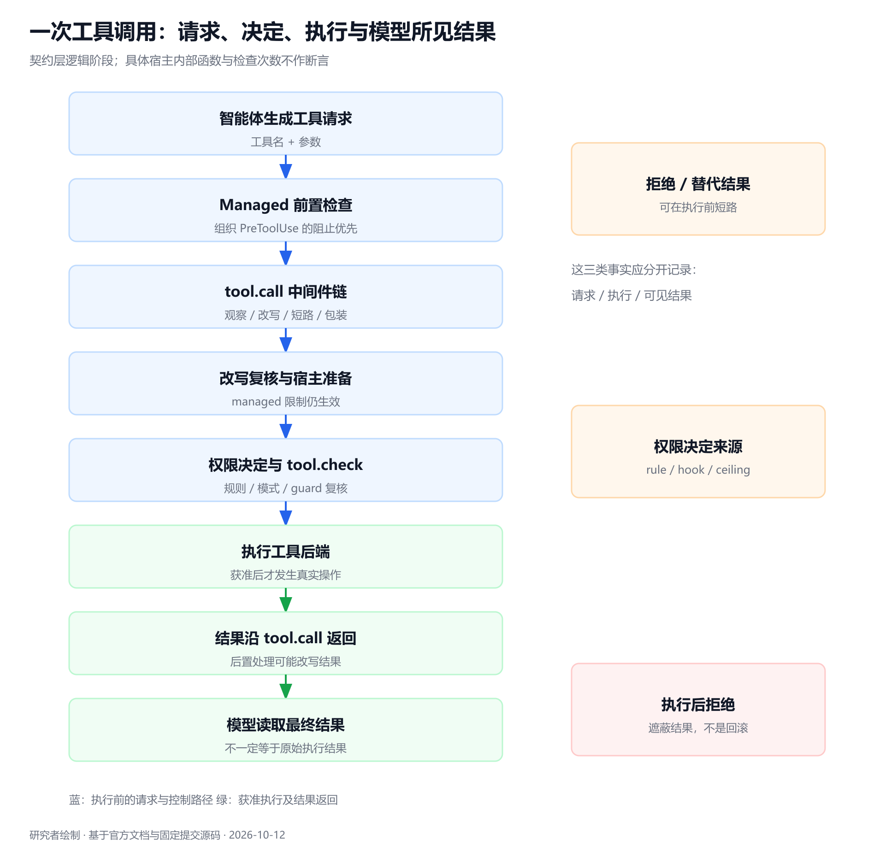

*图 9：逻辑阶段图。managed 前置检查与改写后的复核不应理解为可以被普通用户 mod 绕过的节点。*

| 阶段 | 谁参与 | 改写/拒绝对后续的影响 |
| --- | --- | --- |
| 生成工具请求 | 智能体产生工具名与参数 | 尚未证明工具已执行 |
| managed 前置 Hooks | 组织配置的 `PreToolUse` | 原始请求被阻止时，mod 不再看到该调用 |
| `tool.call` 链 | 按层级与 matcher 进入 handlers | 可改写、短路、包装 `next` 的结果 |
| 改写复核 | managed 控制 | 改写后的请求仍需满足组织限制 |
| 宿主准备权限决定 | 非 managed 设置型 Hooks、权限规则和模式 | 产生允许、询问或拒绝的决定 |
| `tool.check` 链 | 权限参与者及外层 guard | 可以请求调整决定；受组织 guard 保护 |
| 真正执行工具 | 核心工具/MCP 等后端 | 获准才产生真实副作用 |
| 结果向外返回 | 每层 `tool.call` 的后置逻辑 | 可观察或替换模型所见结果，不能撤销已经发生的操作 |

表格是对公开指南的阶段重建，尤其不能把“改写复核”误读成宿主总会在某一个固定 JS 函数中做一次独立检查。[事件顺序指南][S4]、[组织控制][S7]

### 4.2 判断结果：拒绝、替代、失败与执行后遮蔽

1. **执行前返回 `{ deny }`**：本层短路，下游工具没执行。
2. **返回 `{ result }` 而不调用 `next`**：本层提供替代结果，不能由这份结果推导工具执行过。
3. **`next` 执行失败**：可能返回错误结果或抛异常；是否产生部分副作用需要工具自身语义。
4. **执行后返回 `{ deny }`**：屏蔽下游结果，并不恢复文件或回滚外部服务。

用写文件举例：在调用 next 之前拒绝，沿这条路径不会执行后面的写入；写入成功之后再返回 deny，文件已经改变，只是模型看不到原结果。如果某层没有执行工具，却直接返回“成功”，这个返回也不能证明文件真的写过。

因此，审计应分别记录“请求了什么、权限怎么决定、执行到哪一步、模型最终看到了什么”。Tool Tally 只统计当前 hook 收到的成功结果，不是验证每次真实写入的审计系统。把所有 deny 都算成“避免了一次危险操作”会混淆这些阶段。[事件指南][S4]

### 4.3 mod 自身副作用与模型工具的权限边界

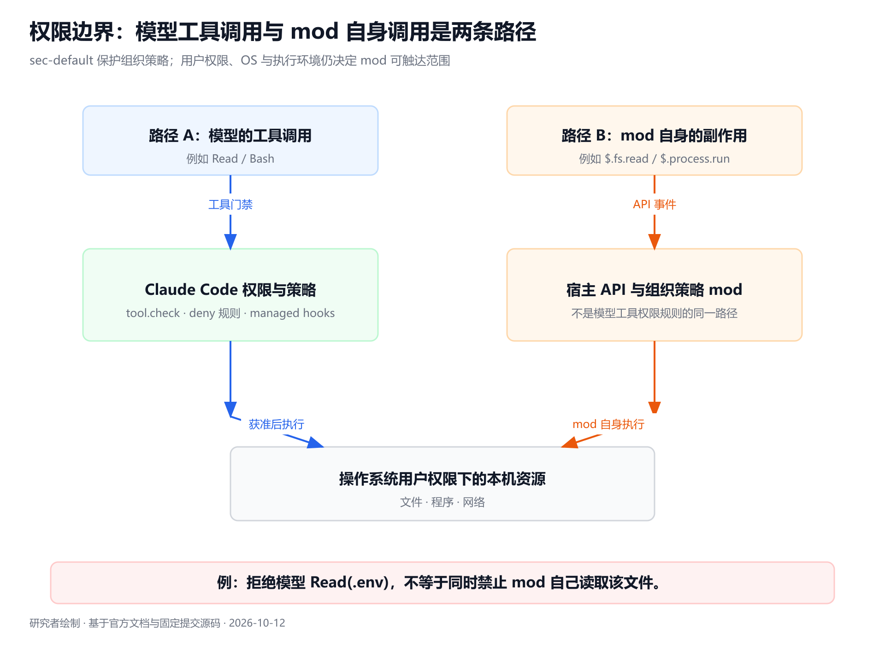

*图 10：模型工具调用与 mod 自身调用属于不同控制路径。*

Mod 可借助 API 读写文件、启动进程、发网络请求、读取会话与调用模型。官方明确强调它以用户权限运行，未被沙箱隔离。即使模型 Bash 有 sandbox，mod 自己启动的程序也不能直接按同一隔离边界理解。[权限说明][S3]

### 4.4 组织 guard 保护哪些对象

| 控制对象 | 有依据的保护/边界 | 工程含义 |
| --- | --- | --- |
| 组织提示词与受管理指令 | 用户层不能直接改写相应受保护事件 | 通过层级和跳过用户层实现 |
| 组织管理的 hooks 与工具拒绝决定 | guard 防止用户 mod 将其放宽 | 仍需检查实际部署是否有 guard |
| mod 的文件 / 进程 API | 不等同于模型工具 deny 规则 | `Read(.env)` 被拒绝不代表 `$.fs.read` 同时受同一规则保护 |
| 界面 | 不允许改写权限提示本身 | 不代表权限提示一定会出现；mod 可在此前参与决定 |
| mod 的准入 | 可限制为组织管理的 mods | 适合先审核再逐步开放 |

依据：[组织管理文档][S7]、[sec-default 注册与策略源码][S14]。

这里的**政策完整性**指组织规定的限制不能被用户 mod 改成更宽松的规则，例如把受保护的拒绝改为允许。它不等于自动缩小所有代码的文件访问权限。guard 是否加载还与 managed settings、组织计划等条件有关，不能把某种组织部署的行为直接套用到所有个人使用场景。

### 4.5 准入、组合与回退的治理建议

以下为工程建议：

1. 首先确定允许哪些来源与版本，而不是只看 plugin 名称。
2. 记录它注册的事件、读写资源、网络域名、模型调用和准入条件。
3. 涉及门禁时放在合适层级，验证是否存在后续改写或短路。
4. 验证未回应、异常、重载、子智能体等边界路径。
5. 对高敏感环境，结合真实 OS / 容器隔离或阻止不可信 mod 加载。
6. 保留停用与回退办法，并在升级后重新检查类型和行为。

**为什么不把静态扫描当作全面安全审计**：它说明调用哪些能力，不直接说明往网络发了什么、是否用进程完成别的动作、是否与其他 mod 组合产生意外结果。

## 5. UI 与状态：绘制、交互到生命周期

**界面的整体机制是“宿主分派绘制事件 → mod 返回描述 → 宿主校验与显示 → 交互回传 → 状态更新与刷新请求 → 宿主安排下一次绘制”。** `ui.render` 处理器返回元素树，宿主把它画到终端或桌面；用户操作经过相应事件链到达回调。状态依赖变化或显式失效通知可以引出重绘，由宿主安排时机并再次分派绘制事件。它与工具执行相互关联，但进入自己的事件链并遵循相应生命周期。

本章先分解显示位置与交互过程（5.1–5.2），再解释不同 surface 的支持范围（5.3）、数据怎样驱动画面（5.4），最后说明模块、会话和任务重载时哪些对象需要重建（5.5）。

### 5.1 界面位置与声明式元素

Mod 通过 `ui.render` 返回一份“要显示什么”的描述。例如，一个 Box 容器里放一段 Text 和一个 Button；容器与子元素的嵌套关系组成**元素树**。这种方式叫**声明式 UI**：代码描述内容与结构，宿主负责画出结果。

`$.ui.resolve(e)` 提供当前显示环境支持的元素构造方法。**surface** 指终端或桌面等承载界面的环境；同一描述能否使用某种元素，要看这个环境支持什么。宿主会先校验描述，再绘制。[类型契约][S15]、[Playground 示例][S9]

| 位置 | 适用内容 | 示例 |
| --- | --- | --- |
| `AbovePrompt`：输入框上方区域 | 常驻简明状态或轻交互 | Token Weather；Replay 提示 |
| `Pane`：内容面板 | 审查、列表、详情和较复杂交互 | Blast Radius；`/diff` |
| `Spinner` 等原有状态组件 | 为现有表现增加信息 | 工具计数等 |

这些不是由 Skill 文本直接创建的 UI，也不是 MCP 工具返回值自动获得的交互容器。

### 5.2 交互闭环：描述树、callback 与 Client

**先用 Tool Tally 的清零按钮理解普通 UI 路径：mod 描述要显示什么，宿主把它画出来；用户点击后，事件经过宿主抵达回调；回调改数据并请求刷新，宿主再安排一次绘制。** 这不是 mod 直接访问屏幕对象、把数字改成 0，而是重新生成一份显示 0 的界面描述。

下图分三条泳道：**mod 代码**保存计数并运行绘制函数与回调；**宿主**分派事件、校验描述、安排刷新；**用户界面**显示内容并接收点击。按 A → B → C、从上往下读。示例假设计数当前为 3、界面支持该按钮、交互没有被其他 mod 接管；它是依据接口与示例代码的讲解，不是新增运行记录。[Tool Tally 行为说明](#71-完整例子tool-tally-的行为与文件)、[界面契约][D-Element]

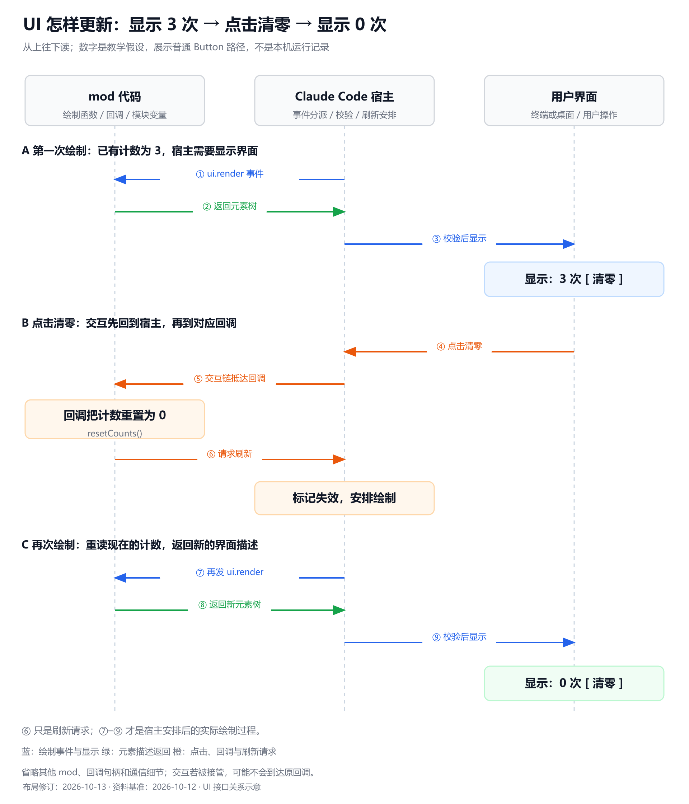

*图 11：A 的①–③显示当前计数，B 的④–⑥处理点击并请求刷新，C 的⑦–⑨重新绘制。蓝色是绘制事件与显示，绿色是元素描述返回，橙色是交互与刷新请求；省略其他 mod 和通信细节。*

**A：第一次绘制，为什么能看见“3 次”和清零按钮？**

1. **① 宿主调用绘制处理器。** 宿主分派 ui.render，告诉 mod 正在绘制哪个组件、使用哪些参数。Tool Tally 匹配 AbovePrompt，即输入框上方的区域。
2. **② mod 返回界面描述。** 绘制函数读取当前计数，使用 $.ui.resolve 提供的元素构造方法，组合文字和 Button，再返回元素树。它还把 next 返回的原有内容保留为子元素。
3. **③ 宿主校验并显示。** 宿主检查描述是否适用于当前界面，再让终端或桌面显示“3 次”与按钮。函数返回元素树和用户看到画面，是两个不同环节。

这里的 **component** 是正在绘制的组件，**props** 是传给它的参数；**元素树**是一份包含“容器里有哪些文字和按钮”的数据描述。它们不是可任意操作的网页 DOM 节点。终端和桌面各自解释这份描述，具体支持范围见第 5.3 节。[RenderElement][D-Element]、[原始设计 §3.2][S28]

**B：点击之后，谁把计数改成 0？**

4. **④ 点击先回到宿主。** 界面报告哪个元素被点击，宿主发起相应交互事件。普通按钮使用 ui.press 路径；它会经过交互处理链。
5. **⑤ 交互抵达按钮回调。** 如果没有被其他 mod 接管，事件最终调用 onPress。Tool Tally 的回调执行 resetCounts，把计数重置为 0。这段函数留在 mod 的运行环境里；第 5.2.1 节解释宿主怎样找到它。
6. **⑥ 回调请求刷新。** Tool Tally 使用普通模块变量保存计数，因而显式调用 $.ui.invalidate('ui.render')，通知相关画面已过时。宿主标记失效并安排绘制；请求刷新不等于屏幕已经变成 0。[Tool Tally 行为说明](#71-完整例子tool-tally-的行为与文件)、[交互指南][S5]

**C：为什么修改数据后还要再次绘制？**

7. **⑦ 宿主再次分派 ui.render。** 到安排好的绘制时机，宿主重新调用绘制处理器。
8. **⑧ mod 返回新的描述。** 函数这次读到计数 0，生成包含新数值的元素树。它返回的是新的显示内容，不是要求屏幕替换某个已有 DOM 对象。
9. **⑨ 宿主校验并显示新画面。** 校验和显示完成后，用户才看到 0。因此可以把更新分成“数据已改变 → 刷新已请求 → 绘制函数已运行 → 新画面已显示”四种状态，不能只看其中一种就判断整个更新成功。[状态与绘制指南][S5]

这张图展示 **普通 Button 与 hooks 的路径**。使用 $.state 时，已建立的读依赖也可以引出重绘，见第 5.4 节；高频键盘、指针和动画可以使用 Client，但普通按钮不必先经过 Client，第 5.2.3 节再解释它的另一条交互路径。

#### 5.2.1 为什么 handler 闭包不能作为普通 JSON 传输

**回调（callback）**是“操作发生后执行的函数”；按钮的 onPress 就是回调。**闭包（closure）**表示函数还能使用它创建时所在环境的变量。例如，确认按钮记住的是哪一项待执行请求，点击时就能回答那项请求。

这样的函数不能像普通 JSON 数据一样直接传给另一侧。历史设计让函数留在插件环境，由宿主维护交互元素的句柄，即用来找到对应元素和回调的标识。用户点击后，显示环境报告元素身份，`ui.press` 等事件进入处理链，最后才调用对应函数。实际句柄格式和通信协议没有完整公开。[原始设计 §3.2.4][S28]

当前界面指南同样说明：其他 mod 可拦截 `ui.press` / `ui.input` / `ui.select`，先于 callback 观察、改写或接管交互。由此可知，“用户点了按钮”与“这个按钮的闭包一定执行”不是同一事实。[交互指南][S5]

**具体建议**：用稳定的 `key` 帮助识别同一个控件，并让回调记住正确的操作对象。假设旧面板还显示请求 A，但全局变量已换成请求 B；点击旧按钮时如果只读取最新全局变量，就可能误批准 B。Blast Radius 把按钮绑定到当时的 `mine` 对象，正是为了避免这种错配。

#### 5.2.2 树校验与多 mod 组合

一个合法 TypeScript 调用可以仍然返回不适合当前 surface 的内容。例如端专有元素、非法属性、过大的文本、错误的子树结构都会影响绘制。公开树契约列举允许的元素与 props，不能把普通 React/HTML props 任意原样传给它。[渲染树契约][D-Element]

多个 mods 修改同一位置时，可以先改组件参数，再让 next 继续绘制；也可以先等 next 返回已有元素树，再给它加一层容器。Tool Tally 使用第二种方式，把原有内容作为 child（子元素）保留，并加入自己的计数内容。

如果直接返回自己的树而不调用 next，就会接管这次绘制，后面的绘制处理器不再运行。外层也可能继续改最终结果；多个信息区域同时加入时，还要协调空间和布局。

#### 5.2.3 Client：高频局部交互与 hooks worker 分离

**Client** 是运行在显示一侧的局部交互模块，适合键盘、指针和动画等频繁更新。例如，移动选择光标可以先在 Client 更新画面，只有需要文件或业务操作时，再向 hooks module 发送消息。

公开契约提供 Client 自己的状态、按帧重绘、输入监听和定时器；`post` 用普通数据向所属 hooks module 发消息。它的能力仍由契约限定，不能当作随意使用 Node 或修改网页 DOM 的运行环境。[ClientProps][D-UIClient]、[ClientSurface][D-ClientSurface]

这条路径是：用户输入先改变 Client 的局部状态和画面，需要业务操作时通过 `ui.message` 通知 hooks，hooks 再用新的 props 更新 Client。旧声明还说明，同一个画面帧内多次 post 会合并；Client 状态属于这个界面实例，卸载后就消失，而不是整个会话一直保存。具体合并行为与支持范围应以目标版本为准。

**设计分析**：把高频局部输入留在绘图一侧，可以减少跨 worker 的事件往返。是否带来某个确定性能收益仍需测量，不应写成已证实的延迟数据。

### 5.3 不同入口与 surface 的能力差异

CLI 与 Desktop Code 是主要绘图入口；VS Code chat、非交互 `claude -p`、Agent SDK 或云会话并不能一概获得相同界面。Remote Control 的 hooks 在本机会话运行，绘图主要体现在本机终端。当前文档还单列 Desktop WSL 不可用情况。[运行入口表][S3]

当前元素表中，基础元素支持两端，而 `Svg`、`Raster`、`Image` 等存在端差异。**建议**按实际 surface 与可用元素做降级，不能由“hooks 可运行”推导出“用户能够看到并点击该 mod 的界面”。[界面指南][S5]

### 5.4 状态：响应式依赖、持久化与并发

**状态机制要同时回答：数据由谁持有、保存多久、变化怎样驱动重绘、多次写入能否协调。** 下文先比较四种存储，再展开响应式依赖、原子性和声明约束。

**证据等级：当前公开行为契约；没有公开 state/store 后端的完整实现。**

界面要更新，宿主必须知道“哪些显示内容已经过时”。普通模块变量只是 JavaScript 数据；修改它时，需要显式调用 `$.ui.invalidate`，通知相关绘制位置重新计算。invalidate 的含义是**使旧画面失效并请求重绘**，不是删除状态。宿主随后安排绘制并分派相应 UI 事件；刷新请求不意味着处理器已运行或屏幕已更新。第二节 C 区将请求、安排和事件分派分开画出。

`$.state` 提供**响应式状态**：UI 绘制读取某个值时，宿主记录“这个界面依赖这个值”；以后值更新，就可以重新运行依赖它的绘制。例如，计数面板读取 count，count 改变后重新生成面板。这说明了“读依赖”的含义，不表示所有普通变量赋值都会自动刷新 UI。[状态指南][S5]

必须分清四种不同的存储：

| 存储 | 持有者与生存期 | 重绘 / 重载 / 会话变化 |
| --- | --- | --- |
| 模块变量 | 单次 hooks module 实例 | 重载丢失，需显式失效 |
| `$.state` | 宿主会话状态 | 跨 module reload；clear/resume/branch 重置 |
| `$.store` | 插件持久键值空间 | 同机多个会话共享；不是事务数据库 |
| Client 本地 state | 某个绘图实例 | 跨该实例 redraw，卸载时消失 |

选型时，把可丢弃选择或缓存留在模块变量，把需要跨模块重载的会话 UI 数据放在 state，把跨会话偏好放在 store。若从 store 复制到 state，另一会话更新 store 不代表本会话副本实时同步。[状态管理指南][S5]

#### 5.4.1 原子写入与读改写不是一回事

**原子操作**指其他参与者不会看见它做到一半的状态；**事务**则把多个步骤组合成一个整体。即使一次保存本身可靠，“先读取、再加一、再保存”也不一定是整体不可分的。

当前文件 API 说明 `$.fs.write` 原地替换内容，不保证别的进程不会读到半写状态；store 更适合多会话共享数据。但即使单次 store 写入被宿主管理，**读取旧值 → 修改 → 保存**仍不是原子的更新事务。两个会话都读到 3 并写入 4，就可能丢失一次增量。[API 参考][S23]、[store 并发说明][S5]

建议按每项独立 key 降低覆盖风险，或将需要严格一致性的状态交给具备相应语义的外部服务。不能凭“存储为 JSON 文件”推断 lock 策略、落盘保证、崩溃一致性或跨进程事务实现。

#### 5.4.2 状态声明与访问约束

使用 `$.state` 时，需要通过 manifest 的类型路径和 `PluginState` 声明说明“这个插件保存哪些键、各是什么类型”。**Declaration merging（声明合并）**是 TypeScript 把多份同名接口声明合成一份的机制；它用来补全类型信息，并不会自己创建运行时数据或方法。

当前 atom/read/update 形式还要求插件名和状态键能从源码中静态识别。atom 可理解为可读取和更新的一个状态单元；具体方法以目标版本为准。界面绘制负责读状态，写状态应放在其他事件或按钮回调里，否则“绘制时改状态 → 状态变化触发绘制”可能形成反复刷新。

所以，从 Tool Tally 的模块变量迁移为宿主状态时，除了换一个容器，还应补声明、reset 恢复路径、并发更新测试和跨 reload 的用户预期，不能只把 `let` 替换成一个 getter。

### 5.5 生命周期：重载、会话重置与 Worker 恢复

**生命周期管理的核心是分别跟踪模块实例、会话状态、界面实例和异步任务。** 一种对象被重建，不意味着其他对象都重置；先区分这些对象，再讨论重载、恢复和代次检查。

**生命周期**指对象从创建、使用到结束的过程。**热重载（hot reload）**是在开发时重新加载改过的模块，不要求把整项工作都从头开始。**模块实例**是某次加载产生的具体运行对象；插件名字相同，也可能已经换成新实例。

例如，旧实例发起读取后，你保存文件触发重载；旧读取完成时，新实例已经在显示另一份数据。此时需要判断返回值属于哪一次任务，而不是只按插件名字接收所有结果。

**证据等级：当前故障说明 + 公开生命周期声明。**

| 场景 | 可确认的行为 | 实现时应关心的对象 |
| --- | --- | --- |
| 开发保存文件 | 重新执行模块并注册处理器 | 旧回调、模块变量、仍在等待的任务 |
| 重载失败 | 开发路径可能保留上一成功版本 | 文件里的版本与当前生效版本可能不同 |
| Worker 被替换 | 新模块的 session.start 可重新运行 | 重新注册、重复提示词、重启任务 |
| clear/resume/branch | 会话状态重置，普通 `session.start` 不同于这些动作 | 恢复 store 到 state 的时机 |
| 移除/重载后旧调用迟到 | 部分注册调用被拒绝，因为来源模块已不活跃 | 实例身份与 generation 检查 |

当前文档对 2.1.292+ 描述了一项限定的恢复行为：Worker 恢复后，特定的 `session.start` 中已发出的 `$.prompt.submit`、`$.command.run`、`$.agent.spawn` 不会再次执行，而返回先前结果。

**Exactly-once** 表示“效果恰好发生一次”。这里不能把这项特定恢复行为扩大成所有网络请求、文件写入和子进程都保证只发生一次；自己的业务操作仍需考虑重复执行。[恢复说明][S6]

公开生命周期声明也表明，若变动涉及 `engine.create` 或 `plugin.register`，更新所涉及的模块集合可能比普通单模块修改更大。[session.start 声明][D-SessionStart]

**generation（代次编号）**用来区分“现在这一批任务”和“已经过时的那一批”。例如，刷新第 8 代开始后用户切换条件，当前编号变为 9；第 8 代的结果回来时发现编号不符，就不再写入当前界面。

实现时应分别记录插件名称、模块实例、会话和任务代次，并在等待结束后检查结果是否仍属于当前任务。Tool Tally 的 `generation` / `turnGeneration` 演示了这种方法，但没有模拟宿主的 Worker 重建；独立后台作业还需要取消和去重。

源码层面的一个更丰富实例是 diff：它合并刷新、记录数据 stamp，并在异步 hunk 返回后检查 stamp，防止已过时的内容覆盖新界面。实际路径见第 6.7 节。

这些动作也需要分别理解：clear 清空会话上下文，resume 恢复已有会话，branch 从会话分出另一条分支，compact 压缩上下文以控制长度。它们不能一概当作“重新加载插件”。当前文档说明，clear/resume/branch 不触发与模块加载相同的 `session.start`，恢复 store 数据应按目标版本使用 `classic.SessionStart` 等契约。

子智能体是主智能体启动的另一个任务执行者；它是否已收到某份指令，也要单独记录。agents-md 正是按接收者维护已发送指令集合，因此会话重置、压缩与子智能体启动要分别验证。[状态指南][S5]、[agents-md 注册实现][S13]

## 6. 官方代码解析：从观察面板到内置机制

三个教学示例来自 Playground 固定提交 `569c5283...`，四个内置实现来自 Claude Code 固定提交 `3deb8736...`。这里的“固定提交”指本次分析始终使用同一版源码，避免仓库以后更新导致描述与文件对不上。截图来自 Playground 仓库，是上游演示图片，不是本次运行结果。

按实现复杂度递进：先读三个 Playground 示例，理解观察、执行前交互与历史记录；再读四个内置 mod，验证能力构造、政策复核、异步 UI 和上下文装配。示例字段存在版本差异，集中对照见附录 A.4。

### 6.1 案例与机制的对应关系

| 案例 | 主要机制 | 阅读时要回答的问题 |
| --- | --- | --- |
| Token Weather | 回合观察、状态与绘制 | 指标何时采集，失败时显示什么？ |
| Blast Radius | tool.call、等待与短路 | 用户未确认前工具是否执行？ |
| Replay Theater | 编辑请求与记录 | 记录的是意图还是成功事实？ |
| telemetry | engine.create、namespace | 类型声明如何对应真实能力？ |
| sec-default | trace、跳层与政策来源 | 下游改写怎样被识别与复核？ |
| diff | 合并刷新、generation、stamp | 迟到数据为什么不会覆盖新 UI？ |
| agents-md | Read 结果与按智能体去重 | 指令何时被视为已完整送达？ |

### 6.2 Token Weather：将上下文使用量变成可读状态

**上下文窗口**是模型一次请求可处理的输入与输出规模。**Token** 是模型计数文本的单位，不能简单等同于汉字或单词。这个 mod 把已有的上下文使用量转成天气词，帮助用户快速理解当前占用；它不需要再调用模型来判断天气。

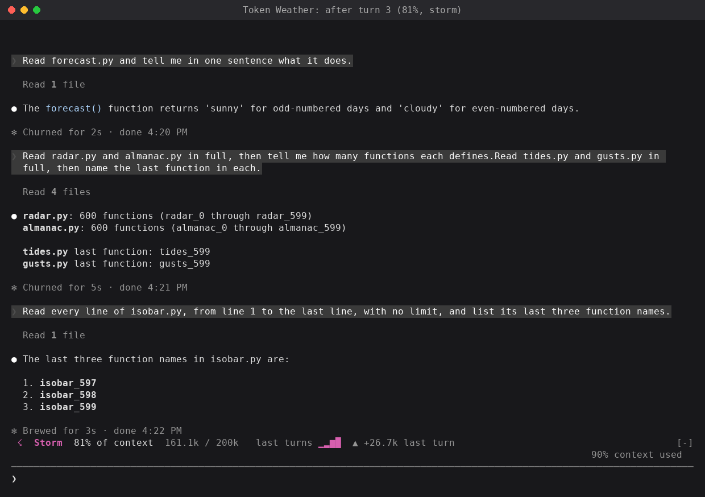

*图 12：官方仓库截图，展示高占用上下文的天气提示。*

**核心路径**：

```text
session.start / turn.complete
        → takeReading($)
        → $.session.usage()
        → 更新 readings，保留最近 12 个值
        → $.ui.invalidate('ui.render')
        → AbovePrompt 显示占用、天气、趋势
```

代码以 25%、50%、75%、90% 分段选择天气词；只在主智能体回合完成后采样，跳过有 `e.agentId` 的回合。微型图按当前历史中的最高 tokens 缩放，表示相对走势，不是固定满窗比例。宽度不足时不显示完整趋势内容，采样异常保留上一读数。[Token Weather 源码][S9]

**值得借鉴**：把观察数据与 UI 分开，失败时保持可用界面；阈值和短文本使连续指标变成可快速识别的状态。

**边界**：它显示的是上下文窗口占用，不是费用预测、日/周额度预测，也不会仅凭天气词证明即将发生压缩。

### 6.3 Blast Radius：在执行前暂停并展示影响

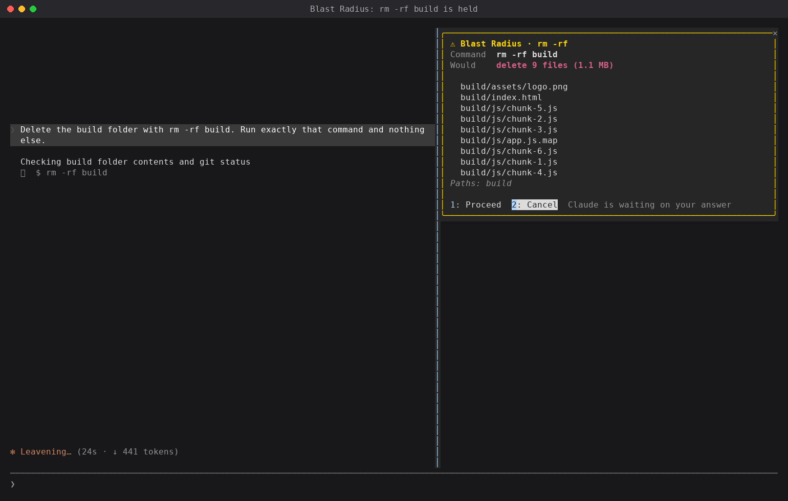

*图 13：官方仓库截图。风险命令保持 pending，用户选择 Proceed / Cancel。*

**核心路径**：`tool.call(Bash)` → 本地分类 → 测量影响 → 打开 Pane，空间不足则用 AbovePrompt → 等待选择 → Proceed 调用 `next(e)`，其他结果返回拒绝。

已核验的实现细节：

- 检查递归/强制删除、部分 Git 破坏性操作与迁移命令，并尝试跟踪前置 `cd`、`pushd`、`git -C` 等目录变化。
- 测量使用程序参数数组与若干 Bash 脚本，统计文件、Git 差异或待迁移项目；显示不超过 10 条主要条目。
- `held` 保存当前等待用户决定的请求，限制同时暂停一项风险操作。检查“是否已有请求”和认领当前请求之间没有 await，因此不会在这个间隙把控制交给另一段异步代码，减少两项请求同时认领的位置竞争。
- 循环等待通过 `$.process.run(['sleep', '0.25'])` 实现；10 分钟未回应、用户取消、回合中止或持有期间异常均走拒绝路径。
- 按钮闭包绑定当前 held 对象，避免后来的调用被旧面板按钮误回答。[Blast Radius 源码][S10]

**工程评估**：这是交互式前置门禁的好示例，但分类器是有限的字符串/分段处理，不是完备的 shell 语义分析。引号中的分隔符、动态展开、别名、包装脚本及并发文件变化都需要额外验证。目录或命令的测量结果也不是最终执行时的原子快照。

“测量失败”的部分路径会展示不能测量的说明，而不是无条件拒绝所有这种命令；不能把它宣传成全面安全保证。另一个成本是等待期间反复创建 `sleep` 进程。该实现可供学习，但生产版应基于当前版本 API 和平台环境重新设计。

### 6.4 Replay Theater：按发生顺序浏览编辑意图

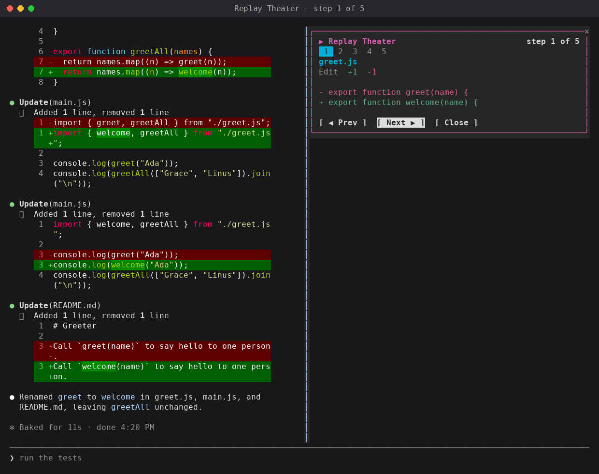

*图 14：官方仓库截图，显示一次回合中的逐步 diff。*

实现分为四块：

1. `session.start` 注册 `/replay`。
2. `tool.call` 看到 `Edit`、`Write`、`MultiEdit`，构造编辑步骤；Write 在执行前读取旧文件。
3. 主回合 `turn.start` 清空 pending，`turn.complete` 把有内容的 pending 作为 replay。
4. `command.run` 或按钮打开回放，Pane/AbovePrompt 提供前后步骤与关闭操作。[Replay Theater 源码][S11]

**算法分析**：diff 表示新旧内容的差异；hunk 是一段相邻的修改。Replay 的行差异算法使用最长公共子序列（LCS）：找出两份文本中顺序相同的行，再把其间的差别标为增加或删除。

它用动态规划保存较小问题的结果，并逐步组合。旧文本有 n 行、新文本有 m 行时，表的规模与 n×m 成比例，所以时间和空间为 `O(nm)`。这意味着两份文本同时变长时，计算量会明显增加。源码在任一输入超过 400 行时退化为全部删除加全部新增，避免表无限扩大；显示时保留修改附近的行，通常限制为 12 行。这里的复杂度是根据源码循环推导的，并非性能实测。

**关键正确性限制**：步骤加入 `pending` 发生在 `next(e)` 之前，未等工具成功。因此显示的是捕获的编辑请求，不保证这些编辑最终写入成功。若用作审计，建议在执行后核验结果，再确认记录；遇到工具失败应单独显示。

另一个细节：某轮没有新的 pending 时，源码直接返回，之前的 replay 仍保留。因此 UI 可能展示最近一次有编辑的回合，并不一定是刚结束的回合。

### 6.5 telemetry：把能力构造落到真实 namespace

`engine.create` 从下层宿主能力构造 sender；在没有内置 telemetry namespace 时补充能力。`telemetry.*` 的 gate 限制第一方遥测入口的调用来源；日志按批次发送，并检查关闭遥测和提供商相关条件。`types/index.d.ts` 声明其 namespace 契约。[telemetry 源码][S12]

**设计分析**：这展示了可组合的能力接口：一个 mod 提供 namespace，其他内置 mod 使用它。这里的 `$.telemetry` 不是可以任意借用的公共第三方分析管道；测试、类型与调用层级需要一起理解。

#### 6.5.1 下层能力、sender 与返回表的组合顺序

telemetry 指收集和发送运行信息的遥测功能。它的 `engine.create` 处理器先拿到下层返回的 `beneath`，即已有能力表；再从中选出 session、env、settings、fs、process、http、clock 等 sender（发送器）需要的方法，组成范围更小的接口；最后建立 telemetry 方法并返回组合后的能力表。[实际 fold][C-TelemetryFold]

关键在返回时的顺序：`return { ...added, ...beneath }`。JavaScript 对象展开中，后面同名字段覆盖前面字段；所以如果 beneath 已经有 telemetry，新加的同名字段不会覆盖它。这个细节决定了组合行为，不能只看“创建了 telemetry 对象”就判断一定替换原有能力。

`types/index.d.ts` 通过 declaration merging 声明 namespace 的方法；方法参数和结果也对应可拦截事件的类型。类型声明并不会自己产生运行时方法，必须与真实 fold 实现一起理解。[Telemetry namespace 契约][C-TelemetryTypes]

### 6.6 sec-default：从政策读取到决定复核

sec-default 保护组织已经设定的限制，主要用三种方式：在受保护事件上跳过用户层、拒绝不被允许的调用者或模块、让不需要改变的结果正常通过。例如，`prompt.compose` 防止用户层改写受保护提示词；`tool.check` 复核用户层改过的权限决定；`plugin.register` 按组织政策决定插件能否加载。判断来源层级使用宿主提供的信息，读取政策失败时也有相应拒绝路径。[sec-default 源码][S14]

**设计分析**：不是把“所有事情都禁止”作为默认安全；它首先保护已有组织政策不被用户层篡改。普通 mod 仍可能有很广的用户权限，不能由 guard 的存在推导出整个 mod 已沙箱化。

**证据等级：固定提交源码。** 这里不只列它监听哪些事件，而是追踪关键函数为何能保住一份政策决定。

#### 6.6.1 政策读取：缓存的是 Promise，连失败也缓存

`register` 以 `Policy.createPolicyMemo(POLICY_MEMO_MS)` 建立读取器。常量为 **500 ms**；`createPolicyMemo` 保存读取开始时刻和 Promise，在窗口内让多个调用共享同一次读取，包括 rejected Promise。`decidedByPolicy` 在读取或决定失败时返回保护条件 `true`。[缓存实现][C-PolicyMemo]、[TTL][C-PolicyTTL]、[失败判定][C-PolicyDecision]

Promise 可以理解为“一次正在进行或已经结束的异步任务”。缓存它，意味着后来的调用者等待同一次读取，而不是重新读一遍；如果这次读取已经失败，后来者在窗口内也会得到同一次失败。TTL 是缓存有效时长，这里的窗口从读取开始计时。源码使用大于 500 ms 才更新的条件，所以边界 500 ms 仍复用，501 ms 的受控测试才触发新读取。

`decidedByPolicy` 的 true 表示“保护条件成立”，不应读成“操作被允许”。例如，无法确认政策能否放宽时，保持保护比把读取失败当成授权更符合这段代码的用途。

这同时解释了两件事：工具注册/列表调用突发时不会每次重复读政策；政策变化可能在窗口内尚未被看到。缓存不是“成功政策永久有效”，也不是每个事件都实时读取新文件。

#### 6.6.2 `tool.check`：允许下游回答，再复核是否被放宽

这里的 **verdict（权限判定）**是一份结果对象，包含 decision 以及相关原因和规则。allow 是允许，deny 是拒绝，ask 是需要询问。代码用 answer 表示正常下游链给出的回答，用 held 表示跳过用户层后得到、需要与 answer 比较的那份判定；held 在这里不是 UI 中的待确认请求对象。

真实代码可以归纳为：

```text
answer = await next(e)
    → 从 next.trace 找到改写决定的用户相关层
    → 按政策判断原规则是否仍须保留
    → 必要时 next.to(e, 'append') 取得绕过用户层的 held
    → 比较 held 与 answer 的宽松程度及原因/规则字段
    → 保留更严格结果，或恢复受保护 held
```

复核分成三个问题：**用户层改了什么、原限制是否仍须保留、最后采用哪份判定**。`rewrittenByUsers` 检查 decision 和 reason/rule/hook 等字段的变化；即使仍然是 deny，删除其关联规则也可能算改写。`holdsOver` 决定比较后保留哪份结果；发生异常时，`caughtAnswer` 只有在 trace 能支持相应结果时才采用它，否则拒绝。[改写识别][C-Rewritten]、[保留判定][C-HoldsOver]、[异常回答][C-CaughtAnswer]

另一个不宜忽略的细节是 `TIERS_HOLDING_USERS` 包含 `user` 和 `prepend`。源码注释解释，相邻共享 worker 的插件可以作为批次出现在 trace，批次可能用首成员的层级表示。因而 guard 不能简单假设“一条 trace 就是一个独立用户插件”，也不能只过滤 `tier === 'user'`。[批次关联层说明][C-Tiers]

| 下层 held | 外层 answer | 固定源码中的关键检查 |
| --- | --- | --- |
| deny | allow | 是否放宽了受保护决定 |
| ask，带 rule/hook/ceiling | allow | 源码可能要求保留这个有依据的 ask |
| 模式自行产生的 ask，无上述依据 | allow | 不能只因都是 ask 就认为全部受相同保护 |
| 相同 decision，删改规则/原因 | 相同 decision | 是否为另一份不同的 verdict |
| 更严格 answer | 较宽松 held | 不能简单以“重新检查的结果”覆盖更严格决定 |

表中的 rule 是关联的权限规则，hook 是关联的设置型 Hook，ceiling 表示判定携带的权限上限约束。比较的不只有 allow/ask/deny 三个字，还包括这些依据是否仍被保留。例如，用户层给出 allow，而绕过它后仍得到受保护 deny，guard 要阻止这次放宽；若用户层给出更严格的拒绝，也不能机械地用较宽松结果覆盖。具体规则仍以 holdsOver 源码和配置为准。

**与概览表述的差异**：当前组织文档概括用户 mod 可批准一些 ask 或非 managed hook 拒绝；固定提交 `holdsOver` 明确检查带 rule、hook、ceiling 的 ask。因此这里将其列为源码/文档差异，结合 `denyRulesHold`、配置与目标版本核验，不把任一宽泛表述当作所有部署的确定行为。

#### 6.6.3 配置不只是读一个布尔值

`denyRulesHold` 只有在可信政策明确把 `allowModsToOverrideDenyRules` 设为布尔 `true` 时才放宽；`personWritablePolicy` 为 true 的政策不能提供这种授权。字符串 `"true"` 不等于布尔 true。

另一方面，`isManagedModsOnly` 对 `allowManagedModsOnly` 使用“非 undefined 且非 false 即限制”的规则。两个选项的错误类型处理方向不同，不能套用相同的 truthy/falsy 转换。[deny 判定][C-DenyHold]、[政策来源判定][C-PersonWritable]、[准入开关][C-ManagedOnly]

truthy/falsy 是 JavaScript 把各种值放进条件判断时当作“真/假”的规则；这里代码没有简单使用这套规则。`allowModsToOverrideDenyRules` 必须明确等于布尔 true，字符串 "true" 不算授权；另一个选项只要不是未设置、也不是布尔 false，就进入限制。这体现了两种不同的容错方向，配置校验不能把它们都转成普通布尔值。

#### 6.6.4 准入、来源与工具命名共同防冒名

`plugin.register` 记录宿主给定来源 id 并按政策决定准入；`tool.register` 的 `registerRefusalOf` 检查 MCP allowlist 以及新工具名字是否看起来属于组织提供的服务器/插件。组织名字归一化等辅助函数支持这条路径。不能仅由 manifest 自称某个名字获得组织身份。[工具注册拒绝][C-RegisterRefusal]

这与 OS 隔离仍是不同问题：保护来源、规则与工具目录，不自动禁止获准 mod 通过自己的 fs/process API 访问用户资源。

### 6.7 diff：异步刷新与过时结果防护

`diff/hooks/register.ts` 包含后端探测、刷新队列、代际标记、pane 状态、计时器等；其子目录分离 Git、布局、视图、按键、回合历史与上下文附加逻辑。

公开实现不是单纯“显示一段 git diff”：它按需要才探测仓库，管理不同比较基准，响应编辑与 shell 命令，在面板打开时轮询仓库变化，并管理用户选择。文件的 ask 操作还能把选中的 diff 内容加入下一次提示词上下文。[diff README 与注册入口][S24]

**设计分析**：让真实产品功能走同一个扩展接口，是对接口完整性的检验；而惰性仓库读取、刷新合并、代际检查等体现了 UI 扩展需要处理竞态与性能，而非只写一次 render。

#### 6.7.1 刷新合并与 hunk stamp 的调用路径

刷新合并解决“变化发生得比读取更快”的问题。在 `diff/hooks/register.ts` 中，`isRefreshing` 表示已有刷新在执行；这时再收到变化，就设置 `isRefreshQueued`，记录“当前刷新结束后还要再读一次”，而不立即开启第二次完整刷新。仓库数据与会话 messages 可以并行读取。[refresh 实现][C-DiffRefresh]

例如，正在读差异时又连续发生几次编辑，代码先完成当前读取，再按标记安排后续刷新。这样减少重复工作，同时保留“还需要更新”的事实。

加载修改片段 hunks 时，`bodyStampOf` 把代次编号和比较基准组成 **stamp（数据版本标记）**。读取结束后，先比较这个标记与当前状态；相符才把结果合并到界面 model，也就是用于绘制的数据模型，而非语言模型。

例如，用户先查看“与提交 A 比较”，随后切到“与提交 B 比较”。A 的读取若晚于 B 返回，不检查 stamp 就可能把界面又改回 A；源码中的标记检查用于丢弃这种过时结果。[hunk stamp 实现][C-DiffBody]

**可借鉴的设计**：UI 的“最终正确”需要异步结果属于当前请求、更新被合并、生命周期已清理。仅仅在 await 后调用 invalidate 不够。

### 6.8 agents-md：执行后的指令装配与去重

agents-md 负责把项目指令送进模型上下文。项目根目录和子目录可能分别有 CLAUDE.md 或 AGENTS.md；进入某个子目录时，要判断哪些约定适用于当前工作。

默认模式为 `claude-md-or-agents-md`，还有同时加载、仅组织指令、仅 CLAUDE.md 等模式。`prompt.context` 处理项目指令；`tool.call(Read)` 在读取文件后补充相关嵌套指令；每个智能体各自记录已收到的文件，避免重复添加。[agents-md 源码][S13]

**设计分析**：这是上下文工程的重要切面。项目约定不再只是加载器里的一条固定文件名规则，策略可以通过 mod 表达；但“不同名字的指令自动合并”并非无条件默认行为，项目原有 CLAUDE.md 会影响 fallback。

#### 6.8.1 Read 结果、目录范围与接收者状态

处理器先等待 Read 的结果，遇到拒绝或错误就不走正常附加路径。随后判断当前模式，解析文件绝对路径与项目根目录，检查 CLAUDE.md 及 fallback（首选不适用时的备用选择），再沿相关父目录查找 AGENTS.md。按 agentId 或主智能体键保存的 `given` 集合，用来记住哪些文件已经发送。[Read handler][C-AgentsRead]

例如，读取某个子目录的源文件时，可能需要考虑从相关目录向上的指令文件；实际选择哪些指令，还取决于模式、范围和已有 CLAUDE.md，不能仅凭目录示意就断言一定全部注入。

offset 指从哪一段开始读，limit 指这次最多读多少；有这些限制时，智能体可能只看到指令文件的一部分。因而“成功读过这个文件”不等于“已完整获得这份指令”。源码只在满足完整读取条件时把它记为已发送，最后通过 `result.context` 附加上下文，保持原文件内容不变。

**设计分析**：上下文加载的正确性来自执行结果、目录范围、fallback 规则与接收者状态共同作用。单纯“遇到文件就读取 AGENTS.md”的描述会漏掉这些约束。

## 7. 开发实践：完成一个可检查的 Mod

先把前面的机制应用到完整 Tool Tally，再说明开发加载、长期分发和故障定位。本节保留行为和验证边界说明，独立源码、配置、交互和测试文件不随报告保留。

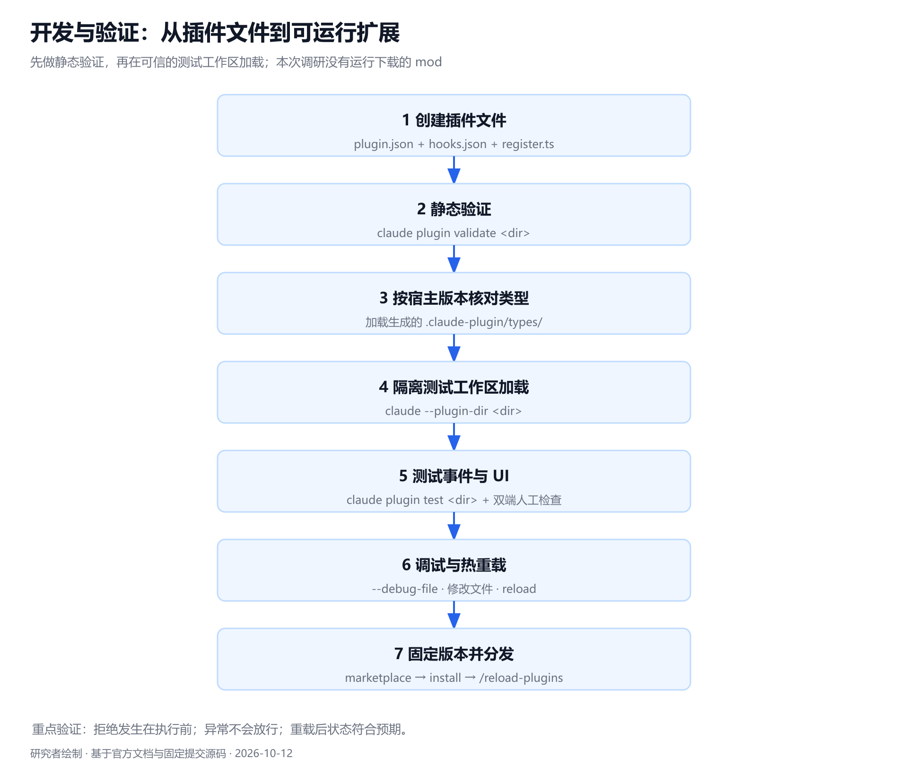

*图 15：建议的开发闭环。本次完成资料与源码分析，没有执行图中的安装及运行步骤。*

### 7.1 完整例子：Tool Tally 的行为与文件

调研阶段曾自行编写 Tool Tally 教程、配置、入口代码及官方测试框架用例。本次精简不保留这些独立文件，下面保留例子的行为说明与验证范围；开发时可参照[官方创建指南][S22]和[官方测试指南][S26]。

例子统计主智能体本轮及累计成功工具调用，在 AbovePrompt 显示计数并提供清零按钮；`/tool-tally` 查询，`/tool-tally reset` 重置。它先等待 `next(e)` 返回再统计，并保留原工具结果与下游 UI。另处理并发完成、跨回合及重置后的迟到结果。

本地用 Node.js 编写了一套简化测试环境，模拟事件和部分宿主方法，完成 10 项逻辑检查。这种用替代函数提供受控返回值的做法叫 mock，适合检查计数、重置和迟到结果等逻辑。

本机 CLI 版本较旧，尚未在真实 Claude Code 中运行 `plugin validate`、`plugin test` 或确认界面绘制。因此，例子已做本地逻辑检查，但宿主兼容性仍需后续验证。

### 7.2 编写入口与开发会话

可以自己编写入口，也可以在 Claude Code 中描述需求，让其使用 `plugin-authoring` 指导生成 mod。开发会话里的 `dev-mods` 目录与永久安装位置不同，生成的扩展有会话范围与清理周期，需要明确如何保留和分发。[创建指南][S22]

### 7.3 验证、会话加载与 marketplace 分发

下面是参考操作，不代表本次执行记录。应先在达到要求的 Claude Code 上使用，并审查将加载的源码。

```powershell
# 检查版本；本机调研时输出 2.1.198
claude --version

# 克隆到专用测试位置后，核查具体示例
claude plugin validate ./claude-code-playground/claude-code/mods/token-weather

# 单次会话加载
claude --plugin-dir ./claude-code-playground/claude-code/mods/token-weather

# 需要长期使用时，把 clone 中的 mods 目录作为本地 marketplace
claude plugin marketplace add ./claude-code-playground/claude-code/mods
claude plugin install token-weather@claude-code-playground-mods
```

**Marketplace** 在这里是“可安装插件的索引”，不要求它一定是商业商店。索引记录插件名称和来源；示例的名称、条目可在 `.claude-plugin/marketplace.json` 核对。[Playground marketplace][S25]。把本地 clone（克隆副本）作为 marketplace 时，索引依赖这个目录的位置；移动或删除目录会影响加载。

### 7.4 排查：载入、匹配、绘制与实际激活版本

排查应先确认 mod 是否已经加载并处于生效状态（active），再判断处理器是否匹配、结果是否通过校验、当前入口能否显示界面。版本、工作区信任、组织设置、插件名冲突、入口路径、静态扫描和 Worker 故障都可能造成“安装了却没效果”。还可能涉及远程 rollout switch，即官方控制功能开放范围的开关。

开发中的 reload 失败可能保留此前成功版本，这与“最新文件内容已经生效”不同。测试必须记录实际激活版本，而不只检查编辑器里的文件。[故障排查指南][S6]

## 8. 验证与性能：哪些结论已经成立

将实现解释转换成证据与验收条件。源码阅读、受控辅助函数测试、教学模型和真实宿主运行的证明范围不同；性能也必须以同条件测量支持。

### 8.1 各检查工具能证明什么

| 检查 | 主要回答的问题 | 不应推导出的结论 |
| --- | --- | --- |
| `claude plugin validate` | manifest、扫描规则、hooks 与 calls 能否识别 | 并不证明逻辑正确或来源可信 |
| 目标版本生成的类型 | 当前宿主允许什么字段与返回形态 | 并不证明跨版本稳定 |
| `claude plugin test` | 事件与 UI 交互逻辑能否按断言工作 | 并不等于真实 surface 绘制已正确 |
| 调试日志 debug log | 为何没有加载、何处拒绝或失败 | 没有错误日志，不等于代码确实执行成功 |
| 人工检查 | 端差异、布局、焦点、可理解性 | 单次通过不证明组合和升级都通过 |

参考：[测试指南][S26]、[创建指南][S22]、[故障排查][S6]。

内置目录的 `claude-code/testing` 用例可以在事件层替代文件、进程、环境等 API。测试因此能指定“读文件返回什么”或“按钮点击后应该发生什么”，而无需真的执行全部外部操作。[内置测试说明][S8]

它能验证“事件传递和返回值是否正确”“按钮调用是否更改正确状态”。**工程建议**同时进行真实 UI 检查与组合测试，因为 mock 通过不保证真实终端绘制、跨版本兼容、外部程序和组织配置都符合预期。

### 8.2 本次证据分层与实测结果

**本次区分四类验证证据**，它们回答的问题不同，不能把通过一个层级写成“Claude Mods 已完整实测”。

| 验证层 | 实际对象 | 本次结果与边界 |
| --- | --- | --- |
| 固定源码核查 | 官方模块和类型、当前文档、原始设计 | 有明确文件和行号，不覆盖宿主闭源实现 |
| 受控政策辅助函数测试 | 经完整阅读的 `createPolicyMemo`、`decidedByPolicy` | 检查实际上游函数；没有加载 mod、访问真实政策或运行工具 |
| 教学语义模型实验 | 自行编写的最小 dispatcher 与 async generator | 检查模型与 JavaScript 语义，不证明 Claude Code 内部数据结构 |
| 自行编写 mod 的逻辑测试 | Tool Tally | 10 项本地检查通过；真实宿主扫描、测试与绘制未运行 |

#### 8.2.1 上游辅助函数：受控执行的七项断言

这里的 helper 是从实际源码中选出的辅助函数。它们包含缓存状态或接收异步读取结果，不宜统称为严格意义上的纯函数。本次只在受控环境执行：使用模拟时钟与读取器，不加载整个 mod，也不读取用户真实政策。

七项断言检查缓存是否共享、何时过期、失败如何处理：500 ms 时仍复用，501 ms 时重新读取；失败的 Promise 也被复用；读取或决定失败时保护条件为 true。

这些结果能确认所测函数的行为，不能直接当成真实 managed settings 的传播延迟。独立测试结果文件已清理，本节保留调研时的检查结论。

#### 8.2.2 教学调度模型：九项语义实验

调研阶段编写的 semantics-lab 教学模型检查了九项断言（独立实验文件已清理）：嵌套顺序、短路、事件副本、跳层与后置处理、用户层跳转限制、普通 next 重试、执行后拒绝不回滚、yield-star 保留完成值、for-await 丢失完成值。

**教学模型**是在本地写一个简化的调度器，把本报告解释的顺序变成可运行例子。它能展示 A、B、核心的先后执行和 JavaScript 流式返回行为；由于不是 Claude Code 的真实引擎，也没有模拟失败恢复、预算、Worker 和政策，不能用它证明宿主的 `.catch` 恢复或权限保护。

### 8.3 真实宿主待验证矩阵

| 条件 | 推荐实验 | 需要收集的证据 |
| --- | --- | --- |
| 同事件多层 | 同时安装 prepend/user/append 与观察者 | 输入、结果、trace、实际层顺序 |
| 普通重复 next vs catch 恢复 | 让可计数、无外部副作用的工具失败 | 后端执行次数与恢复返回值 |
| API 重入 | handler 发起同事件；插件新增 namespace | re-entry / lent 记录及实际参与的 hooks |
| worker 故障与 reload | 受控失败，不使用生产会话 | active module、重复副作用、状态与回调 |
| UI | terminal/desktop、窄屏、模态问题、Client | 合法树、可见内容、焦点、按钮目标 |
| 状态 | clear/resume/branch、两个会话同时写 | 各类 state 生存期与丢失更新 |
| 权限 | ask、deny、rule/hook/ceiling 各组合 | 原决定、改写者、guard 复核后的决定 |

本机 CLI 2.1.198 不满足正式 Mods 条件，本次没有升级或修改用户配置。表中实验因此仍待在合适版本的宿主运行；目前关于这些行为的依据是文档、源码或教学模型，不是本机实际采集的执行记录。

### 8.4 额外耗时与模型成本如何拆分

Mod 一次操作的额外耗时可以粗略拆为：

```text
事件分派 + 本地计算 + 宿主 API 等待 + UI 渲染 + 额外模型/外部服务调用
```

这只是分析框架，没有本次测得的数值。UI 读数类 mod 不必引入额外推理；模型建议、自动分类或内容变换类 mod 可能产生新的计费请求。[Mods API][S21]、[Token Weather][S9]

### 8.5 预算、可靠性与验收指标

普通 hook 的 self-time 预算与业务墙钟耗时不同，具体执行与失败语义见第 3.9 节。文件、HTTP、store、模型输出和重绘也有大小或频率上限，应查目标版本参考表。Blast Radius 的等待循环说明：多数 API 等待不计入自身预算，并不代表用户等待时间有同样上界。[运行限制][S23]、[Blast Radius][S10]

| 问题 | 可见依据 | 建议验证 |
| --- | --- | --- |
| 共享 worker 阻塞 | 当前故障指南描述崩溃和卸载 | 长计算、死循环、共享故障影响 |
| 异常后放行 | handler 失败时的默认继续语义 | 明确 `.catch` 与 catch 自身失败行为 |
| 生命周期状态丢失 | 模块变量随 reload 重置 | 热重载、clear、resume 的期望行为 |
| 观察记录与实际执行不一致 | Replay 在执行前写入 pending | 失败工具调用和执行后确认 |

依据：[故障排查][S6]、[事件指南][S4]、[界面指南][S5]、[Replay 源码][S11]。

### 8.6 性能评估：对照条件与观察指标

建议在同一宿主版本、同一模型、相同任务与工具集合下，比较无 mod、单 mod、完整 mod 组合。观察每回合新增耗时、进程数、额外请求、重绘量、费用、错误率、取消恢复时间，以及任务完成质量。

特别要把主动交互等待和系统额外延迟分开。一个门禁让用户阅读影响范围后再决定，可能延长耗时却提高操作质量；不能只用“更快”衡量它。

**Benchmark（基准测试）**是在固定任务与条件下测量不同方案的表现。本次未进行这种测试，所以只给出测量方法，不给出成本下降比例、完成率提升比例或“零开销”的结论。

## 9. 技术评估：成熟度、适用场景与试点

以已经核验的机制和案例为依据，判断何时值得引入、哪些风险仍要实测，以及如何从只读观察逐步走向组织控制。以下评估与试点方案属于研究判断。

### 9.1 当前证据支持的成熟度判断

官方公开三种教学场景及四个内置实现，已具备从最小观察到复杂交互、政策保护、能力扩展的案例跨度。Playground 明确按原样分享，不提供支持；内置代码和类型仍保留早期版本痕迹。[Playground README][S17]、[内置目录][S8]、[公开类型][S15]

**成熟度判断**：值得试点，但“正式发布”不等于所有 API 已进入长期稳定状态。当前文档与 CHANGELOG 显示持续增加接口、修复行为；固定目标版本比笼统声明“支持 Claude Code”更有意义。[CHANGELOG][S16]

### 9.2 能力、稳定性、测试与隔离的维度评估

| 维度 | 本报告判断 | 原因 |
| --- | --- | --- |
| 能力完整性 | 对宿主定制较强 | 事件、UI、命令、上下文、API 都有案例 |
| 接口稳定性 | 仍需版本约束 | 公开契约与当前文档有明确差异 |
| 可测试性 | 有较好基础 | 官方测试 kit 与内置测试可读 |
| 安全隔离 | 不应依赖其作为通用沙箱 | mod 具有用户权限与副作用 API |
| 工程支持 | 示例与产品支持要分开 | Playground 原样分享，复杂使用需自行验证 |
| 跨平台 | 能力按入口和 surface 分化 | hooks 与绘图并非同一支持范围 |

这是基于已取得证据的定性评估，没有伪造打分权重、用户统计或性能测量。

### 9.3 适合从哪些场景起步

| 场景 | 为什么适合 Mod | 起步方案 |
| --- | --- | --- |
| 上下文 / 额度 / 运行状态 | 会话事件与常驻 UI 联动 | 先做只读面板，区分指标含义 |
| 生产变更前审查 | 执行前暂停并让人看影响 | 小范围确定性规则，验证失败策略 |
| 编辑过程回顾 | 工具事件与顺序回放 | 仅确认成功操作，保留事实阶段 |
| 团队指令装配 | 可程序化选择上下文 | 借鉴 agents-md 并验证冲突与去重 |
| 团队政策与操作审计 | 可位于外层观察/限制行为 | 受管理 mod，验证组合与 API 边界 |
| 定制内置工作视图 | 不等待宿主新增专用页面 | 先借鉴 `/diff` 的布局与刷新策略 |

这些是建议方向，不代表官方已承诺所有组织环境都会开放相同控制能力。

### 9.4 哪些需求不宜优先采用 Mod

如果已有 Skill、脚本 Hook 或 MCP 足以满足需求，新增 Mod 可能只是增加维护面。若需要独立服务、强多租户隔离、跨产品标准化工具，外部服务通常更符合边界；若要求稳定、可证明的操作防护，不能只靠示例中的字符串分类器或用户层观察记录。

### 9.5 三阶段试点与验收

**阶段一：只读观察。** 用一两个透明、无外发数据的指标面板，验证版本、surface、重载和组合行为。验收重点是数值来源与界面一致性。

**阶段二：确定性工作流。** 增加成功编辑记录、命令审查或规则提示，验证执行前后阶段、取消、错误与子智能体。保留相同任务在无 mod 环境下的对照。

**阶段三：受管理的行为控制。** 组织层分发、固定版本、建立准入与回退流程；评估与 OS 隔离、现有 managed hooks 的组合。验收范围包含 mod 自身 API，而不只模型工具调用。

最小验收范围应覆盖上述阶段的观察、执行、界面、政策与回退行为，具体检查条件见第 8.3 节。

### 9.6 对 Harness、上下文工程与人机协作的启发

**Harness Engineering（智能体运行系统的工程设计）**：把模型输出转成真实操作，需要上下文、工具、权限和界面共同工作。Mods 把其中一些节点开放为事件，让团队能用代码改变流程；需要重点验证的是这些改动能否检查、测试并与其他扩展组合。

**Context Engineering（上下文工程）**：组织模型在某个时刻应该看到哪些信息。agents-md 展示了这不仅是写一份好提示词，还要决定何时提供、提供给哪个智能体、哪些目录规则适用、已经发过什么，以及如何保留组织要求。

**Agent 自我改进**：Claude 可以生成 mod 并快速重载，形成更快的 Harness 修改闭环。但“生成并加载”不是“已证明更优”；应加入测试、任务回归、事实记录与可回退版本。

**人机协作**：面板和按钮把一部分决定从自由文本转换成明确动作，同时保留模型继续处理任务的路径。交互要反映实际执行阶段，避免把“打算改什么”展示成“已经改好”。

以上均为研究者从公开机制与案例推导的启发，不作为官方产品路线承诺。

### 9.7 社区入口与检索边界

已定位到 Claude Mods 社区目录及多个同名社区仓库，但这些仅作为后续生态发现入口，不作为本报告技术机制的证据，也未审计或运行其中项目：

- [GitHub claude-code-mods topic](https://github.com/topics/claude-code-mods)
- [karanb192/awesome-claude-code-mods](https://github.com/karanb192/awesome-claude-code-mods)
- [Claude Mods 社区目录](https://claude-mods.com/)

不使用目录页面的项目总数证明生态规模，因为目录可能混列普通 plugins、skills、讨论、教程，且不同站点口径不同。

## 附录 A. 官方来源、版本与代码快照

本附录集中管理资料时间和适用版本。正文使用固定提交的实现证据；开发时仍须使用目标宿主生成的契约。

### A.1 官方源码、博客与设计文档入口

| 资料 | 地址 | 用途 |
| --- | --- | --- |
| 内置 Mods | [anthropics/claude-code/mods][S8] | 阅读真实内置功能、测试和类型声明 |
| 官方示例 | [anthropics/claude-code-playground/claude-code/mods][S17] | Token Weather、Blast Radius、Replay Theater |
| 官方产品博客 | [Customize Claude Code with mods][S1] | 发布背景、能力定位和组织治理概览 |
| 官方开发者博客 | [Getting started with Claude Code mods][S18] | Addy Osmani 的动手教程，2026-10-01 |
| 最初设计提案 | [Issue #91870][S2] | 理解设计起点与早期接口讨论 |
| 原始架构文档 | [Function Hooks: Core Architecture][S28] | 10 页历史设计，解释 continuation、能力 fold 与 UI 边界；与当前版本分开阅读 |
| 当前文档 | [Mods overview][S3] | 使用入口、限制、后续指南导航 |

社区中同名的 `claude-mods` 仓库和目录网站不等于官方实现。本报告以 `anthropics` 的两组代码为核心分析对象。

### A.2 发布过程与历史开关

| 时间 | 已核验事件 | 阅读时应注意 |
| --- | --- | --- |
| 2026-09-03，官方原帖标记日期 | GitHub Issue #91870 发布 Function Hooks 设计提案 | 属于征求反馈阶段，不能当作正式发布日 |
| 2026-09-09，原帖更新 | 明确产品名为 Claude Mods，公开早期试用开关 | 早期工程名称仍是 function hook |
| 2026-10-01 | 官方发布《Customize Claude Code with mods》；提案标记已上线 | 正式产品发布依据 |
| 当前文档 | CLI 从 2.1.287 起默认启用；Desktop 文档给出内置引擎 2.1.286 起可用 | 两个版本号对应不同运行入口 |
| 本次采集 | 官方仓库 CHANGELOG 顶部为 2.1.296；公开 `.d.ts` 首行却标为 2.1.277 | 仓库契约不是最新安装版本契约 |

依据：[官方设计提案][S2]、[发布文章][S1]、[运行入口说明][S3]、[固定提交 CHANGELOG][S16]。Issue 创建时间由 GitHub API 另行核实；表中早期日期采用官方原帖标记。

旧文章若要求设置 `CLAUDE_CODE_ENABLE_FUNCTION_HOOKS=1`，应按所针对的版本理解。当前文档明确指出 2.1.287 及以后忽略该变量，包括设为 `0`；不能把这个早期开关继续当作停用方案。[故障排查指南][S6]

### A.3 固定提交、仓库指标与许可

| 指标 | Claude Code 仓库 | Playground 仓库 |
| --- | --- | --- |
| 提交 | `3deb873687379f0c199a69fdaccc65f0865f7a29` | `569c5283d9a0a7ee7938df85bb32e4f48cbb8c86` |
| 提交时间，UTC | 2026-10-11 19:07:16 | 2026-10-01 16:11:57 |
| Star，采集快照 | 150,251 | 205 |
| Fork，采集快照 | 26,263 | 16 |
| API open_issues_count | 14,689 | 13 |
| 许可说明 | 根目录 LICENSE.md 为 All rights reserved，使用受 Commercial Terms 约束；GitHub API license 为 null | Apache-2.0 |

这些数字来自 2026-10-12 获取的 GitHub API 历史快照，原始元数据文件不随报告保留；`open_issues_count` 是仓库 API 字段，可能包含开放 PR。未单独统计 Mods 的贡献者人数。

**许可判断的边界**：公开可读源码与通常意义上的开源许可不是同一回事。不能因为文件在 GitHub 就把内置 Mods 或 Claude Code 整体标成 MIT / Apache-2.0。此处记录实际 LICENSE 文本，不提供进一步法律解释。[Claude Code LICENSE][S19]、[Playground LICENSE][S20]

### A.4 教程、公开类型与本机版本的差异

| 维度 | 采集的 Playground 实现 | 当前教程 / 文档 | 结论 |
| --- | --- | --- | --- |
| Token Weather 状态 | 模块变量 `readings`，start 时清空 | 教程介绍 `$.state` 跨重载保存 | 截图与教学概念不能替代实际源码检查 |
| UI 数据 | 代码读取 `e.hasSurvey`、`e.bodyColumns` 等旧字段 | 当前参考把组件字段放在 `e.props` | 应依据运行版本调整 |
| 版本提示 | Replay 注释仍写 2.1.280 function hooks | 当前正式入口以 2.1.287 等版本说明 | 代码注释可能滞后 |
| 公开类型 | 内置仓库文件首行 2.1.277 | 当前文档参考称 2.1.290 并含后续新增注记 | 以本机生成契约为准 |

依据：[Playground 源码][S9]、[Replay 源码][S11]、[开发者博客][S18]、[公开类型][S15]、[参考文档][S23]。

**本次没有把示例声称为已在本机通过。** 本机 `claude --version` 为 **2.1.198**，低于正式 Mods 版本要求；没有升级用户安装或为了运行示例修改用户配置。

## 附录 B. 四篇微信文章的获取状态

此处记录用户指定资料的访问情况，不将未取得的正文作为事实或观点依据。

### B.1 逐篇访问记录

| 编号 | 链接 | 获取状态 | 能否使用正文作为证据 |
| --- | --- | --- | --- |
| W1 | [用户参考文章 1](https://mp.weixin.qq.com/s/rZgXj-YZ8vkgd36a2nSLyw) | 网页工具失败；直接 HTTP 返回环境验证页 | 否 |
| W2 | [用户参考文章 2](https://mp.weixin.qq.com/s/eJlC4MTEtsEFO4zQXKHzww) | 网页工具失败；直接 HTTP 返回环境验证页 | 否 |
| W3 | [用户参考文章 3](https://mp.weixin.qq.com/s/QQXOmq_-RdjdjcIZoAzwrA) | 网页工具失败；直接 HTTP 返回环境验证页 | 否 |
| W4 | [用户参考文章 4](https://mp.weixin.qq.com/s/j8TAh7pPf1mDo4iO76OROg) | 网页工具失败；直接 HTTP 返回环境验证页 | 否 |

HTTP 状态为 200，但页面正文是“环境异常，完成验证后即可继续访问”，不是文章。精确 URL 检索也未找到可核验的转载；浏览器尝试因本地运行环境初始化失败而未能提供另一份正文。用户确认暂无替代链接或可粘贴正文。

### B.2 对本次调研的影响

本报告不能回答这四篇分别讨论了什么、赞成/反对什么、展示了哪些社区项目，也没有提取它们的标题、作者、发布时间或配图。没有根据 URL 顺序或搜索到的其他文章猜测内容。

已完成的核心部分由官方博客、当前指南和代码快照支撑。**四篇指定第三方文章的逐篇融合仍是资料缺口**；后续若原页面可读，可按以下问题补充：观点是否针对早期版本、示例是否官方、有哪些可复现步骤、权限和成本主张是否有依据、哪些部分与当前契约不同。

## 附录 C. 交付、来源追溯与复现

阅读正文看机制，复查本附录找文件与证据；两者使用相同的来源和验证边界。

### C.1 交付目录

```text
claude-mods/
├── report.md                    # Markdown 调研报告
├── event-catalog.md             # 事件详解补充报告
├── glossary.md                  # 术语速查
├── references.md                # 原始资料链接与获取状态
└── assets/
    ├── diagrams/                # 12 张自绘 PNG 与 1 张中文速查 SVG
    └── screenshots/             # 报告引用的 3 张官方截图
```

本地仅保留 Markdown 报告、阅读补充文档、资料源链接和正文实际引用的图片。源码、示例、模板、配置、验证数据及其许可副本均已清理。

### C.2 实际完成与尚未执行的验证

实际做了：原始架构 PDF 阅读及页面核验；官方网页与 Markdown 文档读取；GitHub 元数据采集；固定提交源码检查；本机 Claude Code 版本检查；自绘 SVG XML 校验与 librsvg 渲染；配图视觉检查；报告本地链接和图片检查。

补充验证包含：Tool Tally 的 10 项本地逻辑检查、semantics-lab 的 9 项教学模型实验，以及两个经完整阅读的上游政策辅助函数的 7 项断言。辅助函数在模拟依赖下运行，没有加载或注册官方 mod、读取用户真实政策、执行外部程序或调用模型；全部检查均不替代真实 Claude Code 宿主验证。

没有做：安装或加载 mod、登录用户 Claude、升级本机 CLI、运行官方 mod 测试、真实任务 benchmark、安全渗透验证。理由是本任务为调研，且本机 CLI 版本不满足正式功能条件。

### C.3 图示、代码与固定来源追溯

正文使用的 12 张自绘 PNG 和用户提供的 1 张中文速查 SVG 放在 `assets/diagrams/`；三张官方截图放在 `assets/screenshots/`。中文速查图的来源说明、官方截图的原始链接与许可见 [来源索引](references.md)。12 张自绘架构与安全图均为研究者重绘，不冒充官方原图。

源码复查使用正文与附录中的上游固定提交链接。本地不再保留源码副本或独立实验产物；第 7–8 章中的检查次数和结论是调研阶段的历史记录，不能理解为当前目录仍附带可运行实验或原始日志。

### C.4 核心参考资料

1. [官方产品发布：Customize Claude Code with mods][S1]
2. [官方设计提案：Issue #91870][S2]
3. [Mods overview][S3]
4. [React to events][S4]
5. [Draw in the interface][S5]
6. [Troubleshoot a mod][S6]
7. [Manage mods for your organization][S7]
8. [固定提交内置 Mods][S8]
9. [Token Weather][S9]
10. [Blast Radius][S10]
11. [Replay Theater][S11]
12. [Telemetry][S12]
13. [AGENTS.md mod][S13]
14. [Sec-default][S14]
15. [公开 TypeScript 契约][S15]
16. [固定提交 CHANGELOG][S16]
17. [官方 Playground Mods][S17]
18. [官方开发者教程][S18]

[S1]: https://claude.com/resources/articles/claude-code-mods
[S2]: https://github.com/anthropics/claude-code/issues/91870
[S3]: https://code.claude.com/docs/en/plugins/mods/overview
[S4]: https://code.claude.com/docs/en/plugins/mods/events
[S5]: https://code.claude.com/docs/en/plugins/mods/interface
[S6]: https://code.claude.com/docs/en/plugins/mods/troubleshoot
[S7]: https://code.claude.com/docs/en/plugins/mods/admin
[S8]: https://github.com/anthropics/claude-code/tree/3deb873687379f0c199a69fdaccc65f0865f7a29/mods
[S9]: https://github.com/anthropics/claude-code-playground/blob/569c5283d9a0a7ee7938df85bb32e4f48cbb8c86/claude-code/mods/token-weather/hooks/token-weather.mjs
[S10]: https://github.com/anthropics/claude-code-playground/blob/569c5283d9a0a7ee7938df85bb32e4f48cbb8c86/claude-code/mods/blast-radius/hooks/blast-radius.mjs
[S11]: https://github.com/anthropics/claude-code-playground/blob/569c5283d9a0a7ee7938df85bb32e4f48cbb8c86/claude-code/mods/replay-theater/hooks/replay-theater.mjs
[S12]: https://github.com/anthropics/claude-code/tree/3deb873687379f0c199a69fdaccc65f0865f7a29/mods/telemetry
[S13]: https://github.com/anthropics/claude-code/blob/3deb873687379f0c199a69fdaccc65f0865f7a29/mods/agents-md/hooks/register.ts
[S14]: https://github.com/anthropics/claude-code/blob/3deb873687379f0c199a69fdaccc65f0865f7a29/mods/sec-default/hooks/register.ts
[S15]: https://github.com/anthropics/claude-code/blob/3deb873687379f0c199a69fdaccc65f0865f7a29/mods/types/claude-code.d.ts
[S16]: https://github.com/anthropics/claude-code/blob/3deb873687379f0c199a69fdaccc65f0865f7a29/CHANGELOG.md
[S17]: https://github.com/anthropics/claude-code-playground/tree/569c5283d9a0a7ee7938df85bb32e4f48cbb8c86/claude-code/mods
[S18]: https://claude.dev/blog/getting-started-with-claude-code-mods/
[S19]: https://github.com/anthropics/claude-code/blob/3deb873687379f0c199a69fdaccc65f0865f7a29/LICENSE.md
[S20]: https://github.com/anthropics/claude-code-playground/blob/569c5283d9a0a7ee7938df85bb32e4f48cbb8c86/LICENSE
[S21]: https://code.claude.com/docs/en/plugins/mods/api
[S22]: https://code.claude.com/docs/en/plugins/mods/create
[S23]: https://code.claude.com/docs/en/plugins/mods/reference
[S24]: https://github.com/anthropics/claude-code/tree/3deb873687379f0c199a69fdaccc65f0865f7a29/mods/diff
[S25]: https://github.com/anthropics/claude-code-playground/blob/569c5283d9a0a7ee7938df85bb32e4f48cbb8c86/claude-code/mods/.claude-plugin/marketplace.json
[S26]: https://code.claude.com/docs/en/plugins/mods/test
[S27]: https://github.com/anthropics/claude-code-playground/tree/569c5283d9a0a7ee7938df85bb32e4f48cbb8c86/claude-code/mods/token-weather

[D-Events]: https://github.com/anthropics/claude-code/blob/3deb873687379f0c199a69fdaccc65f0865f7a29/mods/types/claude-code.d.ts#L3985

[D-Next]: https://github.com/anthropics/claude-code/blob/3deb873687379f0c199a69fdaccc65f0865f7a29/mods/types/claude-code.d.ts#L5259

[D-Origin]: https://github.com/anthropics/claude-code/blob/3deb873687379f0c199a69fdaccc65f0865f7a29/mods/types/claude-code.d.ts#L5941

[D-Trace]: https://github.com/anthropics/claude-code/blob/3deb873687379f0c199a69fdaccc65f0865f7a29/mods/types/claude-code.d.ts#L10451

[D-Budget]: https://github.com/anthropics/claude-code/blob/3deb873687379f0c199a69fdaccc65f0865f7a29/mods/types/claude-code.d.ts#L4257

[D-Stream]: https://github.com/anthropics/claude-code/blob/3deb873687379f0c199a69fdaccc65f0865f7a29/mods/types/claude-code.d.ts#L9691

[D-Engine]: https://github.com/anthropics/claude-code/blob/3deb873687379f0c199a69fdaccc65f0865f7a29/mods/types/claude-code.d.ts#L3224

[D-Built]: https://github.com/anthropics/claude-code/blob/3deb873687379f0c199a69fdaccc65f0865f7a29/mods/types/claude-code.d.ts#L3709

[D-UIClient]: https://github.com/anthropics/claude-code/blob/3deb873687379f0c199a69fdaccc65f0865f7a29/mods/types/claude-code.d.ts#L1199

[D-ClientSurface]: https://github.com/anthropics/claude-code/blob/3deb873687379f0c199a69fdaccc65f0865f7a29/mods/types/claude-code.d.ts#L1250

[D-Element]: https://github.com/anthropics/claude-code/blob/3deb873687379f0c199a69fdaccc65f0865f7a29/mods/types/claude-code.d.ts#L7498

[D-SessionStart]: https://github.com/anthropics/claude-code/blob/3deb873687379f0c199a69fdaccc65f0865f7a29/mods/types/claude-code.d.ts#L3563

[C-PolicyMemo]: https://github.com/anthropics/claude-code/blob/3deb873687379f0c199a69fdaccc65f0865f7a29/mods/sec-default/hooks/policy/create-policy-memo/create-policy-memo.ts#L11

[C-PolicyTTL]: https://github.com/anthropics/claude-code/blob/3deb873687379f0c199a69fdaccc65f0865f7a29/mods/sec-default/hooks/policy/policy-memo-ms.ts#L7

[C-PolicyDecision]: https://github.com/anthropics/claude-code/blob/3deb873687379f0c199a69fdaccc65f0865f7a29/mods/sec-default/hooks/policy/decided-by-policy.ts#L12

[C-Rewritten]: https://github.com/anthropics/claude-code/blob/3deb873687379f0c199a69fdaccc65f0865f7a29/mods/sec-default/hooks/held-verdict/verdicts/rewritten-by-users.ts#L17

[C-HoldsOver]: https://github.com/anthropics/claude-code/blob/3deb873687379f0c199a69fdaccc65f0865f7a29/mods/sec-default/hooks/held-verdict/verdicts/holds-over.ts#L19

[C-CaughtAnswer]: https://github.com/anthropics/claude-code/blob/3deb873687379f0c199a69fdaccc65f0865f7a29/mods/sec-default/hooks/held-verdict/caught-answer.ts#L16

[C-DenyHold]: https://github.com/anthropics/claude-code/blob/3deb873687379f0c199a69fdaccc65f0865f7a29/mods/sec-default/hooks/policy/deny-rules-hold.ts#L17

[C-PersonWritable]: https://github.com/anthropics/claude-code/blob/3deb873687379f0c199a69fdaccc65f0865f7a29/mods/sec-default/hooks/policy/is-person-writable.ts#L12

[C-ManagedOnly]: https://github.com/anthropics/claude-code/blob/3deb873687379f0c199a69fdaccc65f0865f7a29/mods/sec-default/hooks/policy/is-managed-mods-only.ts#L15

[C-RegisterRefusal]: https://github.com/anthropics/claude-code/blob/3deb873687379f0c199a69fdaccc65f0865f7a29/mods/sec-default/hooks/tool-register-refusal/register-refusal-of.ts#L21

[C-TelemetryFold]: https://github.com/anthropics/claude-code/blob/3deb873687379f0c199a69fdaccc65f0865f7a29/mods/telemetry/hooks/register.ts#L53

[C-TelemetryTypes]: https://github.com/anthropics/claude-code/blob/3deb873687379f0c199a69fdaccc65f0865f7a29/mods/telemetry/types/index.d.ts#L124

[C-DiffRefresh]: https://github.com/anthropics/claude-code/blob/3deb873687379f0c199a69fdaccc65f0865f7a29/mods/diff/hooks/register.ts#L322

[C-DiffBody]: https://github.com/anthropics/claude-code/blob/3deb873687379f0c199a69fdaccc65f0865f7a29/mods/diff/hooks/register.ts#L246

[C-AgentsRead]: https://github.com/anthropics/claude-code/blob/3deb873687379f0c199a69fdaccc65f0865f7a29/mods/agents-md/hooks/register.ts#L180

[C-Tiers]: https://github.com/anthropics/claude-code/blob/3deb873687379f0c199a69fdaccc65f0865f7a29/mods/sec-default/hooks/held-verdict/verdicts/ranking/tiers-holding-users/tiers-holding-users.ts#L9

[S28]: https://github.com/user-attachments/files/31802150/EXTERNAL.Function.Hooks.Core.Architecture.pdf?research=20261012

[D-Register]: https://github.com/anthropics/claude-code/blob/3deb873687379f0c199a69fdaccc65f0865f7a29/mods/types/claude-code.d.ts#L7449

[D-On]: https://github.com/anthropics/claude-code/blob/3deb873687379f0c199a69fdaccc65f0865f7a29/mods/types/claude-code.d.ts#L5475

[D-Registration]: https://github.com/anthropics/claude-code/blob/3deb873687379f0c199a69fdaccc65f0865f7a29/mods/types/claude-code.d.ts#L7459

[D-EngineInterface]: https://github.com/anthropics/claude-code/blob/3deb873687379f0c199a69fdaccc65f0865f7a29/mods/types/claude-code.d.ts#L3698
