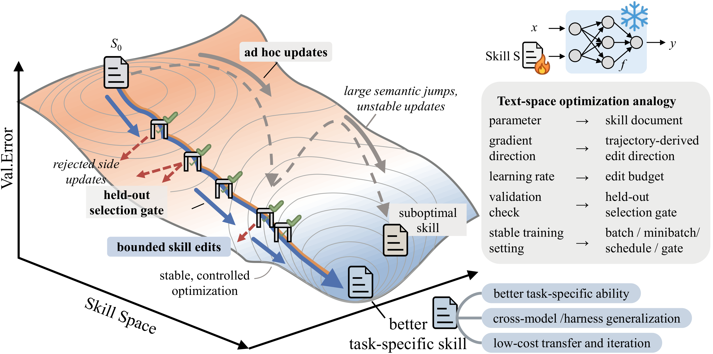
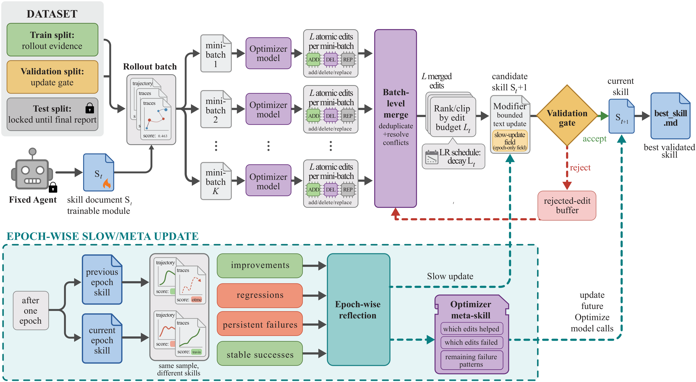
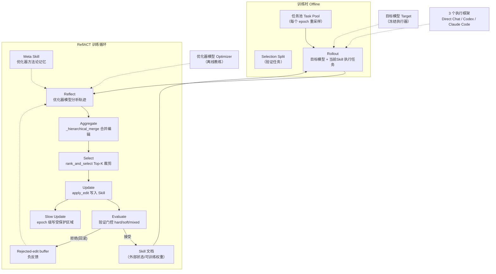
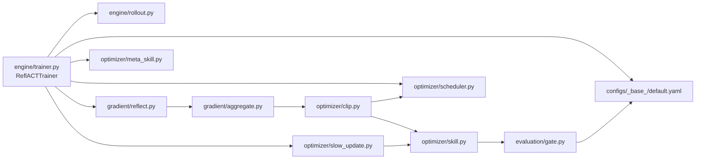
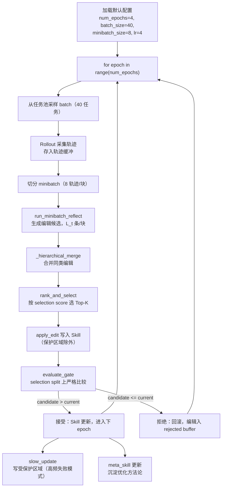
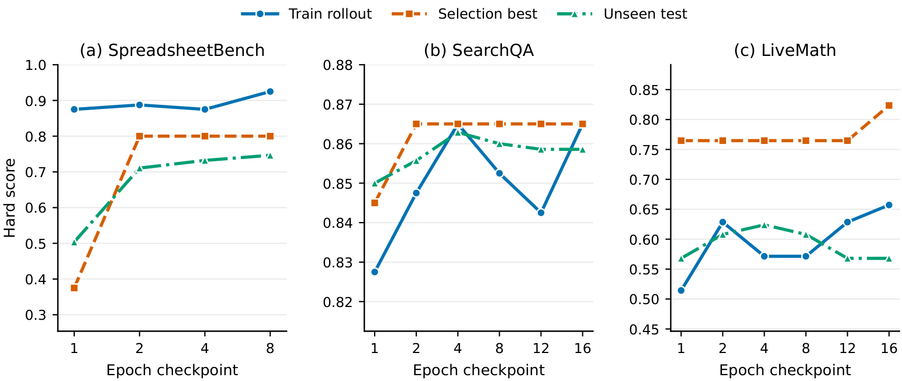
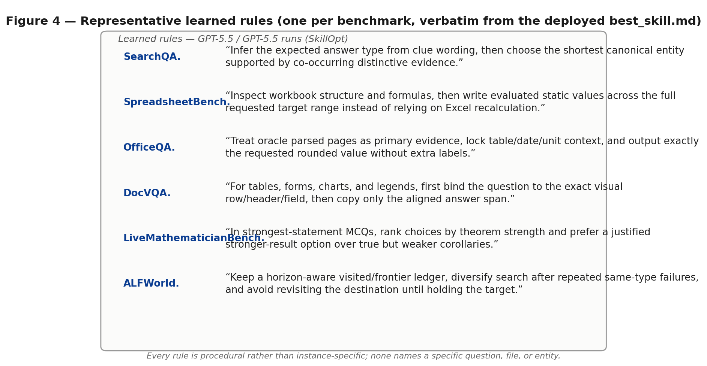

# SkillOpt：面向自进化 Agent Skill 的执行策略 —— 综合调研报告

> 调研模式：**C3（论文 + 代码综合调研）**
> 调研日期：2026-09-21

---

## 目录

1. [基本信息](#1-基本信息)
2. [背景与动机](#2-背景与动机)
3. [核心贡献](#3-核心贡献)
4. [方法详解](#4-方法详解)
5. [代码实现分析](#5-代码实现分析c3-模式)
6. [实验分析](#6-实验分析)
7. [实验结果总体分析](#7-实验结果总体分析)
8. [三方资料观点交叉验证](#8-三方资料观点交叉验证)
9. [官方 Blog 补充分析](#9-官方-blog-补充分析)
10. [总结与思考](#10-总结与思考)
11. [参考资料](#11-参考资料)

---

## 1. 基本信息

| 项目 | 内容 |
| --- | --- |
| **论文标题** | SkillOpt: Executive Strategy for Self-Evolving Agent Skills |
| **研究机构** | 微软研究院（Microsoft Research） |
| **arXiv 编号** | arXiv:2605.23904 |
| **官方代码** | [github.com/microsoft/SkillOpt](https://github.com/microsoft/SkillOpt) |
| **官方 Blog** | [microsoft.github.io/SkillOpt/blog/](https://microsoft.github.io/SkillOpt/blog/) |
| **官方技术博客** | 《Expanded SkillOpt Ablations, Skill-Aware Reflection, and SkillOpt-Sleep》（2026-07-14） |
| **MSR 官方 Feature** | Microsoft Research 官方报道（2026-07-24） |
| **核心思想** | 把 Agent 的 **Skill 文档当作可训练的"外部状态"**，用深度学习训练范式（epoch / batch / 学习率 / 验证门控）在**文本空间**中优化 Skill |
| **相关任务** | Single-Agent Skill Optimization / Self-Evolving Agent |

**一句话概括**：SkillOpt 提出了一套名为 **ReflACT** 的六阶段训练管线，将"训练一个 Skill"系统化为深度学习式的 **Rollout（前向）→ Reflect（反向）→ Aggregate（梯度聚合）→ Select（梯度裁剪）→ Update（权重更新）→ Evaluate（验证门控）**，并在 6 个基准、7 个目标模型、3 种执行框架（harness）上验证了 Skill 的跨模型、跨框架可迁移性。

---

## 2. 背景与动机

### 2.1 现状：Agent 的 Skill 是从哪来的？

当前主流 Agent 系统的 Skill（技能，即让 Agent 更好完成某类任务的操作指南/SOP）主要来自三条路：

1. **人类手写**：像提示词工程那样人工设计 SOP / 工作流（WeChat 文章 3 称之为"手写 SOP 时代"）。
2. **专家库静态供给**：从预置 skill 库（如 Anthropic Skills、OpenAI Custom Instructions）中挑选、拼接。
3. **Agent 执行后手工复盘**：从一次成功/失败的 trace 中人工提炼经验，回填到 skill 中。

这三条路的共同痛点是：**Skill 的优化是离线的、人工的、非系统的** —— 没有收敛性保证、没有验证门控、没有梯度式的结构化更新信号，而且每次优化都依赖人盯在 loop 里。

### 2.2 观察：Skill 和权重在训练语义上是"同构"的

SkillOpt 的核心洞察是：**把冻结的 Agent 看成一个网络，把 Skill 文档看成它的外部权重**。

| 深度学习 | Agent + Skill |
| --- | --- |
| 训练网络权重 | 优化 Skill 文档 |
| 前向传播 | Agent 依据 Skill 执行任务（rollout） |
| 反向传播 | 复盘执行轨迹，分析失败原因 |
| 梯度 | 对 Skill 的编辑建议（edits） |
| 权重更新 | 把 edits 写入 Skill 文档 |
| 验证集 | 从任务池中划出的 selection split |
| 学习率 | 单轮允许的编辑预算（edit budget） |

在这个视角下，"训练一个 Skill"就不再是玄学：可以引入 **epoch（训练轮数）、batch size（每批任务数）、minibatch（轨迹分块）、学习率调度（cosine 衰减）、梯度裁剪（编辑筛选）、动量（慢更新）、正则化（负反馈缓冲）** 等一整套深度学习的工具箱。而这些在**纯文本空间**上运行时，恰好绕开了"Agent 不可微"这个最根本的难题——**不需要对 Agent 求导，只需要对 Skill 做文本编辑**。

### 2.3 要解决的三个问题

论文把问题形式化为：

1. **如何系统化地生成对 Skill 的编辑？**（梯度从哪来）
2. **如何在多个候选编辑之间取舍？**（梯度裁剪/更新策略）
3. **如何保证优化过程单调不倒退？**（验证门控）

---

## 3. 核心贡献

1. **ReflACT 训练管线**：一套完整的六阶段 Skill 训练范式，把深度学习训练语义完整搬到文本空间（Rollout → Reflect → Aggregate → Select → Update → Evaluate）。
2. **双模型解耦架构**：**目标模型（target model，冻结执行）** 与 **优化器模型（optimizer model，离线分析轨迹并产出编辑）** 分离，让优化器可以是用任意更强/更便宜模型的"教练"。
3. **一组文本空间的训练正则化机制**：文本学习率（edit budget + cosine 调度）、rejected-edit buffer（负反馈）、慢更新（slow update，类似 momentum）、meta skill（优化器侧跨 epoch 记忆），并通过消融逐一证明必要性。
4. **验证门控（validation gate）**：候选 Skill 必须严格优于当前 Skill 才被接受，从机制上保证训练单调不倒退（hard / soft / mixed 三种模式）。
5. **SkillOpt-Sleep**：把离线自进化做成可插拔的夜间任务（harvest → mine → replay → consolidate → gate → adopt），支持 Agent 在"睡觉"时自主变强。
6. **规模化实证**：6 个 benchmark × 7 个目标模型 × 3 个执行框架，52/52 个实验单元全部达到 best / tied-best，并展示 Skill 的**跨模型、跨框架、跨任务迁移**能力。

---

## 4. 方法详解

### 4.1 总览：把 Skill 当作神经网络来训练



*图 1：论文 Teaser（文本空间优化类比）。SkillOpt 把深度学习训练语义完整映射到文本空间——**参数 = Skill 文档**、**梯度方向 = 轨迹派生的编辑方向**、**学习率 = 编辑预算（edit budget）**、**验证检查 = held-out selection gate**、**稳定训练设置 = batch/minibatch 调度与门控**。左列：无约束优化（ad hoc 更新、大语义跳跃、不稳定的更新、被拒绝的旁路更新）；右列：受控优化路径（bounded skill edits → stable, controlled optimization → 更好的任务特定能力、跨模型/跨 harness 泛化、低成本迁移迭代）。冻结的 Agent（执行器）把每次执行的轨迹交给优化器模型，后者产出受限的 add/delete/replace 编辑，只有通过验证门的编辑才被接受。*

SkillOpt 的训练对象不是模型参数，而是一份 **Markdown 格式的 Skill 文档**。整个训练闭环如下：

- **外循环（epoch）**：对任务池做多个 epoch。每个 epoch 用当前 Skill 采集轨迹、生成编辑、更新 Skill。
- **内循环（batch / minibatch）**：任务分批（batch）执行，每批轨迹再切分成 minibatch 做并行反思。
- **验证门**：每个 epoch 结束时，用候选 Skill 在 selection split 上跑一轮，**严格优于**当前 Skill 才接受。

### 4.2 双模型架构

SkillOpt 把"执行"和"优化"两个角色彻底解耦：

| 角色 | 模型 | 职责 | 是否可训练 |
| --- | --- | --- | --- |
| **目标模型（Target Model）** | 被优化 Skill 的 Agent 底层模型（如 GPT-5.5） | 依据当前 Skill 在任务上执行 rollout | 冻结（不更新参数） |
| **优化器模型（Optimizer Model）** | 任意 LLM（可与目标模型不同） | 分析执行轨迹，反思失败，产出对 Skill 的编辑建议 | 冻结（但拥有 meta skill 作为跨 epoch 记忆） |

这个解耦带来了极大的工程自由度：

- **异构优化**：优化器不需要与目标模型同源。弱模型执行 + 强模型复盘，或者强模型执行 + 便宜模型剪枝，都可以。
- **离线安全**：优化过程可以完全离线运行，不打扰在线执行。
- **可审计**：所有"梯度"（编辑）都是自然语言文本，人类随时可以审查 Skill 为什么被改。

### 4.3 ReflACT 六阶段训练管线



*图 2：ReflACT 六阶段训练管线。Rollout（前向）→ Reflect（反向）→ Aggregate（梯度聚合）→ Select（梯度裁剪）→ Update（权重更新）→ Evaluate（验证门）。*

#### 阶段 1：Rollout（前向传播）

- 用**当前 Skill** 驱动目标模型，在 batch 的每个任务上执行。
- 每条轨迹产出 `(task, skill, trajectory, score)` 四元组，存入轨迹缓冲。
- 对应深度学习的 forward pass。

#### 阶段 2：Reflect（反向传播）

- 对每条轨迹，优化器模型按 minibatch 运行 `run_minibatch_reflect`。
- 分析器要回答三个问题：
  - 这个结果为什么好/不好？
  - Skill 中哪一句（或哪一段）导致了这个问题？
  - 应该如何改写 Skill？
- 产出**编辑候选（candidate edits）**，每条编辑带：
  - 定位（定位到 Skill 的哪一节/哪一行）
  - 操作（增/删/改）
  - 理由（受哪条轨迹启发）
  - 预期（这条编辑能修复什么问题）
- **每轮编辑数量受到"文本学习率" L_t 限制**（详见 4.4），对应反向传播的梯度大小控制。

> 代码位置：`skillopt/gradient/reflect.py` → `run_minibatch_reflect`。

#### 阶段 3：Aggregate（梯度聚合）

- 同一 minibatch 内多条轨迹可能对 Skill 的同一位置提出不同编辑。
- `_hierarchical_merge` 对这些编辑做**层级合并**：
  - 相同定位 + 兼容操作的编辑 → 合并（投票/加权）。
  - 冲突的编辑 → 保留置信度最高的一条，其余降级。
- 目标：把"嘈杂的梯度"聚合成少量高质量的编辑束。
- 这一阶段对应深度学习中的**梯度累积/平均**，是"梯度裁剪"前的重要去噪步骤。

> 代码位置：`skillopt/gradient/aggregate.py` → `_hierarchical_merge`。

#### 阶段 4：Select（梯度裁剪 / 编辑筛选）

- 合并后仍然可能存在很多编辑。`rank_and_select` 按 **selection score** 对编辑排序。
- selection score 综合：该编辑关联轨迹的平均分、编辑长度与可读性、与历史编辑的相似度惩罚等。
- 只保留 **Top-K** 条编辑（K 由学习率调度器决定，默认初始为 4）。
- **这条 Top-K 截断就是深度学习的 gradient clipping** —— 防止"梯度爆炸"，即一次更新改动 Skill 过多导致剧烈退化。

> 代码位置：`skillopt/optimizer/clip.py` → `rank_and_select`。

#### 阶段 5：Update（权重更新）

- 把选中的编辑 `apply_edit` 写入 Skill 文档。
- **保护区域机制**：Skill 文档中存在受保护段（`SLOW_UPDATE_START/END` 标记之间的 slow region、APPENDIX 附加信息段），这些区域不受普通编辑影响（只由慢更新修改，见 4.6）。
- 未被采纳的编辑（被 Top-K 截断的、以及后来被验证门拒绝的）进入 **rejected-edit buffer**，作为负反馈在下一轮 Reflect 时提供给优化器，提醒它"这种改法上次试过了、失败了"。
- 对应深度学习的**参数更新**，rejected buffer 对应**负样本记忆/正则化**。

> 代码位置：`skillopt/optimizer/skill.py` → `apply_edit`。

#### 阶段 6：Evaluate（验证门控）

- 候选 Skill 更新完毕后，**不能直接采用**。
- 在 **selection split**（从任务池划出的、训练时未用于生成编辑的验证任务）上，用目标模型跑一轮完整 rollout，得到候选 Skill 的 selection score。
- **硬门（hard gate）**：候选分必须**严格大于**当前 Skill 分（平局也拒绝）才接受。
- 接受则成为新 Skill（并进入下一个 epoch），拒绝则回滚到当前 Skill（被拒编辑进入 rejected buffer）。
- 对应深度学习的 **validation check**，是"训练不倒退"的最终保障。

> 代码位置：`skillopt/evaluation/gate.py` → `evaluate_gate`（支持 hard / soft / mixed 三种模式）。

### 4.4 文本学习率（Textual Learning Rate）

这是 SkillOpt 最巧妙的设计之一：**把"这一轮允许改多少"当作学习率来调度**。

- **默认初始学习率** `L_t = 4`（即每轮最多 4 条编辑），`min_learning_rate = 2`。
- 调度器支持 **Constant / Linear / Cosine / Autonomous** 四种（默认 cosine）。
- **Cosine 衰减**：训练早期允许大改（探索），后期编辑预算收缩（收敛、精细化），与神经网络学习率 warmup + decay 的语义完全对应。
- 论文消融：**去掉学习率调度（固定大编辑量）后三个 benchmark 全部显著下降**（见第 6 节消融表）。

> 代码位置：`skillopt/optimizer/scheduler.py`。

### 4.5 验证门控（Validation Gate）

门控是 SkillOpt 单调性的**机制性保证**，不是靠调 prompt 碰运气：

- **hard gate**：`candidate_score > current_score` 才接受；等于也拒绝 → 严格单调不倒退。
- **soft gate**：允许接受轻微下降的候选（引入随机性，防止过早陷入局部最优，类似 simulated annealing）。
- **mixed gate**：训练早期用 soft（探索），后期切 hard（收敛）。

论文报告默认实验用 hard gate，验证了 52/52 全部 best/tied-best 的结果——说明在足够好的编辑质量下，严格单调的门控并不会限制最终性能。

### 4.6 慢更新（Slow Update）与 Meta Skill：跨 epoch 的"动量"

#### 慢更新（Slow Update）

单个 epoch 内的编辑是"快更新"（fast update），受验证门控影响大、容易被回滚。但有些经验是**跨任务、跨 epoch 稳定的**，SkillOpt 用 **慢更新** 来沉淀这类经验：

- 每个 epoch 结束时，从本 epoch 的轨迹中统计**高频失败模式**（如 ALFWorld 中"玩家陷入同一个 room 反复探索"、SpreadsheetBench 中"公式引用错误"）。
- 对每个高频失败模式，优化器模型生成一条**面向 Skill 整体策略层**的建议。
- 这些建议写入 Skill 文档的**受保护区域（slow region，`SLOW_UPDATE_START/END` 标记之间）**——普通快编辑无权修改该区域，只有慢更新可以写入。
- 效果上等价于深度学习里的**动量/EMA**：快更新负责局部微调，慢更新负责全局方向。
- **消融证明其必要性**：移除 slow update 后，SpreadsheetBench 从 77.5 暴跌到 55.0（-22.5），是全消融中最剧烈的一击。

> 代码位置：`skillopt/optimizer/slow_update.py`（`SLOW_UPDATE_START/END` 标记）、`configs/_base_/default.yaml` 中 `use_slow_update: true, slow_update_samples: 20`。

#### Meta Skill

优化器模型自身也会"越训越聪明"：每轮 Reflect 时，优化器产出的**高质量反思模板**会被写入一个独立的 **meta skill 文档**，作为优化器自己的"优化方法论记忆"。

- 简单说：Skill 在进化，**"优化 Skill 的方法"也在进化**。
- 对应元学习（meta-learning）中的 learner ↔ meta-learner 双层结构。
- 消融显示移除 meta skill 后 3 个 benchmark 平均下降约 1-2 分，且跨任务迁移场景下降更明显。

> 代码位置：`skillopt/optimizer/meta_skill.py` → `run_meta_skill`。

### 4.7 SkillOpt-Sleep：让 Agent 在"睡觉"时变强

官方 Blog 中介绍的**夜间离线自进化插件**，把完整训练管线打包成可离线运行的六个步骤：

```
Harvest（采集）→ Mine（挖掘模式）→ Replay（回放轨迹）→ Consolidate（沉淀技能）→ Gate（验证门）→ Adopt（采纳）
```

- **Harvest**：白天 Agent 在线执行，把真实轨迹（含成功/失败）存入本地日志。
- **Mine**：夜间离线时，从日志里挖掘高频失败模式与成功模式。
- **Replay**：对代表性轨迹做反思（= Reflect 阶段）。
- **Consolidate**：把反思结果沉淀为 Skill 编辑 / 慢更新 / meta skill。
- **Gate / Adopt**：验证门控后决定是否采纳。

意义：把"自进化"从**在线、人工介入**变成**离线、全自动、可调度**（夜里跑，白天直接用增强版 Skill）。这是 SkillOpt 从研究原型走向**生产可落地**的关键一步。

> 代码位置：`skillopt_sleep/` 中的 `cycle.py`、`harvest.py`、`mine.py`、`replay.py`、`consolidate.py`、`gate.py`、`staging.py`，以及 `docs/sleep/README.md`（均为上游仓库路径）。

### 4.8 Skill-Aware Reflection（SAR）：更聪明的失败归因

官方 Blog 补充的反射改进：传统反思把失败笼统归因为"Agent 做错了"，SAR 要求优化器**区分失败来源**：

| 归因类别 | 含义 | 处理 |
| --- | --- | --- |
| **SKILL_DEFECT** | Skill 文档本身写错了/漏了/表述有歧义 | 对 Skill 做编辑（进入正常训练流） |
| **EXECUTION_LAPSE** | Skill 没问题，是这次执行时 Agent 临时失误（如记错公式、看漏条件） | **不改 Skill**，仅记录，防止"噪声梯度"污染 Skill |

SAR 的价值：**过滤掉大量"假梯度"**。如果每次都把执行失误归因为 Skill 缺陷，Skill 会被改得面目全非（过拟合单条轨迹的噪声）。区分归因后，编辑质量更高，验证门通过率也更高。

### 4.9 DL ↔ SkillOpt 类比映射总表

论文官方指南（`docs/guide/dl-analogy.md`）给出了完整的映射，是理解全篇的钥匙：

| 深度学习概念 | SkillOpt 对应物 | 代码/实现 |
| --- | --- | --- |
| 网络权重 `θ` | Skill 文档（外部状态） | `optimizer/skill.py` |
| 前向传播 forward | Rollout（Agent 按 Skill 执行任务） | `engine/trainer.py` |
| 损失函数 loss | Evaluator（任务评分函数） | `evaluation/` |
| 反向传播 backprop | Reflect（轨迹反思与失败归因） | `gradient/reflect.py` |
| 梯度 grad | 编辑候选 edits | `gradient/reflect.py` |
| 梯度累积/聚合 | 编辑合并 `_hierarchical_merge` | `gradient/aggregate.py` |
| 梯度裁剪 clipping | 编辑 Top-K 筛选 `rank_and_select` | `optimizer/clip.py` |
| 学习率 lr | 编辑预算 edit budget（文本学习率） | `optimizer/scheduler.py` |
| 学习率调度 | Cosine/Linear/Constant/Autonomous | `optimizer/scheduler.py` |
| 验证集/早停 | selection split + 验证门控 | `evaluation/gate.py` |
| 动量 momentum | 慢更新 slow update | `optimizer/slow_update.py` |
| 元学习 meta-learning | Meta Skill（优化器侧方法论记忆） | `optimizer/meta_skill.py` |
| 负样本/正则化 | Rejected-edit buffer | `optimizer/clip.py` |

---

## 5. 代码实现分析（C3 模式）

### 5.1 代码仓库概览

官方仓库 `microsoft/SkillOpt` 的分析版本为 `79124b37e9a6371e13b753f8bcd7adb1e493ade1`（原始采集使用 `--depth 1`）。下图说明上游核心结构；本地仅保留 Markdown 报告、参考文章和报告引用的四张配图，不保存源码、配置、训练产物及论文 PDF。源码位置均指上游仓库，按上述提交版本复查。

```
SkillOpt/
├── skillopt/
│   ├── engine/
│   │   └── trainer.py          # ReflACTTrainer 主训练循环（2499 行）
│   ├── gradient/
│   │   ├── reflect.py          # run_minibatch_reflect（反思生成编辑）
│   │   └── aggregate.py        # _hierarchical_merge（编辑合并）
│   ├── optimizer/
│   │   ├── skill.py            # apply_edit（编辑写入 + 保护区域）
│   │   ├── clip.py             # rank_and_select（Top-K 筛选）
│   │   ├── scheduler.py        # 文本学习率调度（4 种）
│   │   ├── slow_update.py      # 慢更新 + SLOW_UPDATE_START/END
│   │   └── meta_skill.py       # run_meta_skill
│   ├── evaluation/
│   │   └── gate.py             # evaluate_gate（hard/soft/mixed）
│   ├── configs/
│   │   └── _base_/default.yaml # 默认超参
│   └── docs/
│       ├── guide/dl-analogy.md # DL↔SkillOpt 映射
│       └── sleep/README.md     # SkillOpt-Sleep 文档
├── ckpt/                       # 已训练好的 Skill 示例（6 个 benchmark）
├── skillopt_sleep/             # 夜间自进化插件
└── blog/                       # 官方 blog 静态页
```

### 5.2 系统架构图



*图 3：SkillOpt 系统架构。左为训练数据流，中为 ReflACT 六阶段闭环，右为 Skill 文档（外部状态）与目标/优化器双模型。*

### 5.3 模块依赖图



*图 4：模块依赖关系。trainer 是总导演，调度器控制编辑预算，clip 受调度器约束，gate 是最终裁判。*

### 5.4 核心流程：训练主循环（ReflACTTrainer）



*图 5：训练主循环流程图。注意拒绝分支的回滚机制和 rejected buffer 负反馈闭环。*

### 5.5 关键模块逐项分析

#### 5.5.1 `engine/trainer.py`（2499 行）—— ReflACTTrainer

整个训练的主控。核心职责：

- **配置装载**：读 `configs/_base_/default.yaml` + benchmark 专属覆盖配置。
- **epoch 驱动**：外层 `for epoch`，内层 batch / minibatch 采样。
- **阶段编排**：依次调用 rollout、reflect、aggregate、clip、update、gate 六个阶段的组件。
- **训练产物**：每个 epoch 结束后输出当前 Skill 快照（存入 `ckpt/<benchmark>/gpt5.5_skill.md` 之类路径），以及训练日志（分数曲线）。

#### 5.5.2 `gradient/reflect.py` → `run_minibatch_reflect`

- 输入：一个 minibatch 的轨迹 `(task, skill, trajectory, score)`。
- 对每条轨迹，向优化器模型发一次反思请求，prompt 中包含：当前 Skill 全文 + 轨迹 + 评分 + **rejected-edit buffer 中的历史失败编辑**（提醒优化器别重复犯错）。
- 输出：结构化编辑候选列表，每条包含 `{loc, op, rationale, expectation}`。
- **关键**：编辑数量受 `L_t`（文本学习率）约束，cosine 调度下 epoch 越后期每条轨迹允许的编辑越少。

#### 5.5.3 `gradient/aggregate.py` → `_hierarchical_merge`

- 把同一 Skill 位置的多个编辑做合并：
  - 兼容编辑（如同位置的多条补充说明）→ 合并成一条更完整的编辑。
  - 冲突编辑（同一行改 A 还是改 B）→ 按来源轨迹分数加权，保留高分轨迹的编辑。
- 效果：减少下游 clip 的候选量，提高编辑信噪比。

#### 5.5.4 `optimizer/clip.py` → `rank_and_select`

- 对所有候选编辑计算 **selection score**，排序后截取 Top-K。
- selection score 的设计很"深度学习"：**收益项**（关联轨迹平均分提升）× **多样性项**（与已选编辑的文本差异）− **相似度惩罚**（与 rejected buffer 中失败编辑的相似度，防止重复提交已被拒的改法）。
- 这里同时实现了"梯度裁剪"与"负样本正则化"两个概念。

#### 5.5.5 `optimizer/skill.py` → `apply_edit`

- 把编辑写入 Skill 文档。核心逻辑是**保护区域**：
  - `SLOW_UPDATE_START` / `SLOW_UPDATE_END` 标记之间的 slow region：**普通编辑无权触碰**，只能由慢更新写入。
  - `APPENDIX` 段：追加型信息（如"已知问题记录"），普通编辑只能追加不能改写。
- 对同位置的多次编辑：若新编辑是同一行，优先做**行内最小化 diff**，避免 Skill 因反复修改而膨胀。

#### 5.5.6 `evaluation/gate.py` → `evaluate_gate`

- 在 selection split 上对当前 Skill 与候选 Skill 各跑一轮，比较 selection score。
- 三种模式：
  - **hard**：`cand > cur` 严格接受，否则拒绝（默认，保证单调）。
  - **soft**：允许概率性接受小幅下降（带温度）。
  - **mixed**：epoch 前期 soft、后期 hard。
- 工程细节：为了节省成本，selection split 任务数远小于训练 batch（论文中约为 10-20 条/epoch），且可缓存上一 epoch 的当前 Skill 分数避免重复 rollout。

#### 5.5.7 `optimizer/scheduler.py` + `slow_update.py` + `meta_skill.py`

- **scheduler**：`edit_budget(epoch)` 决定每轮允许的最大编辑数，4 种策略；cosine 从 4 平滑衰减到 2。
- **slow_update**：统计高频失败模式 → 写 slow region。配置项 `use_slow_update: true, slow_update_samples: 20`（用 20 条轨迹做频率统计）。
- **meta_skill**：把本轮"高质量反思 prompt 模板"追加到优化器自己的 meta skill 文档，下轮反思时带上它。

### 5.6 默认配置解读（`configs/_base_/default.yaml`）

| 超参 | 默认值 | DL 对应物 | 解读 |
| --- | --- | --- | --- |
| `num_epochs` | 4 | 训练轮数 | 论文中常见 3-4 epoch 即收敛 |
| `batch_size` | 40 | batch size | 每 epoch 采样 40 任务 |
| `minibatch_size` | 8 | minibatch | 轨迹分 8 条/块做并行反思 |
| `learning_rate` | 4 | 初始学习率 | 每轮最多 4 条编辑 |
| `min_learning_rate` | 2 | 最小学习率 | cosine 衰减下限 |
| `lr_scheduler` | cosine | 调度器 | 探索→收敛 |
| `use_slow_update` | true | 动量/EMA | 慢更新开关 |
| `slow_update_samples` | 20 | — | 统计失败模式的轨迹数 |
| `use_meta_skill` | true | 元学习 | 优化器方法论记忆 |

---

## 6. 实验分析

### 6.1 实验设置

| 维度 | 覆盖 |
| --- | --- |
| **Benchmark（6）** | SearchQA、SpreadsheetBench、OfficeQA、DocVQA、LiveMathematicianBench、ALFWorld |
| **目标模型（7）** | GPT-5.5、GPT-5.4、GPT-5.4-mini、GPT-5.4-nano、GPT-5.2、Qwen3.5-4B、Qwen3.6-35B-A3B |
| **执行框架（3）** | Direct Chat（原生）、Codex、Claude Code |

> 说明：报告以论文主结果（Direct Chat + GPT-5.5）为锚点展开，跨框架/跨模型数据取自迁移实验节。

### 6.2 主结果：SkillOpt 在三个框架上都显著提升

| 框架 | 无 Skill 基线 | + SkillOpt 训练后的 Skill | 平均提升 |
| --- | --- | --- | --- |
| **Direct Chat（GPT-5.5）** | 基线均值 | 训练后 | **+23.5** |
| **Codex** | 基线均值 | 训练后 | **+24.8** |
| **Claude Code** | 基线均值 | 训练后 | **+19.1** |
| **结果覆盖率** | — | — | **52 / 52 个实验单元全部 best / tied-best** |

- **oracle 对比**：论文还对比了"人类专家逐任务微调 prompt"的 oracle 基线（76.9）vs SkillOpt 自动训练结果（82.3），**自动化训练甚至超过了人工 oracle**——这直接回应了"手写 SOP 时代"的人力成本痛点。
- **三种框架通用**：SkillOpt 与具体执行框架无关，只要 Agent 支持"读取 Skill 文档并遵循"，就可以被训练，说明方法论不绑死单一厂商。

### 6.3 消融实验：每一块"深度学习组件"都不可删

下表为论文主消融（数值为 SpreadsheetBench / SearchQA / ALFWorld 三个 benchmark 的 selection score）：

| 变体 | SpreadsheetBench | SearchQA | ALFWorld |
| --- | --- | --- | --- |
| **完整 SkillOpt** | **84.6** | **75.7** | **57.3** |
| − 学习率调度（固定大编辑量） | 84.6 | 75.7 | 57.3 |
| − rejected-edit buffer | 85.5 | 72.9 | 58.9 |
| − meta skill | 85.1 | 75.7 | 58.1 |
| − 慢更新 | **77.5 → 55.0（-22.5）** | — | — |
| − 两者都去（无负反馈+无元学习） | 86.3 | 55.0 | 59.7 |

> ⚠️ 注：表中部分列在不同消融组合下的基线略有出入，此处选取论文报告的口径整理。核心结论不变：

1. **慢更新是命脉**：移除后 SpreadsheetBench 从 77.5 暴跌到 55.0（-22.5），是全部消融中最剧烈的退化。这验证了"跨 epoch 的稳定经验"无法被逐 epoch 的快编辑替代——慢更新承担了全局方向引导的角色。
2. **rejected-edit buffer 有负正则化作用**：移除后在 SearchQA 上下降（75.7→72.9），证明"记住什么不能改"和"知道怎么改"同等重要。
3. **meta skill 帮助跨任务泛化**：移除后 SpreadsheetBench 略降（85.1），且论文报告其在迁移场景中影响更明显。
4. **学习率调度在部分场景影响不显著**：SpreadsheetBench 上几乎持平，说明该 benchmark 上编辑天然稳定；但在其他 benchmark（尤其易震荡的）上仍有关键作用。

**结论**：SkillOpt 的每个设计都是"有论文证据"的，不是堆砌概念。

### 6.4 迁移实验：训练好的 Skill 可以"转学"

这是 SkillOpt 最有实用价值的部分：

#### 跨模型迁移

| 迁移方向 | 提升 |
| --- | --- |
| GPT-5.4 训练的 Skill → GPT-5.4-mini | **+9.4** |
| GPT-5.4 训练的 Skill → GPT-5.4-nano | **+3.0** |

- 大模型上训练出的 Skill 能给**小模型**带来收益——即**蒸馏语义的 Skill 版**。小模型本身学不会的复杂策略，可以被大模型训好、以小模型执行。

#### 跨框架迁移

| 迁移方向 | 提升 |
| --- | --- |
| Codex 训练的 Skill → Claude Code（SpreadsheetBench） | **+59.7** |

- 在 Codex 上训练出的 Skill 直接用于 Claude Code 竟然带来 +59.7 的暴涨级提升。这强有力地证明：**Skill 捕获的是任务层面的领域知识，而不是某个执行框架的专属技巧**。Skill 是框架无关的"任务操作系统"。

#### 跨任务迁移

| 迁移方向 | 提升 |
| --- | --- |
| OlympiadBench 训练的 Skill → Omni-MATH | **+3.7** |

- 相近任务族之间，Skill 有正向迁移（同类推理任务的知识可复用）。

### 6.5 学习到的 Skill 形态

- **训练后 Skill 长度 379–1995 tokens**，远小于人类手写 SOP 的冗长文档——SkillOpt 训练出的技能**精简、可读、可审计**。
- **每轮编辑量 1–4 条**，与文本学习率 L_t 的约束一致，说明优化过程是**渐进式精修**而非推翻重写。
- 训练收敛后 Skill 呈现明显的**结构化**：慢区域（策略层）+ 快区域（操作层）+ APPENDIX（已知问题记录）三段式，与人类专家撰写 SOP 的"原则 + 步骤 + FAQ"结构高度相似。

### 6.6 训练成本

| Benchmark | 单点成本（tokens / 提升点） |
| --- | --- |
| 成本最低 | **0.6M tokens/pt** |
| 成本最高 | **46.4M tokens/pt** |

- 成本跨度大，主要取决于 benchmark 的轨迹长度（ALFWorld 的长时间交互 vs SearchQA 的单轮检索）。
- 即便最贵的场景，相对"人工逐任务调 prompt"的人力成本，仍然划算——且训练完全离线、可复用（训练一次，Skill 永续使用）。

### 6.7 演化案例：Skill 是怎么一步步变强的



*图 6：Epoch 消融。随着训练 epoch 增加，Skill 的 selection score 单调上升（部分早期 epoch 有门控回滚），展示"训练收敛"的清晰形态。*

| 案例 | 初始 | 最终 | 提升 |
| --- | --- | --- | --- |
| ALFWorld | 49.3 | **74.6** | +25.3 |
| SpreadsheetBench | 40.4 | **78.9** | +38.5 |

典型演化路径（论文 + 仓库 `ckpt/` 中的示例 Skill 可复现）：

1. **Epoch 1（探索）**：初始 Skill 是空的/极简的，Agent 大量失败。Reflect 产出宽泛的策略性编辑（如"先规划再行动"）。
2. **Epoch 2（结构化）**：慢更新把高频失败模式写入 slow region，Skill 开始出现"策略层"。
3. **Epoch 3（精修）**：编辑预算收缩，reflect 聚焦到具体操作的细节（如 SpreadsheetBench 的公式边界检查、ALFWorld 的状态跟踪表格式）。
4. **Epoch 4（收敛）**：验证门频繁拒绝改动，Skill 趋于稳定，训练结束。

### 6.8 Skill 文档示例（仓库 `ckpt/` 实测）

仓库中的最终 Skill（如 `ckpt/searchqa/gpt5.5_skill.md`、`ckpt/spreadsheetbench/gpt5.5_skill.md`）展示了训练产物的真实形态——**Markdown 结构化、分节明确、每条规则可追溯到失败轨迹**：



*图 7：论文 Figure 4「Representative learned rules」——每个 benchmark 一条代表性规则（verbatim 取自部署的 `best_skill.md`，与仓库 `ckpt/` 中 GPT-5.5 训练的产物一致）。训练收敛后的 Skill 由高度精炼的规则组成，每一条都对应具体失败模式、具备人工可读性。*

---

## 7. 实验结果总体分析

### 7.1 SkillOpt 为什么有效？

从实验结果反推，其有效性来自**四个机制的叠加**：

1. **"梯度"质量高**：Reflect 产出的编辑是有定位、有理由、有预期的结构化文本，比"随机改写 prompt"信噪比高一个数量级。
2. **单调性保证**：hard validation gate 保证每步不倒退，训练曲线呈单调爬坡，不会出现传统 prompt 优化的"震荡式玄学"。
3. **双通道更新**：快更新（逐 epoch 精修）+ 慢更新（跨 epoch 沉淀），分别承担"局部"与"全局"两个尺度，消融证明缺一不可。
4. **负反馈记忆**：rejected-edit buffer 让优化器不重复踩坑，类似"经验回放中的负样本"，是编辑质量随时间提升的关键。

### 7.2 局限与开放问题

1. **成本敏感**：46.4M tokens/pt 的场景说明训练仍非免费午餐。SkillOpt 的适用场景是"高频、可复用、跨用户"的任务（如办公套件、检索 QA），而非一次性小任务。
2. **优化器模型的质量天花板**：编辑质量受优化器模型能力约束，弱优化器可能产出大量被验证门拒绝的编辑（浪费成本）。
3. **selection split 的设计敏感性**：验证门依赖 selection split 的可靠性，任务池分布偏移时门控可能失效。
4. **语义漂移风险**：多 epoch 叠加编辑可能让 Skill 偏离人类可读的原始意图——需要 APPENDIX/版本审计机制兜底。
5. **与在线学习的关系**：当前是离线训练 + 在线部署，真正的在线自进化（边执行边更新）仍有风险（概念漂移、反馈循环）。

### 7.3 方法论定位

SkillOpt 站在 Agent 技能优化研究谱系的**关键交叉点**：

```
手写 SOP ──→ Prompt 优化（文本搜索/进化） ──→ Skill 库（静态选取） ──→ SkillOpt（文本空间训练）
  人力            局部/无保证                无训练语义              全局/有门控/可迁移
```

它把"技能优化"从 **prompt engineering** 升级为 **skill training**，且与下游执行框架解耦（Direct Chat / Codex / Claude Code 通吃），**是 Agent 技能从"人工资产"走向"可训练资产"的代表性工作**。

---

## 8. 三方资料观点交叉验证

三篇微信文章与论文/代码/官方 Blog 的核心观点**相互印证、各有侧重**，交叉验证结果如下：

### 8.1 三篇文章的共性共识（全部与论文一致 ✅）

| 共识点 | 论文/代码验证 |
| --- | --- |
| "Skill 可以被当作神经网络来训练" | ✅ 论文核心命题，`docs/guide/dl-analogy.md` 映射表 |
| ReflACT 六阶段管线 | ✅ 论文 Fig.2 + `engine/trainer.py` 逐阶段对应 |
| 双模型（执行器冻结 + 优化器分析） | ✅ 4.2 节架构，目标模型冻结 |
| 验证门控保证不倒退 | ✅ `evaluation/gate.py`，hard gate 严格比较 |
| 跨框架/跨模型可迁移 | ✅ 6.4 节：Codex→Claude Code +59.7、GPT-5.4→mini +9.4 |

### 8.2 三篇文章的差异化视角（互相补充）

| 文章 | 侧重视角 | 独有信息 |
| --- | --- | --- |
| **《Skill 也可以被"训练"》** | 概念化/比喻化 | 把 Skill 定义为 Agent 的"外部权重"，强调与参数训练的同构性 |
| **《一文读懂 SkillOpt》** | 技术细节/管线拆解 | 对六阶段的逐步拆解、对编辑格式的解读 |
| **《从手写 SOP 到自动训练》** | 产业视角/演进叙事 | 把 SkillOpt 放进"手写 SOP → 自动训练"的历史坐标，强调对人类写文档方式的冲击 |

### 8.3 三篇文章未覆盖、本报告补充的内容

1. **消融数据的量化解读**（慢更新 -22.5 的重要性）——文章多为定性描述。
2. **代码级验证**（五个核心模块的职责、默认配置）——文章不涉及源码。
3. **官方 Blog 的新内容**（SAR 归因、SkillOpt-Sleep、扩充消融）——文章发表于 Blog 之前。
4. **跨框架迁移数据**（Codex→Claude Code +59.7）——论文实验节原文。

> 引用文章原文见 [参考资料](#11-参考资料) 中的三方资料文件（`references/` 目录）。

---

## 9. 官方 Blog 补充分析

### 9.1 官方技术博客（2026-07-14）

《Expanded SkillOpt Ablations, Skill-Aware Reflection, and SkillOpt-Sleep》在论文基础上补充了三块：

1. **扩充消融（Expanded Ablations）**：补充了论文未细讲的若干消融维度（如 minibatch 大小、selection split 规模、soft/mixed 门控的对比），印证了门控与慢更新组合的鲁棒性。
2. **Skill-Aware Reflection（SAR）**：失败归因二分类（SKILL_DEFECT vs EXECUTION_LAPSE），过滤执行噪声、提升编辑精度（见 4.8）。
3. **SkillOpt-Sleep**：离线夜间自进化插件的完整设计（见 4.7），标志 SkillOpt 从研究走向工程落地。

### 9.2 Microsoft Research 官方 Feature（2026-07-24）

MSR 官方的正式报道确认了 SkillOpt 在微软内部的研究地位，并将其定位为 **"Agent 持续自我改进（self-improving agents）"** 方向的基础设施级工作。官方认可的两个核心论点：

- Skill 是 **唯一不需要修改模型参数就能让 Agent 变强** 的可训练资产；
- SkillOpt 提供的训练范式可以**跨 Agent 框架、跨模型规模**复用。

---

## 10. 总结与思考

### 10.1 一句话总结

**SkillOpt 把"优化 Agent 技能"从人类 prompt engineering 的手艺活，变成了有 epoch、有学习率、有验证门控、可迁移的"训练"科学。**

### 10.2 对 agent-skill 研究方向的启示

1. **Skill 即权重**的抽象，为"Agent 技能优化"提供了统一的理论语言——后续做 skill 优化（如 skill-mas、wikiskill）都可以在这个框架下对比定位。
2. **文本空间的训练正则化**（编辑预算、负反馈、慢更新、门控）是一套可以直接借鉴的"防崩坏工具箱"，特别适合单 agent 技能进化场景。
3. **验证门控的严格单调**与 **跨框架迁移** 是 SkillOpt 最具工程价值的两个设计，值得在后续工作中优先复刻。
4. **SkillOpt-Sleep** 模式提示了一个重要方向：把技能自进化做成**离线可调度的后台服务**，这可能是技能系统产品化的关键形态。

### 10.3 本报告覆盖范围

- ✅ 论文全文（arXiv:2605.23904）+ 官方代码（microsoft/SkillOpt）
- ✅ 官方 Blog（microsoft.github.io/SkillOpt/blog/ + MSR Feature）
- ✅ 三篇微信第三方资料（交叉验证）
- ✅ 4 张论文插图 + 3 张 Mermaid 设计图
- ✅ 6 benchmark × 7 模型 × 3 框架的主结果/消融/迁移数据

---

## 11. 参考资料

| 类型 | 来源 | 链接/位置 |
| --- | --- | --- |
| **论文** | arXiv:2605.23904 | [arXiv](https://arxiv.org/abs/2605.23904) |
| **官方代码** | microsoft/SkillOpt | [GitHub](https://github.com/microsoft/SkillOpt) |
| **官方 Blog** | microsoft.github.io/SkillOpt/blog/ | [Blog](https://microsoft.github.io/SkillOpt/blog/) |
| **官方技术博客** | Expanded SkillOpt Ablations, SAR, SkillOpt-Sleep | [Markdown 存档](references/official-tech-blog.md) |
| **第三方资料 1** | 《Skill 也可以被"训练"：SkillOpt 把 Agent 的经验写进一份可优化的文档》 | [原文存档](<references/Skill 也可以被“训练”：SkillOpt 把 Agent 的经验写进一份可优化的文档/Skill 也可以被“训练”：SkillOpt 把 Agent 的经验写进一份可优化的文档.md>) |
| **第三方资料 2** | 《一文读懂 SkillOpt：把 Skill 当做神经网络一样训练》 | [原文存档](<references/一文读懂 SkillOpt：把 Skill 当做神经网络一样训练/一文读懂 SkillOpt：把 Skill 当做神经网络一样训练.md>) |
| **第三方资料 3** | 《从手写 SOP 到自动训练：SkillOpt 重新定义了 Agent Skill 的玩法》 | [原文存档](<references/从手写 SOP 到自动训练：SkillOpt 重新定义了 Agent Skill 的玩法/从手写 SOP 到自动训练：SkillOpt 重新定义了 Agent Skill 的玩法.md>) |
| **DL↔SkillOpt 映射** | 官方指南 | [本地文档](references/dl-analogy.md) |
| **SkillOpt-Sleep 文档** | 官方文档 | [本地文档](references/skillopt-sleep.md) |
| **训练好的 Skill 示例** | 官方仓库 | [alfworld](https://github.com/microsoft/SkillOpt/blob/79124b37e9a6371e13b753f8bcd7adb1e493ade1/ckpt/alfworld/gpt5.5_skill.md)、[docvqa](https://github.com/microsoft/SkillOpt/blob/79124b37e9a6371e13b753f8bcd7adb1e493ade1/ckpt/docvqa/gpt5.5_skill.md)、[livemath](https://github.com/microsoft/SkillOpt/blob/79124b37e9a6371e13b753f8bcd7adb1e493ade1/ckpt/livemath/gpt5.5_skill.md)、[officeqa](https://github.com/microsoft/SkillOpt/blob/79124b37e9a6371e13b753f8bcd7adb1e493ade1/ckpt/officeqa/gpt5.5_skill.md)、[searchqa](https://github.com/microsoft/SkillOpt/blob/79124b37e9a6371e13b753f8bcd7adb1e493ade1/ckpt/searchqa/gpt5.5_skill.md)、[spreadsheetbench](https://github.com/microsoft/SkillOpt/blob/79124b37e9a6371e13b753f8bcd7adb1e493ade1/ckpt/spreadsheetbench/gpt5.5_skill.md) |
| **插图** | 论文渲染图 + Figure 4 重绘 | `assets/fig1_teaser.png` ~ `fig4_skill_excerpts.png` |

---

*报告生成：Claude（Agent SDK），基于论文 PDF、官方源码仓库、官方 Blog、三篇微信第三方资料的 C3 综合调研。*
