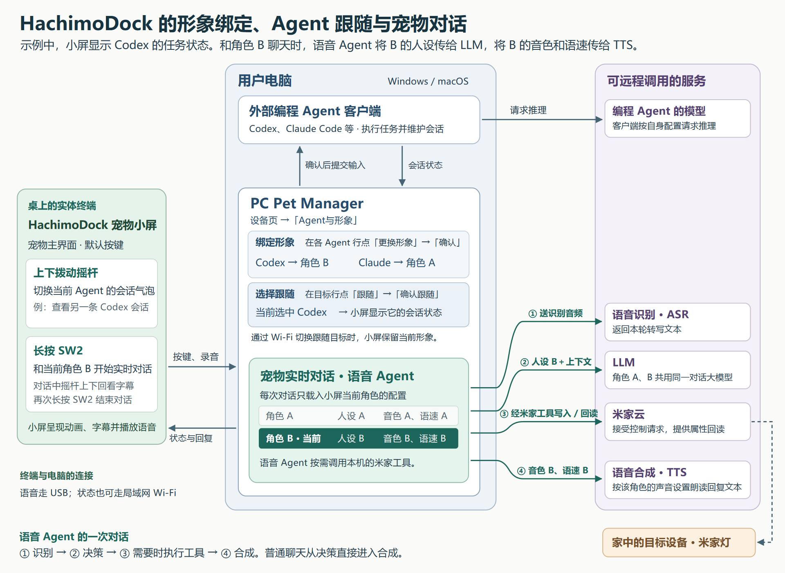
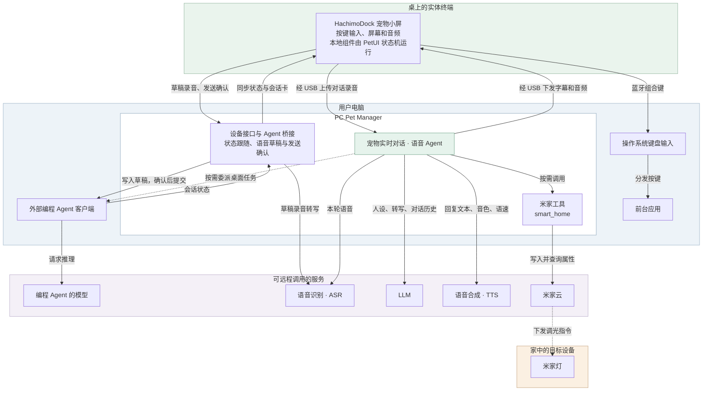
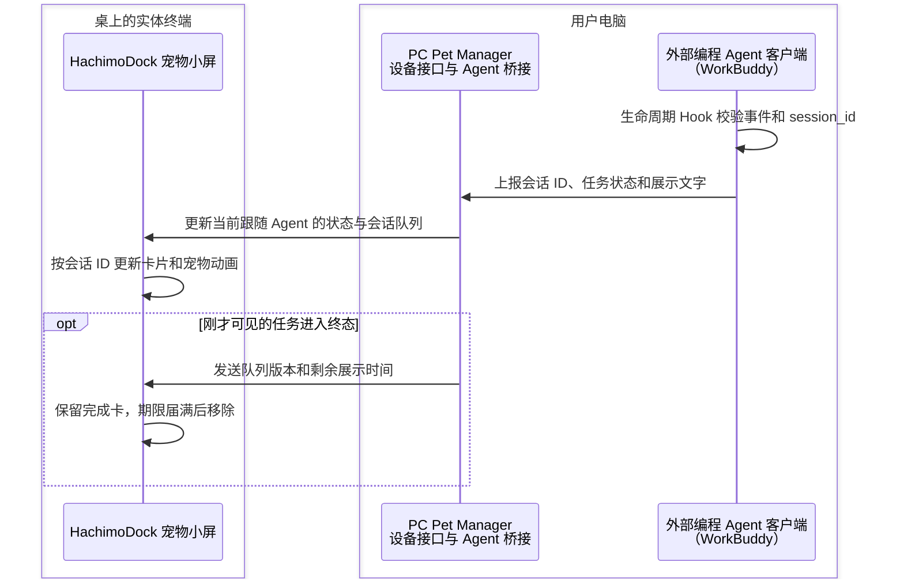
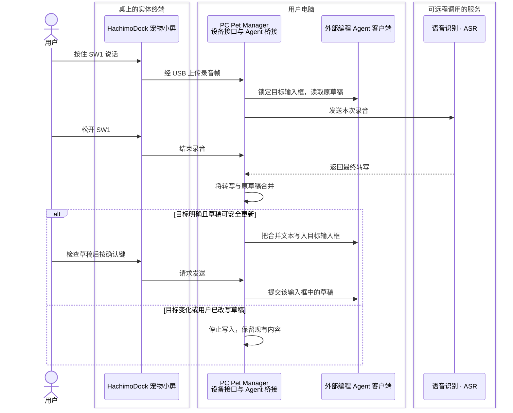
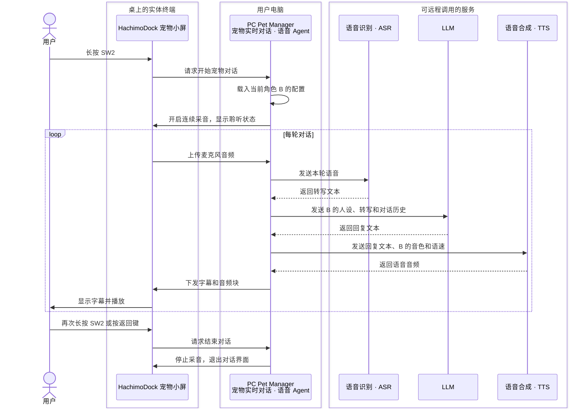
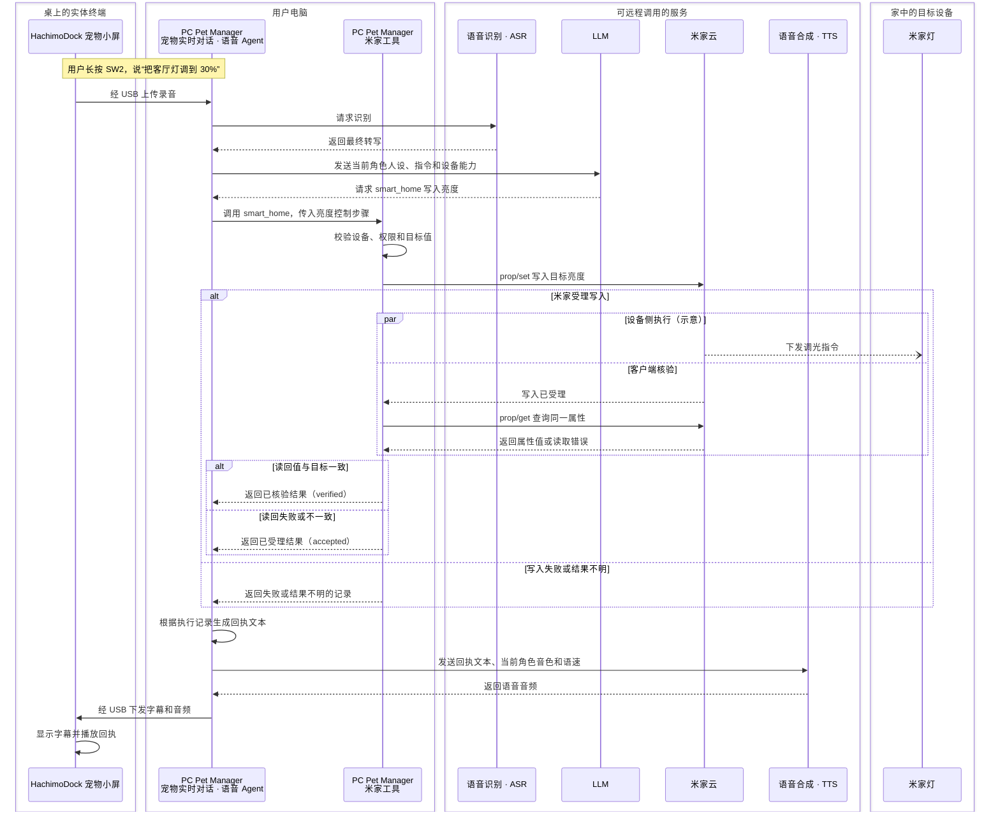
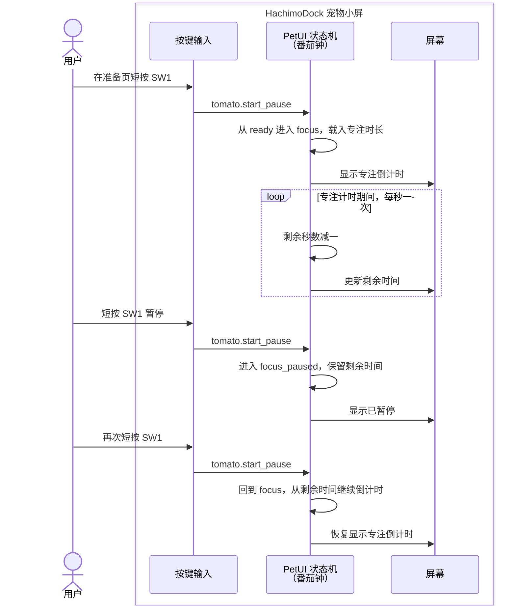
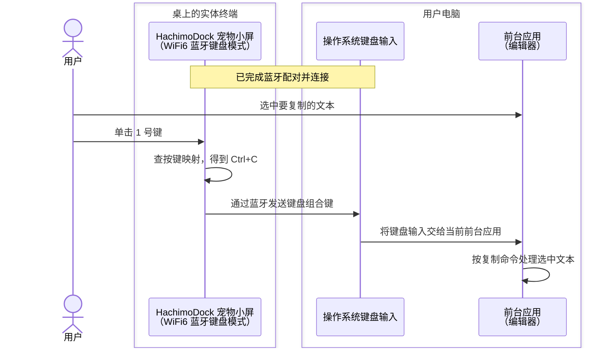
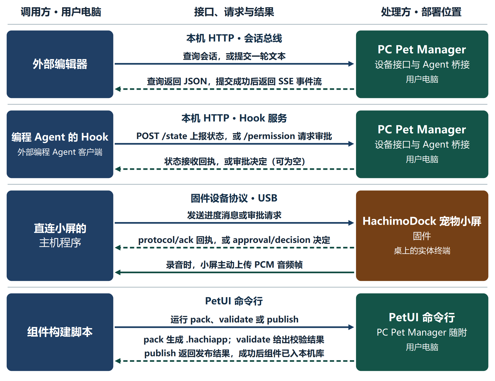

# HachimoDock 调研：从桌面 Agent 状态跟随到宠物语音控制

> 调研状态：局部复查完成
>
> 采用版本：HachimoDock（786e03940510b05cab25fa996b799ce3a5e90751）
>
> 调研人：technologyHu
>
> 最近修订时间：2026-11-19 20:39:34（北京时间）
>
> 其他待确认事项：本轮按固定版本源码核对接口，未联调运行中的桥接服务或实体设备。
>
> 附加交付：[assets/LICENSE.txt](<assets/LICENSE.txt>)

HachimoDock 由桌上的 ESP32-P4 小屏和用户电脑上的 Pet Manager 组成。小屏可以显示编程任务进度、接收按键和语音，也能独立运行番茄钟等本地组件。涉及编程会话、对话模型或米家账号时，由电脑连接相应的应用和服务。[项目说明][overview] · [设备协议][pcm]

**同一句“把客厅灯调到 30%”，入口决定结果。** 按住 SW1 说话，转写结果先进入电脑上已打开的 Agent 输入框，由用户检查并确认发送。在宠物页长按 SW2 后说话，则进入宠物自己的实时对话；如果米家已授权且灯具支持亮度控制，Pet Manager 可以完成写入、回读和语音反馈。图 5 展示草稿如何提交，图 7 展示家居指令如何执行和回读。[语音输入与实时对话][overview] · [米家控制说明][homeDoc]

本文采用官方标签 `v0.1.241`（提交 `786e039`）和固件 `0.7.104-p4-r287`。安装包中的 HachimiDock 与下文的 Pet Manager 指同一个桌面客户端。[官方发布页][releasePage] · [发布元数据][release]

## 1. 功能概览

### 1.1 操作入口：在电脑上配置角色与跟随目标，在小屏上切换会话或聊天



**图 1　宠物形象、任务跟随与实时对话的操作入口**  
用户在电脑上为 Agent 绑定宠物形象、选择跟随目标。在小屏上，上下拨摇杆可查看该 Agent 的会话，长按 SW2 则开始和当前角色聊天。

| 用户想改变什么 | 在哪里操作 | 改变后的结果 |
| --- | --- | --- |
| 给编程 Agent 指定宠物形象 | 电脑的「设备 → Agent与形象」，在对应行点「更换形象」并确认 | 可以同时保存 Codex → 角色 B、Claude → 角色 A。设备跟随 Codex 时，修改 Claude 的绑定只更新其已保存的形象。[形象绑定源码][channel] |
| 选择小屏显示谁的任务 | 同一面板，在目标 Agent 行点「跟随」并确认 | 一次跟随一个 Agent。通过 USB 切到 Claude 时可同步角色 A；通过 Wi-Fi 切换时保留当前形象，因此角色 B 也能显示 Claude 的任务。[切换跟随逻辑][follow] |
| 查看该 Agent 的另一段会话，或和宠物聊天 | 在小屏宠物主界面上下拨摇杆，或长按 SW2 | 默认摇杆选择当前 Agent 的会话气泡，长按 SW2 开启当前角色的实时对话。进入对话后，摇杆改为回看字幕。[固件按键][keys] · [实时对话交互][realtime] |

**表 1　形象绑定、Agent 跟随与会话选择**  
前两项在 Pet Manager 中设置。小屏的摇杆选择会话气泡，长按 SW2 开启当前角色的实时对话。

### 1.2 六类使用场景及其交互流程

“小屏”指 HachimoDock 宠物小屏，“语音 Agent”运行在 PC Pet Manager 内。表中按键均采用默认配置。[操作说明][overview]

| 场景 | 交互链路 | 示例与使用条件 |
| --- | --- | --- |
| **外部状态呈现**：小屏用会话卡和宠物动画显示编程任务进度 | 外部编程 Agent 客户端或电脑数据源 → PC Pet Manager → 小屏 | WorkBuddy 请求权限，小屏显示对应会话正在等待；主机监测组件也可显示电脑状态。见 [3.1 节 · 图 3](#31-外部状态呈现小屏用会话卡和宠物动画显示编程任务进度)。[事件映射][hook] · [队列协议][queue] |
| **向桌面 Agent 输入**：在小屏上口述需求，检查草稿后发送给外部编程 Agent 客户端 | 小屏录音 → PC Pet Manager 调用 ASR → 外部编程 Agent 客户端的输入框 | 按住 SW1 说“补一个空输入测试”。通过 USB 写入草稿，目标输入框须可访问。见 [3.2 节 · 图 5](#32-向桌面-agent-输入在小屏上口述需求检查草稿后发送给外部编程-agent-客户端)。[录音协议][pcm] · [草稿合并][draft] |
| **与宠物对话**：语音 Agent 按当前角色的人设回答，小屏播放回复 | 小屏录音 → 语音 Agent 调用 ASR、LLM 和 TTS → 小屏播放 | 长按 SW2 后问“天空为什么是蓝色的？”，听完可继续问。需要配置语音和模型服务。见 [3.3 节 · 图 6](#33-与宠物对话语音-agent-按当前角色的人设回答小屏播放回复)。[实时对话][realtime] |
| **宠物调用工具**：语音 Agent 调用米家工具调节亮度，小屏播报结果 | 语音 Agent → 本机工具（按需访问米家云等服务）→ 执行回执 → 小屏播报 | “记下明天准备周报”写入本机待办；“把客厅灯调到 30%”经米家云写入设备属性。见 [3.4 节 · 图 7](#34-宠物调用工具语音-agent-调用米家工具调节亮度小屏播报结果)。[实时工具][realtime] · [米家控制][homeDoc] |
| **板端本地交互**：按小屏上的实体键启动、暂停或继续番茄钟 | 小屏按键或定时事件 → PetUI 状态机 → 小屏显示 | 已安装的番茄钟可在设备上暂停、恢复和倒计时。安装与同步组件需要客户端。见 [3.5 节 · 图 8](#35-板端本地交互按小屏上的实体键启动暂停或继续番茄钟)。[番茄钟按键][buttons] · [状态机][widget] |
| **电脑快捷键**：小屏发送蓝牙组合键，电脑前台应用执行快捷操作 | 小屏实体按键 → 蓝牙键盘输入 → 电脑操作系统 → 前台应用 | WiFi6 板型可将按键映射为复制、粘贴等组合键。进入蓝牙键盘模式后，按键用于操作电脑，退出后恢复宠物操作。见 [3.6 节 · 图 9](#36-电脑快捷键小屏发送蓝牙组合键电脑前台应用执行快捷操作)。[蓝牙快捷键][overview] |

**表 2　按输入、执行方和输出归纳的六类场景**  
每行链接指向同一场景的时序图；箭头表示输入、处理和输出的顺序。

## 2. 系统架构与部署

### 2.1 模块分工：小屏、用户电脑和远程服务如何协作



**图 2　整体架构与服务调用关系**  
箭头标出请求或消息的发送方向，服务结果沿原路返回。图 1 把电脑端操作合在 PC Pet Manager 中；这里分出设备接口与 Agent 桥接、语音 Agent 和米家工具。语音草稿和实时对话通过 USB 传输，状态同步也可使用受支持板型的局域网 Wi-Fi。蓝牙快捷键由操作系统直接分发给前台应用。[会话总线][bus] · [桌面任务工具][deskTool] · [实时对话][realtime] · [家居执行器][homeExec]

宠物小屏是 HachimoDock 的实体终端。小屏上的**宠物角色**由动画、人设和声音设置共同呈现。电脑上有两类 Agent：**外部编程 Agent 客户端**维护项目会话和任务；**语音 Agent** 由 PC Pet Manager 运行，负责识别用户的话、请求模型决策及调用工具。米家灯具是执行家居指令的另一台设备。[客户端与硬件][overview] · [会话总线][bus] · [宠物对话][realtime]

| 部署位置 | 在这次交互中负责什么 |
| --- | --- |
| 实体小屏 | 屏幕和扬声器呈现状态、字幕与声音；按键、摇杆和麦克风接收输入。固件还运行本地 PetUI 组件。[设备说明][keys] · [组件运行时][runtime] |
| 用户电脑上的 Pet Manager | React 界面保存配置，Tauri 原生端处理设备通信和系统输入，Node 桥接进程通过适配器收集编程会话状态。[会话总线][bus] · [适配器注册与探测][registry] |
| 用户电脑上的编程 Agent 客户端 | Codex、Claude、WorkBuddy 等客户端执行自己的任务并维护会话，可按各自配置请求推理。具体能否写入草稿、切换会话，取决于适配器、平台及目标窗口。[支持范围][overview] |
| 按需接入的服务与家居设备 | 宠物对话使用语音识别（ASR）、对话大模型（LLM）及语音合成（TTS）。米家控制另需授权账号、米家云及开放相应能力的设备。[实时对话配置][realtime] · [智能家居说明][homeDoc] |

**表 3　各部署位置的职责**  
小屏处理输入和呈现，用户电脑运行 Pet Manager 和编程客户端，语音、推理及家居服务按场景接入。

### 2.2 角色与模型：多个角色如何共用 LLM、保留各自的声音

用户在 Pet Manager 的「API 配置 → 对话大模型」选择模型，分别为各形象保存人设、音色和语速。图 1 选中角色 B 后，图 2 中的语音 Agent 把 B 的人设作为系统提示，与本轮转写和对话历史交给 LLM，再把回复文本、B 的音色和语速交给 TTS。换成角色 A 时，同一个 LLM 收到 A 的人设，TTS 读取 A 的声音设置。[对话模型配置][config] · [按形象保存的参数][role] · [模型请求构造][llm]

### 2.3 硬件与连接：支持的板型、连接方式和独立运行条件

PC 发行包支持 Windows x64 和 Apple silicon macOS。实体终端可以按公开方案自制，R287 正式固件有 WiFi6、Pico 各自的 v1、v3 四个构建目标。其他 ESP32-P4 开发板仍需核对板级适配。官方设备使用 32 MB Flash、32 MB PSRAM 和 480×640 面板，横向逻辑画布为 640×480。日常升级可用 OTA，完整烧录会覆盖配置和组件。[硬件与发布说明][overview] · [构建目标][firmware] · [板级配置][board]

| 接入条件 | 可用路径 |
| --- | --- |
| USB 连接 WiFi6 或 Pico | 支持状态跟随、桌面语音草稿和宠物实时对话。Pico 可以经 USB 上传控制家居的语音，由电脑联网访问米家。[设备功能][overview] · [音频协议][pcm] |
| WiFi6 小屏与电脑在同一局域网 | 配对后可跟随 Agent。实时对话等无线控制还需先经 USB 给同一设备授权；USB 接管会结束正在进行的无线对话。Pico 使用有线连接。[配对与授权][lan] · [客户端说明][overview] |
| 只有电脑，或只有独立供电的小屏 | 电脑上的智能家居页可直接查询、控制设备，也可把键入的自然语言交给家居工具。单独供电的小屏则可运行已经安装的本地计时器或游戏。[PC 家居入口][homePage] · [PetUI 组件][petui] |

**表 4　硬件与连接条件对功能的影响**  
可按板型、连接方式以及电脑是否在线，判断状态跟随、语音和独立功能的可用范围。

排查小屏断线时，先区分传输层。USB-UART 用逐行 JSON 传递 `topic` 和 `payload`，原生 USB OTG 支持高速 bulk 帧。串口连接下客户端每两秒发送心跳，固件连续六秒未收到有效主机消息会判定断线。支持确认的非流式请求可以携带 `requestId`，设备返回 ACK 或 NACK。[USB 传输][wire] · [心跳与确认][ack]

## 3. 典型场景的运行时序

六张时序图沿用表 2 的场景顺序。图 3、5 中的编程会话由外部编程 Agent 客户端维护；图 6、7 中的宠物会话由语音 Agent 处理。图 8、9 分别展开小屏本地计时和电脑快捷键输入。

### 3.1 外部状态呈现：小屏用会话卡和宠物动画显示编程任务进度

WorkBuddy 的 Hook 用 `session_id` 把每条事件归到具体会话。提交问题映射为 `working`，请求工具权限映射为 `waiting_user`，正常结束和工具失败分别映射为 `done` 和 `error`。未知事件或缺少有效会话 ID 的输入会被丢弃。[WorkBuddy Hook][hook]



**图 3　外部状态呈现：从 WorkBuddy 事件到小屏会话卡**  
PC Pet Manager 按会话 ID 同步状态，小屏据此更新对应的会话卡和宠物动画。[会话队列][queue]

小屏固件分别用以下消息处理状态、进度文字和会话队列： `state/<agent>`、`speech/text`、`session/current`。一次桌面快照最多包含八张卡，小屏在选中项附近最多显示三张。刚刚完成的活跃任务可保留 60 秒；快照携带 `transitionRevision` 和剩余时间，重复快照沿用原截止时间。设备在倒计时最后十秒重连时，完成提示只显示剩下的十秒。[固件分派][dispatch] · [快照与终态保留规则][queue]


**图 4　小屏上的宠物状态动画（官方演示）**  
动画展示了小屏如何用宠物动作呈现 Agent 的工作状态。[上游动画][originalGif] · [素材许可](assets/LICENSE.txt)

### 3.2 向桌面 Agent 输入：在小屏上口述需求，检查草稿后发送给外部编程 Agent 客户端

小屏经 USB 上传 16 kHz 单声道 PCM，每帧 20 毫秒。PC Pet Manager 检查音频会话、分块序号、字节数和校验值。使用 WorkBuddy 或 DeepSeek Harness 时，用户须先在外部编程 Agent 客户端打开目标对话；在小屏上选择气泡不会打开历史窗口。[录音协议][pcm] · [桌面输入边界][overview] · [DSH 集成][dsh]



**图 5　向桌面 Agent 输入：语音转写如何写入草稿并经确认发送**  
PC Pet Manager 将 ASR 返回的转写写入目标输入框。松开 SW1 结束录音，用户检查草稿并按确认键后才会发送。[草稿合并][draft]

`VoiceDraft` 保存原始输入和上次写入值。识别文本发生修订时，客户端从原始输入重新合并，并尽量保留光标之后的文字。用户手动改过草稿或目标已变时，PC Pet Manager 停止写入。编程工具的权限审批另走 `approval/request` 等消息，协议 ACK 只确认设备处理了对应请求。[草稿实现][draft] · [审批分派][dispatch] · [消息确认][ack]

### 3.3 与宠物对话：语音 Agent 按当前角色的人设回答，小屏播放回复

在宠物页长按 SW2，PC Pet Manager 内的语音 Agent 开始一段实时对话。普通问答在该会话内完成。若用户要求处理电脑文件或项目，语音 Agent 还可通过桌面任务工具，将任务交给 Codex 或 WorkBuddy 当前打开的对话。[实时对话][realtime] · [桌面任务工具][deskTool]



**图 6　与宠物对话：USB 半双工对话中的语音识别、回复生成与播放**  
ASR 返回转写，LLM 根据角色人设和对话上下文生成回复，TTS 按该角色的音色和语速合成音频。小屏播放后继续聆听。[实时对话][realtime]

USB 半双工模式在扬声器播放期间和播放结束后 250 毫秒丢弃麦克风帧，避免宠物把自己的回复当作下一句输入。全双工路径取决于设备声明的音频能力。[音频协议][pcm] · [能力协商][wire]

### 3.4 宠物调用工具：语音 Agent 调用米家工具调节亮度，小屏播报结果

以“把客厅灯调到 30%”为例。要完成图中的属性回读，PC Pet Manager 需获得中国大陆米家账号的授权，能唯一定位这盏米家灯，且灯的亮度属性可读写。[智能家居说明][homeDoc]



**图 7　宠物调用工具：米家灯亮度的写入、回读与播报**  
语音 Agent 依据米家云返回的亮度属性生成回执，经 TTS 合成后由小屏播报。图中米家灯的动作是示意，属性回读只能核验米家云报告的值。[米家协议][miot] · [执行记录][homeExec]

| 源码环节 | PC Pet Manager 如何处理这条指令 |
| --- | --- |
| 授权与发现 | 用户在 PC 完成小米授权。后端同步家庭、房间、设备和手动场景。`Home::describe` 按 URN 或型号查 MIOT 能力规范，取得属性类型、范围和读写权限。[PC 入口][homePage] · [设备能力][homeCaps] |
| 转写与目标定位 | 最终转写送入宠物对话，超时则提示重说。LLM 可用 `search`、`describe`、`read` 查询目标，仍有歧义时追问。对已定位的灯，它提出 `set`，指定设备 `did`、服务 `siid`、属性 `piid` 和目标值。账号令牌留在客户端。[语音转写][asr] · [工具参数][homeTool] |
| 校验与确认 | PC Pet Manager 检查账号归属、属性可写性和取值范围。明确指令最多 5 步可直接执行，6–12 步需先播报并取得语音确认，等待和条件检查也计步。确认绑定本次会话和计划，完整播报后 60 秒内有效，只能消费一次。保存常用任务与立即执行分开处理。[计划校验][control] · [会话确认][homeConfirm] · [播放与确认激活][playback] |
| 执行 | `Home::execute_plan` 记录计划，`execute_step` 再校验，通过米家云接口 `/app/v2/miotspec/prop/set` 写亮度。小屏无需保存米家令牌或发现灯具的局域网地址。多步计划遇错会停止后续步骤，已发出的步骤不会自动撤回，结果不明时也不会重放。[执行器][homeExec] · [云协议][miot] |
| 回读与播报 | 云端受理后，PC Pet Manager 用 `prop/get` 读取同一属性。读值成功且与目标相等，记为 `verified`；写入获受理但未核实读值，记为 `accepted`。原生 `home_receipt` 根据记录生成回执，TTS 合成音频，由小屏播放并显示字幕。[属性回读][homeExec] · [回执生成][receipt] · [播放][playback] |

**表 5　一条米家语音指令的源码执行环节**  
按授权、定位、校验、执行和回读的顺序，可追踪目标亮度如何变成设备属性写入及可播报的回执。

**动作与场景的反馈不同。** 调用音箱等设备的动作时，PC Pet Manager 按 `siid + aiid` 和规定顺序提交参数；触发已有手动场景时，由米家执行场景内的动作。这两种操作成功后记为 `accepted`，没有亮度属性那样的相等回读可供核验。[执行器][homeExec] · [官方智能家居说明][homeDoc]

### 3.5 板端本地交互：按小屏上的实体键启动、暂停或继续番茄钟

番茄钟安装后，独立供电的小屏即可运行它。按键配置把 SW1 的短按映射为 `tomato.start_pause`，PetUI 番茄钟状态机定义该动作在各个状态下的效果。[按键映射][buttons] · [状态转换与计时规则][widget]



**图 8　板端本地交互：番茄钟如何在小屏上启动、暂停和恢复**  
同一个 SW1 动作在准备时启动计时，在专注时暂停，在暂停时从保留的秒数继续。

### 3.6 电脑快捷键：小屏发送蓝牙组合键，电脑前台应用执行快捷操作

WiFi6 板型可以作为蓝牙键盘。先在小屏「蓝牙快捷键」中配置按键并开启蓝牙模式，再在电脑的蓝牙设置中配对 HachimiDock。下面以默认的 1 号键和支持 Ctrl+C 的前台编辑器为例。[官方蓝牙快捷键说明][btKeys]



**图 9　电脑快捷键：小屏按键如何通过蓝牙触发电脑上的复制操作**  
小屏发送 Ctrl+C，电脑操作系统将按键交给当前前台应用。图中的前台应用是编辑器，由它执行复制。[按键配置与模式切换][btKeys]

## 4. 扩展开发与复用许可

用户如何选择跟随目标、发起语音对话或操作小屏，见[第 1 节「功能概览」](#1-功能概览)。从用户输入到设备执行的六条链路，见[第 3 节「典型场景的运行时序」](#3-典型场景的运行时序)。

外部程序有三种接入方式：读写编程会话或上报任务状态，用 **PC Pet Manager 的本地 HTTP 桥接服务**；主机程序与实体小屏交换消息，用**固件设备协议**；构建和分发小屏工具或游戏，用 **PetUI 命令行**。宠物对话中的 ASR、LLM、TTS 和米家工具由语音 Agent 调用。下列本机 HTTP 路由没有向外部程序提供录音转写、宠物聊天或米家调光接口。[会话总线路由](https://github.com/ai-maker-lab/HachimoDock/blob/786e03940510b05cab25fa996b799ce3a5e90751/pc/src-tauri/bridge/packages/agent-session-bus/src/server.js) · [Hook 路由](https://github.com/ai-maker-lab/HachimoDock/blob/786e03940510b05cab25fa996b799ce3a5e90751/pc/src-tauri/bridge/packages/clawd-backend-service/src/headless-mqtt.js) · [语音 Agent 与米家工具][homeTool]



**图 10　四类调用方的接口、处理模块与返回结果**  
向右的实线表示调用，向左的虚线表示返回给该调用方的结果。小屏主动上传的 PCM 音频用单独的向左实线表示。组件发布成功后保存在电脑上，安装到小屏还需同步。[会话总线][bus] · [固件协议][ack] · [录音协议][pcm] · [PetUI 制作指南][petui]

### 4.1 本机 HTTP 接口：查询会话、提交任务和上报状态

调用方与 PC Pet Manager 运行在同一台电脑、同一系统用户下。会话总线和 Hook 服务使用不同的回环端口。程序通过项目的 `readDescriptor` 读取本次启动的端口，通过 `headersFor` 构造鉴权请求头。表中的 `read`、`control`、`hook` 为各操作所需的最低权限；桥接服务重启后须重新读取描述文件。[本机调用约定][bus]

| 外部程序要做什么 | 接口与主要输入 | 调用方拿到什么 |
| --- | --- | --- |
| 探测服务、查找可用 Agent | 总线 `GET /agent/health` 无需凭据；`GET /agent/status` 使用 `read` | 前者返回 `ok` 和服务名；后者返回 `adapters` 列表，列出适配器标识和就绪状态。 |
| 查找目标会话 | 总线 `GET /agent/sessions?agentId=codex&limit=5`（`read`） | 返回 `sessions`，可从中取得会话 ID。标题、任务状态、最近更新时间等字段取决于适配器及已有状态记录。 |
| 持续跟踪会话进度 | 总线 `GET /agent/session-events`（`read`），传 `agentId`，后续查询带上次的 `cursor` 和 `streamId` | 每次返回一批有序的 `events` 和新游标。首次查询给出当前活跃会话；`reset: true` 表示日志已过期或桥接已重启，需重新建立本地视图。 |
| 向会话提交一轮文本 | 总线 `POST /agent/inject`（`control`），传 `agentId`、`sessionId`、`text` | 成功后返回 SSE 事件流。`ready` 给出 `runId`，`token` 给出文本片段，`tool` 报告工具活动，`done` 或 `error` 结束本轮。适配器未就绪可在开流前返回 HTTP 503。 |
| 取消本次流式调用 | 总线 `POST /agent/cancel`（`control`），传 `ready` 返回的 `runId` | 找到活跃调用时返回 `ok`、`runId` 和 `agentId`。这只确认总线已取消该调用，底层编程任务是否停止取决于适配器。 |
| 把外部编程任务的进度交给小屏展示 | Hook 服务 `POST /state`（`hook`），上报 Agent、会话 ID、状态和展示文字。WorkBuddy Hook 提供了事件映射示例。 | 返回 `{"ok":true}` 表示桥接服务已接收上报。会话卡和动画由后续设备同步更新。 |
| 让桥接服务处理兼容 Agent 的权限请求 | Hook 服务 `POST /permission`（`hook`），传入该 Agent 的权限事件 | 有决定时返回 `hookSpecificOutput.decision`，其中 `behavior` 为 `allow` 或 `deny`；返回空对象时，本次 Hook 没有给出决定。 |

**表 6　本机 HTTP 接口的输入、权限与返回结果**  
会话总线查询返回 JSON，文本提交成功后返回 SSE。Hook 的状态回执与权限决定分属两个接口。[会话总线实现](https://github.com/ai-maker-lab/HachimoDock/blob/786e03940510b05cab25fa996b799ce3a5e90751/pc/src-tauri/bridge/packages/agent-session-bus/src/server.js) · [Hook 服务实现](https://github.com/ai-maker-lab/HachimoDock/blob/786e03940510b05cab25fa996b799ce3a5e90751/pc/src-tauri/bridge/packages/clawd-backend-service/src/headless-mqtt.js) · [WorkBuddy 事件映射][hook]

例如，外部编辑器要向已有的 Codex 会话提问，可先用 `/agent/status` 检查适配器，再从 `/agent/sessions` 取目标 ID，最后向 `/agent/inject` 提交以下 JSON。编辑器逐个拼接 `token.text` 即可显示回复，同时保留 `ready.runId` 供取消使用。[会话写入协议][bus]

```json
{"agentId":"codex","sessionId":"<查询得到的会话 ID>","text":"解释这个项目的入口"}
```

支持范围由适配器决定。例如 WorkBuddy 能上报状态，其总线适配器不支持向会话注入文本；图 5 中的语音草稿通过桌面辅助功能写入。要为新的编程客户端提供会话能力，可继承 `BaseAdapter` 实现探测、枚举、创建及文本提交，再交给 `AdapterRegistry` 注册。[适配器契约][bus] · [注册实现][registry] · [桌面草稿][overview]

### 4.2 固件设备协议：更新小屏、接收设备事件

这组接口面向已连接实体小屏的主机程序。USB-UART 每行传一个含 `topic` 和 `payload` 的 JSON 对象；原生 USB OTG 使用 `pet-usb-native-v1` Bulk 协议封装消息。[传输与握手][wire]

- **更新状态与会话卡。** 主机发 `state/<agent>` 更新宠物工作状态，发 `session/current` 同步会话卡，发 `speech/text` 更新进度文字。例如下面这条消息会让小屏显示“正在运行测试”。受支持的非流式请求带上 `requestId` 后，主机可收到与之对应的 `protocol/ack`；`ok` 表示固件是否处理成功，构建结果仍由主机上报。[消息主题][queue] · [字段示例](https://github.com/ai-maker-lab/HachimoDock/blob/786e03940510b05cab25fa996b799ce3a5e90751/firmware/protocol.md#L1690-L1708) · [消息回执][ack]

```json
{"topic":"speech/text","payload":{"displayTitle":"构建任务","displayContent":"正在运行测试","status":"working","requestId":"progress-1"}}
```

- **接收小屏录音。** 在 USB 按住说话模式下，小屏依次发出 `audio/begin`、`audio/chunk`、`audio/end`。主机按 `sessionId` 和分块序号组装 PCM 音频，并用结束帧核对字节数和校验值。到这一步取得的是录音，转写文字由后续 ASR 调用产生。[录音协议][pcm]
- **接收实体审批结果。** 支持该协议的主机可以发送 `approval/request`，小屏用 `approval/decision` 回传对应的 `requestId` 和决定。主机应将决定交回发起请求的会话。设备返回的传输回执与用户作出的审批决定要分别处理。[固件审批协议](https://github.com/ai-maker-lab/HachimoDock/blob/786e03940510b05cab25fa996b799ce3a5e90751/firmware/protocol.md#L3-L30) · [DSH 集成示例][dsh]

### 4.3 PetUI 命令行：生成、校验和发布组件包

构建脚本可以调用 PC Pet Manager 随附的 `petui`（Windows 为 `petui.cmd`）。以下以已有的 `focus-timer` 工程为例。组件 ID 和类型来自 `component.json`，按键映射来自 `buttons.json`，计时状态转换定义在 `runtime/widget.json`。[PetUI 制作指南][petui] · [番茄钟清单][manifest] · [状态机][widget]

```sh
petui pack focus-timer focus-timer.hachiapp
petui validate focus-timer.hachiapp
petui publish focus-timer.hachiapp
```

`pack` 产出可分发的 `.hachiapp` 文件；`validate` 给出包校验结果；完成预览和交互自测后，`publish` 将该版本写入本机组件库，供 PC Pet Manager 发现。把该版本安装或更新到小屏，还需执行设备同步，并核对目标固件支持的能力。[发布与同步约定][petui] · [板端运行时][runtime]

### 4.4 复用许可：项目内创作与对外分发

项目自有代码采用非商业源码可见许可证。项目内的个人自制、学习、修改和非商业组件创作按许可证约定使用；商业集成或将代码用于独立于本项目的软硬件产品，须另取书面授权。分发涉及第三方代码、字体或素材时，还需核对各自条款。[项目许可证第 1–4、8 条][license]

## 5. 验证结果与证据边界

### 5.1 已有证据：离线测试覆盖什么，源码能确认什么

调研采用 `v0.1.241 / R287`，按 Git 树中的 blob 标识核对所取文件。表 7 汇总该版本已有的离线测试结果，并区分哪些结论来自源码阅读。[官方发布页][releasePage] · [发布元数据][release]

| 证据 | 结果与适用范围 |
| --- | --- |
| 适配器注册表单元测试 | 5/5 通过。覆盖注册、查找、重复 ID、状态缓存、探测异常和适配器枚举。[测试源码][regTest] |
| 语音平台条件单元测试 | 3/3 通过。覆盖 macOS Codex 草稿对 CLI 的依赖，以及 Devin、MiMoCode 的平台判断。用例执行的是条件函数。[测试源码][voiceTest] |
| 米家前端单元测试 | 4/4 通过。覆盖页面提示、按家庭 ID 筛选同名设备、参数解析和回执文案。[测试源码][homeTest] |
| 发布版源码与协议 | 静态追踪了固件消息分派、草稿合并、角色和模型配置、米家工具调用及番茄钟状态机。源码能解释各节点何时发送请求、怎样处理结果。[固件分派][dispatch] · [草稿合并][draft] · [模型请求][llm] · [米家执行器][homeExec] · [番茄钟][widget] |

**表 7　已有验证结果及其覆盖范围**  
三组离线测试覆盖注册表、语音平台条件和米家前端；固件消息、模型请求与家居执行路径的依据来自静态源码。

### 5.2 待验证环节：实机交互、在线服务与发行包复现

现有测试尚未覆盖真实桌面 Agent、小屏、在线模型与米家灯具之间的端到端交互。USB/Wi-Fi 接管、录音到输入框的延迟、扬声器回声、实际调光效果以及组件在不同板型上的表现仍缺实测。MiMo Desktop 的发布说明和 MiMoCode 的前端平台判断涉及不同输入路径，需按客户端及平台分别验证。本次也未完整编译客户端或固件，发行二进制的逐字节复现仍待验证。[发布说明][releasePage] · [平台条件测试][voiceTest]

[btKeys]: https://github.com/ai-maker-lab/HachimoDock/blob/786e03940510b05cab25fa996b799ce3a5e90751/README.md#L96-L102
[overview]: https://github.com/ai-maker-lab/HachimoDock/blob/786e03940510b05cab25fa996b799ce3a5e90751/README.md
[release]: https://github.com/ai-maker-lab/HachimoDock/blob/786e03940510b05cab25fa996b799ce3a5e90751/latest-release.json
[license]: https://github.com/ai-maker-lab/HachimoDock/blob/786e03940510b05cab25fa996b799ce3a5e90751/LICENSE
[hook]: https://github.com/ai-maker-lab/HachimoDock/blob/786e03940510b05cab25fa996b799ce3a5e90751/pc/src-tauri/bridge/hooks/workbuddy-pet-manager-hook.js#L6-L45
[registry]: https://github.com/ai-maker-lab/HachimoDock/blob/786e03940510b05cab25fa996b799ce3a5e90751/pc/src-tauri/bridge/packages/agent-session-bus/src/registry.js#L9-L89
[bus]: https://github.com/ai-maker-lab/HachimoDock/blob/786e03940510b05cab25fa996b799ce3a5e90751/pc/src-tauri/bridge/packages/agent-session-bus/README.md
[wire]: https://github.com/ai-maker-lab/HachimoDock/blob/786e03940510b05cab25fa996b799ce3a5e90751/firmware/protocol.md#L572-L591
[queue]: https://github.com/ai-maker-lab/HachimoDock/blob/786e03940510b05cab25fa996b799ce3a5e90751/firmware/protocol.md#L951-L994
[dispatch]: https://github.com/ai-maker-lab/HachimoDock/blob/786e03940510b05cab25fa996b799ce3a5e90751/firmware/main/pet_p4_protocol.c#L4304-L4356
[pcm]: https://github.com/ai-maker-lab/HachimoDock/blob/786e03940510b05cab25fa996b799ce3a5e90751/firmware/protocol.md#L1576-L1649
[draft]: https://github.com/ai-maker-lab/HachimoDock/blob/786e03940510b05cab25fa996b799ce3a5e90751/pc/src-tauri/src/voice_draft.rs#L8-L38
[dsh]: https://github.com/ai-maker-lab/HachimoDock/blob/786e03940510b05cab25fa996b799ce3a5e90751/integrations/dsh-hachimodock/README.md
[lan]: https://github.com/ai-maker-lab/HachimoDock/blob/786e03940510b05cab25fa996b799ce3a5e90751/firmware/protocol.md#L2497-L2545
[ack]: https://github.com/ai-maker-lab/HachimoDock/blob/786e03940510b05cab25fa996b799ce3a5e90751/firmware/protocol.md#L1661-L1688
[petui]: https://github.com/ai-maker-lab/HachimoDock/blob/786e03940510b05cab25fa996b799ce3a5e90751/pc/skills/petui/SKILL.md
[buttons]: https://github.com/ai-maker-lab/HachimoDock/blob/786e03940510b05cab25fa996b799ce3a5e90751/pc/builtin-clawpkgs/tomato-clock/buttons.json
[widget]: https://github.com/ai-maker-lab/HachimoDock/blob/786e03940510b05cab25fa996b799ce3a5e90751/pc/builtin-clawpkgs/tomato-clock/runtime/widget.json
[manifest]: https://github.com/ai-maker-lab/HachimoDock/blob/786e03940510b05cab25fa996b799ce3a5e90751/pc/builtin-clawpkgs/tomato-clock/component.json
[runtime]: https://github.com/ai-maker-lab/HachimoDock/blob/786e03940510b05cab25fa996b799ce3a5e90751/firmware/main/pet_p4_program_runtime.c
[voiceTest]: https://github.com/ai-maker-lab/HachimoDock/blob/786e03940510b05cab25fa996b799ce3a5e90751/pc/src/lib/agent-voice-capabilities.test.js
[regTest]: https://github.com/ai-maker-lab/HachimoDock/blob/786e03940510b05cab25fa996b799ce3a5e90751/pc/src-tauri/bridge/packages/agent-session-bus/test/registry.test.js
[channel]: https://github.com/ai-maker-lab/HachimoDock/blob/786e03940510b05cab25fa996b799ce3a5e90751/pc/src/dashboard/ChannelMatrixCard.jsx#L170-L206
[follow]: https://github.com/ai-maker-lab/HachimoDock/blob/786e03940510b05cab25fa996b799ce3a5e90751/pc/src/dashboard/ChannelMatrixCard.jsx#L547-L560
[keys]: https://github.com/ai-maker-lab/HachimoDock/blob/786e03940510b05cab25fa996b799ce3a5e90751/firmware/README.md#L50-L61
[role]: https://github.com/ai-maker-lab/HachimoDock/blob/786e03940510b05cab25fa996b799ce3a5e90751/pc/docs/realtime-chat.md#L33-L37
[config]: https://github.com/ai-maker-lab/HachimoDock/blob/786e03940510b05cab25fa996b799ce3a5e90751/pc/docs/realtime-chat.md#L55-L57
[llm]: https://github.com/ai-maker-lab/HachimoDock/blob/786e03940510b05cab25fa996b799ce3a5e90751/pc/src-tauri/src/persona_llm.rs#L71-L85
[firmware]: https://github.com/ai-maker-lab/HachimoDock/blob/786e03940510b05cab25fa996b799ce3a5e90751/firmware/BUILD.md#L5-L18
[board]: https://github.com/ai-maker-lab/HachimoDock/blob/786e03940510b05cab25fa996b799ce3a5e90751/firmware/platformio.ini#L817-L855
[homePage]: https://github.com/ai-maker-lab/HachimoDock/blob/786e03940510b05cab25fa996b799ce3a5e90751/pc/src/SmartHome.jsx#L47-L76
[homeDoc]: https://github.com/ai-maker-lab/HachimoDock/blob/786e03940510b05cab25fa996b799ce3a5e90751/pc/docs/smart-home.md
[realtime]: https://github.com/ai-maker-lab/HachimoDock/blob/786e03940510b05cab25fa996b799ce3a5e90751/pc/docs/realtime-chat.md
[deskTool]: https://github.com/ai-maker-lab/HachimoDock/blob/786e03940510b05cab25fa996b799ce3a5e90751/pc/docs/desktop-agent-voice.md
[homeCaps]: https://github.com/ai-maker-lab/HachimoDock/blob/786e03940510b05cab25fa996b799ce3a5e90751/pc/src-tauri/src/smart_home.rs#L236-L411
[control]: https://github.com/ai-maker-lab/HachimoDock/blob/786e03940510b05cab25fa996b799ce3a5e90751/pc/src-tauri/src/smart_home.rs#L417-L571
[homeConfirm]: https://github.com/ai-maker-lab/HachimoDock/blob/786e03940510b05cab25fa996b799ce3a5e90751/pc/src-tauri/src/smart_home.rs#L807-L880
[homeExec]: https://github.com/ai-maker-lab/HachimoDock/blob/786e03940510b05cab25fa996b799ce3a5e90751/pc/src-tauri/src/smart_home.rs#L572-L688
[miot]: https://github.com/ai-maker-lab/HachimoDock/blob/786e03940510b05cab25fa996b799ce3a5e90751/pc/src-tauri/src/miot_protocol.rs#L13-L101
[homeTool]: https://github.com/ai-maker-lab/HachimoDock/blob/786e03940510b05cab25fa996b799ce3a5e90751/pc/src-tauri/src/persona_llm.rs#L599-L620
[receipt]: https://github.com/ai-maker-lab/HachimoDock/blob/786e03940510b05cab25fa996b799ce3a5e90751/pc/src-tauri/src/persona_llm.rs#L575-L586
[playback]: https://github.com/ai-maker-lab/HachimoDock/blob/786e03940510b05cab25fa996b799ce3a5e90751/pc/src-tauri/src/realtime_chat.rs#L2091-L2156
[asr]: https://github.com/ai-maker-lab/HachimoDock/blob/786e03940510b05cab25fa996b799ce3a5e90751/pc/src-tauri/src/realtime_chat.rs#L2003-L2045
[homeTest]: https://github.com/ai-maker-lab/HachimoDock/blob/786e03940510b05cab25fa996b799ce3a5e90751/pc/src/lib/smart-home.test.js
[originalGif]: https://github.com/ai-maker-lab/HachimoDock/blob/786e03940510b05cab25fa996b799ce3a5e90751/assets/agent-status.gif
[releasePage]: https://github.com/ai-maker-lab/HachimoDock/releases/tag/v0.1.241
