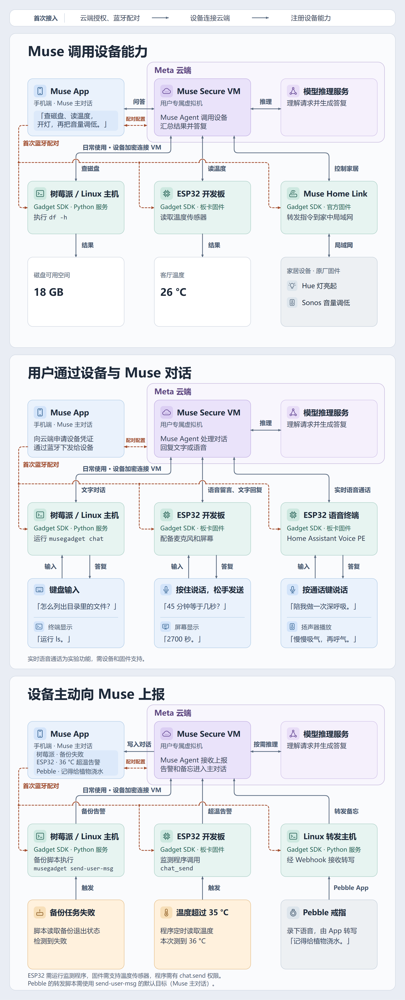
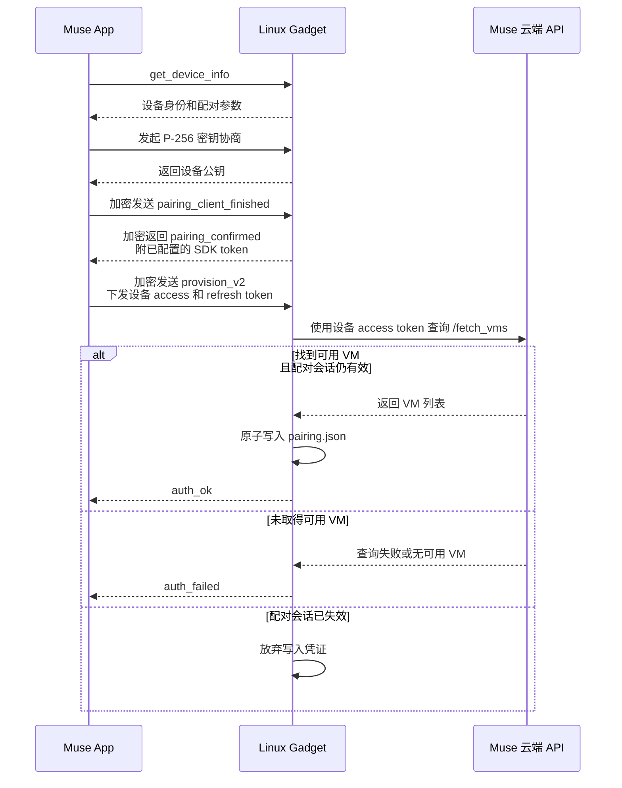
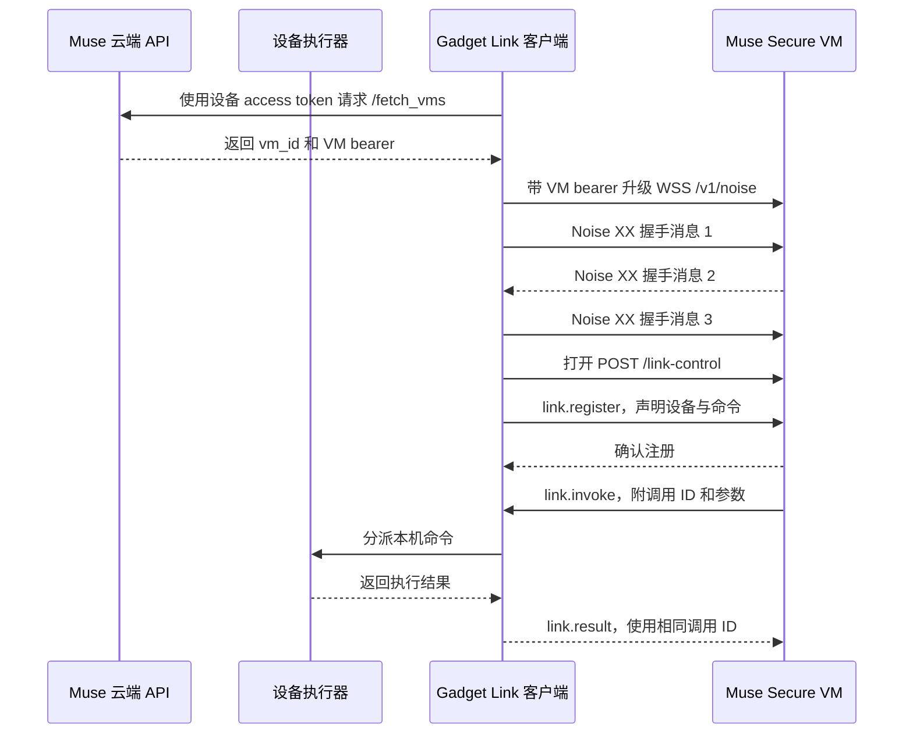
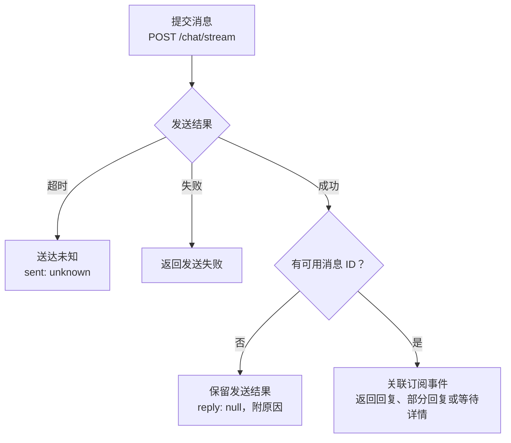

# Muse Gadget SDK 调研

> 调研状态：局部复查部分完成
>
> 采用版本：Muse Gadget SDK（6a44074014daad1a623f54e62a169f514741836b）
>
> 调研人：technologyHu
>
> 最近修订时间：2026-11-18 15:55:15（北京时间）
>
> 主要待确认事项：正式 Muse App 设备令牌申请的精确顺序与云端工具选择策略。
>
> 附加交付：[assets/muse-gadget-sdk-three-scenarios.svg](<assets/muse-gadget-sdk-three-scenarios.svg>)

## 1. 背景与价值

Muse Gadget SDK 为 Agent OS 提供了一个设备接入实例。设备配对后注册身份和能力，通过 Link 会话接收调用、回传结果，也能主动提交消息。设备端实现可复用，接入 Muse 产品还需要 Meta 签发的凭证和用户的 Muse Secure VM。 [设备描述协议][device] · [设备 API 代码][api] · [官方仓库][repository]

Meta 于 2026 年 9 月 8 日发布个人 Agent Muse。每位用户的 Muse 在云端专属的 **Muse Secure VM** 中运行，可以持续处理任务。随后开放的 **Muse Gadget SDK** 提供 ESP32 固件和 Linux 设备端 SDK，让开发者把 Agent 接到传感器、屏幕、麦克风、执行器和局域网设备。官方家居网关 Home Link 基于 ESP32-C5，使用基于 ESP32 Device SDK 的官方固件。 [Muse 发布公告][launch] · [Muse Gadgets 官网][gadgets] · [官方仓库][repository] · [Home Link][home]

SDK 实现配对、身份认证、安全长连接、能力声明和消息传送。开发者可在这套接口上接传感器、继电器或音视频终端，也可以让备份脚本把失败原因送到用户会话。经家居网关接入的局域网设备可继续运行原厂固件。 [设备描述协议][device] · [Linux SDK][linux-readme] · [ESP32 SDK][esp-readme] · [Home Link][home]

### 组件、部署和职责

| 组件 | 运行位置 | 职责 |
| --- | --- | --- |
| Muse App | 手机 | 登录、发现和配对 Gadget，查看主会话或独立会话。官方文档也描述了手机和 Web 客户端与用户 VM 的日常连接 |
| Muse 云端 API | Meta 云端 | 设备令牌服务与 VM 查询。设备通过 `/fetch_vms` 获取可用 VM 及连接凭证 |
| Muse Secure VM | Meta 云端的用户专属虚拟机 | 运行 Muse Agent 和工具执行环境，承接设备会话、能力调用和对话。官方称核心 Agent 运行在 VM 内的 Hatch runtime cell |
| 模型推理服务 | Meta 云端的推理基础设施 | VM 通过推理代理发送必要数据。Muse 产品可更新所用模型，设备端依赖 SDK 协议和服务接口 |
| Gadget SDK | 树莓派等 Linux 主机上的 Python 服务，或 ESP32 固件 | 配对、注册能力、响应 VM 调用以及发起设备侧消息 |
| Home Link、Hue、Sonos、Pebble | 网关、家居终端、随身设备及其手机或转发机 | Home Link 官方固件基于 ESP32 SDK。Hue 和 Sonos 经网关访问。图中的 Pebble 方案由手机处理录音，Linux 主机运行 Gadget SDK 并转发转写 |

开源仓库提供设备端实现，也包含视频测试手机应用、Web Flasher 和家居技能。Meta 的架构说明把 Hatch Agent 及其工具放在隔离的 runtime cell，凭证服务、推理代理和 Sentinel 运行于 cell 之外。正式 Muse App 的配对实现、云端鉴权及 VM 路由的内部代码未见于 SDK。产品模型更新与设备协议各自演进。 [Muse 安全架构][security] · [Meta 模型更新说明][models] · [设备 API 代码][api] · [仓库说明][repository]

## 2. 面向的场景

| 场景 | 用户体验和交互路径 | 示例对应的实现 |
| --- | --- | --- |
| **Muse 调用设备能力** | 用户在 Muse App 说「查磁盘、读温度、开灯，再把音箱音量调低」。VM 通过 Link 会话调用树莓派或 ESP32。家居指令经 Home Link 进入局域网，访问 Hue Bridge 或 Sonos 接口 | Linux 的 `system.run` 可执行 `df -h`。ESP32 的 `sensors.read` 随板型和构建配置开放。家居控制依赖技能、设备型号和局域网接口。 [Linux SDK][linux-readme] · [ESP32 能力注册][esp-register] · [Hue 技能][hue] · [Sonos 技能][sonos] |
| **用户通过设备与 Muse 对话** | 树莓派键盘和终端用于文字问答。带麦克风和屏幕的 ESP32 可发送语音留言并显示回复。装有相应固件的语音终端还可实时对话和播放回复 | Linux 用 `musegadget chat`。ESP32 的语音留言和实时通话有各自的协议路径。实时通话是实验功能，Home Assistant Voice Preview Edition 等设备需要兼容固件和服务端支持。 [Linux 对话][linux-chat] · [ESP32 普通对话][esp-chat] · [ESP32 实时语音][esp-voice] |
| **设备主动向 Muse 上报** | 树莓派备份脚本检测到失败后发消息。ESP32 监测程序看到温度过限后发消息。Pebble App 将语音转写经 Webhook 交给 Linux，再转发到 Muse 会话 | Linux 用 `send-user-msg`，ESP32 可用有 `chat.send` 权限的板端应用。温度阈值和上报逻辑由开发者实现。原版 Pebble 脚本显式传 `--session-id`，图示的主会话需要调整这个参数。 [Linux 发消息][linux-chat] · [ESP32 应用发消息][wasm-chat] · [Pebble 桥接脚本][pebble-bridge] |

Pebble Index 01 经蓝牙把录音交给手机，两条路线都由 Pebble App 收集录音并处理转写。下图中的 **Webhook 路径**把转写 POST 给 Linux，再由已配对的 SDK 用设备凭证转发。Core Devices 的 **Muse 插件**在 Pebble App 中打开网页登录，用捕获的 Muse Web 会话和内置 Musemeow JS 库从手机直接发送。插件默认选择主会话，也可选可写的独立会话。插件文档说明它使用逆向得到的 Web 接口，所核对版本只支持标准 Muse VM，遇到 Confidential VM 的证明请求会在发送前失败。 [Pebble Index 01 开发文档][pebble-index] · [Pebble Webhook 格式][pebble-hook] · [Muse 插件源码说明][pebble-plugin]

[原始可编辑 SVG](assets/muse-gadget-sdk-three-scenarios.svg)

图来自用户提供的参考报告。橙色虚线表示首次配对配置和蓝牙接入，灰色实线表示设备投入使用后的调用、对话和上报。图中的读数、对话内容和阈值是场景示例。App 到云端的配对箭头概括凭证申请与交付，设备侧可确认的顺序见第 4.1 节。

## 3. SDK 能力清单

| 能力 | SDK 提供的接口或实现 | 适用条件 |
| --- | --- | --- |
| 设备身份与能力发现 | `link.register` 上报设备身份及 `commands_v2`，`device.guide` 提供可按需读取的说明 | 设备已成功接入。启用板端应用的 ESP32 还可返回结构化屏幕、按钮、硬件设备和运行时信息。 [设备描述协议][device] |
| 远程执行和本地文件 | Linux 有 `system.run`、`file.read`、`file.write`、`device.health`，并支持通过 JSON 文件注册自定义命令 | 操作对象是 Linux 设备本身，受本机执行账户权限约束。文件操作按块传输。 [Linux 执行器][executor] · [本地文件实现][fileops] · [自定义命令][dropin] |
| ESP32 硬件能力 | 视固件提供屏幕绘制、图片、动画、传感器、摄像头、健康状态及 BLE 扫描、读写等接口 | `commands_v2` 随板型、驱动和构建选项变化。 [ESP32 注册实现][esp-register] · [ESP32 开发手册][esp-agents] |
| 文本、语音和图片 | 设备可投递文本、发送语音留言或发起实验性的实时通话。Linux `--image` 支持附带不超过 2 MiB 的受支持格式图片 | 各模式需要对应的客户端、硬件和服务端能力。 [Linux 发送接口][send] · [Linux 实时通话][linux-voice] · [ESP32 实时语音][esp-voice] |
| 局域网发现和访问 | ESP32 通过 `device.discover` 用 ARP、mDNS、SSDP 等探测设备，支持隧道的构建可以经 `/link-tunnel` 转送 IP 包 | 依赖网关固件和 VM 的隧道授权。家居技能提供目标设备协议及使用规则。 [隧道流][tunnel] · [发现实现][discovery] · [家居技能目录][skills] |
| ESP32 板端应用 | `app.run`、`app.install`、`app.api`，基于 WAMR 运行 WASM。Host API 访问 LVGL 界面、触控、按键、设备、聊天和状态 | 需支持的板型，并在构建启用 `MUSE_APPS=1`。清单声明依赖和权限，内存预算随板卡变化。 [应用 SDK][wasm] · [应用权限][wasm-permissions] |
| 访问用户 VM 数据 | 设备经独立请求流访问 `GET /chat/history`、`POST /fs/read` 和 `POST /fs/write` | 服务器需对设备令牌启用相关操作。这里访问的是 VM 用户 home 下的文件，路径和缓冲均受接口约束。 [Linux VM 数据接口][vm-data] · [ESP32 VM 数据接口][esp-requests] |
| 本地视频和开发工具 | Muse Gadgets Test 在同一 Wi-Fi 把手机摄像头或片段传到 ESP32 屏幕。仓库还提供 Web Flasher、模拟器、板型配置和功耗诊断 | 本地视频经 TCP 发送 H.264 或 VP8，走单独的局域网链路。编解码与帧率取决于设备和配置。 [视频协议][video] · [Web Flasher][flasher] · [ESP32 SDK][esp-readme] · [功耗工具][power] |

## 4. 技术原理与完整流程

### 4.1 首次接入与凭证

自绘。图以已联网的 Linux Gadget 为例。配对和凭证交付经 BLE，设备查 VM 时改用 HTTPS。 [BLE 消息处理][ble-setup] · [配对状态元数据][pairing-status] · [Linux 凭证校验][pair]

1. **准备 SDK token。** 开发者从 Muse Gadgets 获取，Linux 安装时配置，ESP32 在固件构建或支持的 USB 配置入口设置。它标识 Gadget 集成。配对所得的设备 access/refresh token，以及随后查询获得的 VM bearer，都各有用途。 [SDK 入门][repository] · [Linux 配置][linux-readme] · [ESP32 配置][esp-readme] · [设备 API][api]
2. **设备开启 BLE 配对。** 用户在 Muse App 开启开发者模式，选中附近的 Gadget。设备以 GATT 提供 `get_device_info`。社区配对 v5 在 BLE 上以 P-256 ECDH、HKDF-SHA256 和 AES-256-GCM 建立加密会话。Linux 依赖 App 侧确认，ESP32 还可以采用设备按钮或屏幕交互。社区设备缺少厂商身份验证，因此主动中间人仍是配对阶段的威胁。 [Linux 配对说明][linux-pair-guide] · [配对状态机][pairing] · [ESP32 配对说明][esp-pair]
3. **App 交付设备凭证。** Linux 会在加密的 `pairing_confirmed` 状态中附上配置的 SDK token，再接收加密的 `provision_v2`，其中包括设备 access/refresh token、API 地址和 Noise 主机。ESP32 可同时接收 Wi-Fi 配置，已联网的 Linux 复用原连接。公开设备端代码确认 BLE 凭证交付及设备令牌服务的存在。第 2 节场景图中的 App 云端凭证申请是协议层归纳，正式 App 的精确请求顺序仍待确认。ESP32 代码还保留了未收到 refresh token 时兼容申请设备令牌的分支。 [Linux 凭证处理][ble-setup] · [配对状态元数据][pairing-status] · [ESP32 凭证分支][esp-credentials] · [设备令牌接口][mint]
4. **设备校验并保存。** Linux 的 `_verify_and_save()` 用设备 access token 请求 `/fetch_vms`，获得可用 VM 后原子保存 `pairing.json`，包含本次配对的节点身份和凭证，再经 BLE 返回配置成功。ESP32 将配对数据持久化到 NVS，并按固件设置连接 VM 或重启建连。在线命令注册随后由设备会话完成。 [Linux 配对入口][pair] · [BLE 配置回报][ble-setup] · [ESP32 配置流程][esp-provision]

| 凭证或标识 | 用途 |
| --- | --- |
| SDK token | 参与首次接入的开发者集成标识。改变已配对设备的 SDK token 后，需要重新配对来更新关联 |
| 设备 access / refresh token | access token 用于设备级认证与 VM 查询，refresh token 用于轮换 |
| `vm_id` / `vm_auth_token` | 指定目标 VM，并认证该 VM 的 WebSocket 连接 |
| `node_id` / `model_id` | 分别区分已配对设备实例和硬件型号。设备发消息时带实例身份 |

参考 [设备 API][api] · [Linux 连接与轮换][service] · [设备身份协议][device]

Linux 的 `provision_v2` 校验 `ssid` 和 `password` 字段为字符串，随后丢弃这两个值，复用本机网络。VM 查询失败时返回 `auth_failed`，凭证在查询有结果且会话仍允许提交的情况下才进入 `pairing.json`。ESP32 的兼容补发分支要求 Wi-Fi 已连接。 [Linux BLE 配置处理][ble-setup] · [Linux 配对入口][pair] · [配置原子替换][config-save] · [ESP32 凭证分支][esp-credentials]

### 4.2 建连、注册与调用

自绘。图展示一次正常调用。设备凭证用于查 VM，VM bearer 用于 WebSocket 建连，调用 ID 用于匹配执行结果。 [VM 选择与重连][service] · [WSS 和 Noise 建连][link-open] · [Linux 调用处理][invoke]

1. **查 VM 和建连。** Linux `Service.run()` 优先选择标为 default 的 VM，其次用第一个可用实例。设备带 VM bearer 对 `wss://<noise_host>/v1/noise?vm_id=<vm_id>` 发起升级，再做 `Noise_XX_25519_AESGCM_SHA256` 三报文握手。应用帧带流 ID，可在同一连接复用控制流、对话请求或可选隧道。控制流是 Noise 会话上的 HTTP 语义流，使用 `POST /link-control`。 [VM 选择与重连][service] · [WSS 和 Noise 建连][link-open] · [Noise 实现][noise] · [应用帧复用][transport]
2. **注册能力。** `link.register` 上报 `node_id`、`display_name`、`platform`、版本、`device_family: "gadget"`、硬件型号、元数据和 `commands_v2`。命令描述含参数及超时等约束，通过相同请求 ID 匹配注册确认。控制面 JSON 使用 4 字节小端长度前缀，重连会重新注册。`device.guide` 可按需调用，减少每次注册重复发送的说明。协议将 guide 的 Markdown 限在 4096 字节，权限仍由运行环境和服务端决定。 [注册 JSON 与编码][register] · [设备描述协议][device]
3. **分派并回传结果。** 设备收到 `link.invoke`，按调用 ID、命令名、参数和超时分派，再以 `link.result` 回传相同 ID 及 `ok`、`payload` 或 `error`。Linux 在并发约束内调度工作线程和子进程；ESP32 由 `handle_invoke_request()` 解码并交 `on_ws_command()` 执行编译进固件的命令。Agent 具体如何选工具由服务端决定。 [Linux 调用处理][invoke] · [ESP32 调用接收][esp-invoke] · [ESP32 分发][esp-app]
4. **处理断线与撤销。** Linux 服务支持退避重连和令牌轮换，收到解绑事件后清理配对状态。连接断开时已启动的本机任务可能继续执行，旧会话的结果不会自动补发，排队中尚未执行的调用会取消。结果未知时先核对真实设备状态，再决定是否重做物理动作。 [重连与轮换][service] · [调用实现][invoke] · [断线行为][linux-readme]

**经 Home Link 控制家居。** 启用 `CONFIG_HOMEHUB_TUNNEL` 的 ESP32 固件等注册确认后，在 Noise 会话上打开 `POST /link-tunnel`。IP 包按长度封装后转送到设备侧 lwIP 网络接口，经 NAPT 进入局域网。`device.discover` 帮助寻找终端，实际控制经网关访问终端服务。Hue 和 Sonos 技能描述各自的设备协议、操作步骤和鉴权条件，仓库将其标为社区技能。设备兼容性还取决于网关固件、网络和 VM 的隧道授权。 [隧道控制流][tunnel] · [网络接口][netif] · [设备发现][discovery] · [Home Link][home] · [社区技能说明][skills-readme] · [Hue 技能][hue] · [Sonos 技能][sonos]

### 4.3 对话与上报

- **发送消息。** `musegadget send-user-msg` 把消息交给本地 Unix socket `/run/musegadget/musegadget.sock` 上的服务，服务复用已配对的设备会话，向 VM 发 `POST /chat/stream`。请求包含 `message`、`device_id`、`output_modality`，可选 `session_id` 用于独立会话，省略时投主会话。服务端的确认对象可用于跟踪提交，消息 ID 取决于服务端返回的内容。以 root 运行服务时，socket 归 root 和命令执行账户所在的组，权限设为 `0660`，root 和该组的进程可经它发消息。 [本地 socket][local-socket] · [发送接口][send] · [确认对象](https://github.com/facebookincubator/muse-gadget-sdk/blob/6a44074014daad1a623f54e62a169f514741836b/linux/src/musegadget/link_client.py#L917-L928) · [CLI 说明][linux-chat]
- **跟踪回复。** `musegadget chat` 读取终端输入，也订阅 `/chat/subscribe` 的会话事件。`send-user-msg --wait` 可等待一轮回复。SDK 用确认对象中的消息 ID 关联回复。确认对象缺少可用的 ID 时，`--wait` 保留发送结果，返回 `reply: null` 并说明原因。主会话并发时，来自其他客户端的回复可能进入等待结果。 [终端交互][terminal] · [订阅实现][subscribe] · [等待与关联][wait] · [消息 ID 提取](https://github.com/facebookincubator/muse-gadget-sdk/blob/6a44074014daad1a623f54e62a169f514741836b/linux/src/musegadget/muse_turn.py#L187-L195)
- **ESP32 的语音形态。** 普通语音留言按一次录音、一次提交处理，回复经会话事件呈现，屏幕或扬声器取决于设备能力。实时通话用 `POST /voice/realtime` 流式传音频与事件，并在结束时呼叫 `/voice/end-call`。实验性实时语音的专用连接不发送 `link.register`，设备控制仍使用原控制会话。 [普通对话实现][esp-chat] · [ESP32 实时语音][esp-voice] · [Linux 实时语音代码][linux-voice-code]
- **主动告警与备忘。** 备份脚本或传感器程序决定触发时机。WASM 监测应用可读取设备字段，达到条件后调用 `chat_send(text)`，由运行时检查 `chat.send` 权限。Pebble 示例接收手机发来的 HTTP `/ingest` 请求，接受 JSON 或 multipart，检查共享令牌和 1 MiB 请求体上限，取出转写交给 CLI。采样、阈值、去重和失败重试属于上层逻辑。 [板端应用 SDK][wasm] · [应用发消息实现][wasm-send] · [Pebble 桥接脚本][pebble-bridge]

自绘。以 Linux 的 `send-user-msg --wait` 为例，图从消息提交开始。已有会话先订阅再提交，新建的独立会话则在提交后重试订阅。 [等待与关联][wait] · [确认对象](https://github.com/facebookincubator/muse-gadget-sdk/blob/6a44074014daad1a623f54e62a169f514741836b/linux/src/musegadget/link_client.py#L917-L928) · [消息 ID 提取](https://github.com/facebookincubator/muse-gadget-sdk/blob/6a44074014daad1a623f54e62a169f514741836b/linux/src/musegadget/muse_turn.py#L187-L195)

### 4.4 VM 文件与媒体链路

Linux 的本地 `file.read`、`file.write` 由执行器在设备侧处理，每块最多 64 KiB，分块写入完成后才替换目标。设备主动发起的 `/fs/read`、`/fs/write` 使用 VM 用户 home 下的路径，由服务器决定是否为设备令牌开放。Linux 的缓冲式 VM 请求最多接收 1 MiB。ESP32 文档建议 VM 文件每次读取不超过 1024 字节，预留 JSON 转义和 Base64 膨胀空间。多次 VM append 请求分别提交。 [本地文件实现][fileops] · [Linux VM 数据接口][vm-data] · [ESP32 VM 数据接口][esp-requests]

Android 和 iOS 的 Muse Gadgets Test 可将手机摄像头或片段通过局域网 TCP 发送到 ESP32，板上解码 H.264 或 VP8。仓库还记录了 USB 线缆镜像协议。手机投屏、USB 调试和设备与 Muse 的语音会话使用独立的协议入口。 [本地视频协议][video] · [线缆镜像协议][mirror] · [实时语音说明][esp-voice]

## 5. 代码实现与扩展示例

### 源码阅读顺序

| 环节 | Linux | ESP32 |
| --- | --- | --- |
| 产品入口 | `cli.py` 的 `pair`、`run`、`chat`、`send-user-msg`。systemd 保持进程运行，默认状态目录为 `/var/lib/musegadget` | `main/main.c::app_main()`，`main/app.c` 编排配对、联网和命令分发，构建时叠加板型配置。 [Linux CLI][cli] · [systemd 配置][systemd] · [ESP32 入口][esp-main] · [板型配置][boards] |
| BLE 配对 | `pair.py` 开配对窗口，`ble_server.py` 接 BlueZ，`ble_setup.py` 处理 GATT 消息，`pairing.py` 实现加密状态机 | `ble_server.c` 管 BLE 配置流，`link_pairing.c` 实现配对会话，`app.c` 处理入网和凭证持久化。 [Linux 配对][pair] · [ESP32 BLE][esp-ble] · [ESP32 配对会话][esp-crypto] |
| 云端连接及设备 RPC | `muse_api.py` 查 VM 与刷新令牌，`service.py` 管重连，`link_client.py` 管注册、命令、对话请求，`noise/` 管帧与加密 | `vm_api.c` 查 VM 与设备令牌，`noise_control.cpp` 管控制流，`noise_tunnel.cpp` 和 `tunnel_netif.c` 实现隧道。 [Linux API][api] · [Linux Link 客户端][link] · [ESP32 API][mint] · [ESP32 控制流][esp-register] |
| 扩展设备能力 | `commands.py` 验证自定义命令定义，`Executor` 执行，`Service.run_command()` 可覆写 | `build_register_json()` 声明能力，`on_ws_command()` 提供固件实现。支持板端应用的构建还可运行 WASM。 [命令解析][commands] · [Linux 执行器][executor] · [ESP32 扩展步骤][esp-extension] · [WASM SDK][wasm] |
| 对话与主动消息 | `terminal_chat.py` 实现终端 UI，`link_client.py` 发送和订阅，`muse_turn.py` 关联回复 | `muse_chat_session.cpp` 管留言、订阅及界面输出，`muse_voice_call_core.c` 管实时通话，`muse_apps_chat.c` 为板端应用提供聊天接口。 [终端][terminal] · [轮次关联][turn] · [ESP32 普通对话][esp-chat] · [实时通话核心][esp-voice-core] |

### 5.1 Linux 自定义只读命令

以下示例将「查看磁盘容量」实现为一个返回 JSON 对象的只读命令。脚本路径为 `/usr/local/lib/muse/disk_free.py`，命令定义放在 `/etc/musegadget/commands.d/host.disk_free.json`，由部署方管理文件所有权和执行账户权限。 [自定义命令配置][dropin] · [配置校验][commands]

~~~json
{
  "description": "读取本机根分区的总容量和剩余容量，单位为字节。",
  "exec": ["/usr/bin/python3", "/usr/local/lib/muse/disk_free.py"],
  "timeout_ms": 3000
}
~~~

~~~python
import json
import shutil

usage = shutil.disk_usage("/")
print(json.dumps({"total_bytes": usage.total, "free_bytes": usage.free}))
~~~

服务重启后，`host.disk_free` 进入 `commands_v2`。执行器通过 stdin 传入参数 JSON，通过 stdout 接收结果，把 JSON 对象转换成 `link.result` 的 payload。运行时用指定的绝对路径和参数数组启动自定义程序。内置 `system.run` 通过 `/bin/bash -c` 执行，访问范围取决于运行账户。自定义命令超时或非零退出会返回错误。内置 `system.run` 将退出码和超时标志放在结果的 payload 中，调用方需要读取这两个字段判断命令是否成功。 [命令注册与执行][executor] · [注册和调用协议][invoke]

### 5.2 ESP32 扩展的两种层级

- **固件级。** 增加板级驱动或控制逻辑，在 `build_register_json()` 声明参数与行为，在 `on_ws_command()` 实现。已有板型的 `sensors.read` 可作为参考。耗时任务应交专用设备任务处理，避免阻塞处理在线会话的任务。 [命令扩展步骤][esp-extension] · [注册实现][esp-register] · [命令处理][esp-app]
- **板端应用级。** 设备先通过 `device.guide` 报告硬件设备、屏幕和内存预算，`app.api` 再分片返回完整的应用 API 文本。应用从 `gadget` 模块导入 Host API，通过清单声明所需设备和权限，可用 `app.run` 启动，或者经 `app.install` 放入设备启动器。可用于温度仪表、阈值监测、看板等，实际设备字段和执行器动作由固件提供。 [设备说明协议][device] · [应用 SDK][wasm] · [应用使用说明][wasm-permissions]

板端模块导出 `on_start`，可选 `on_event`、`on_frame` 和 `on_stop`。请求 VM 等耗时工作立即返回操作 ID，应用用 `EV_DONE` 接收结果。在应用清单中，`requires` 是启动时需满足的依赖，`uses` 声明会使用的设备与权限。应用退出后内存释放，可用 `state_save` 和 `state_load` 保存跨运行状态。 [应用生命周期][wasm-lifecycle] · [应用清单与权限][wasm-permissions]

## 6. 边界与设计启示

- **设备权限。** Linux 命令和文件操作具有执行账户的访问权，账户能够 sudo 时，实际权限面会扩大。凭证由服务管理，命令子进程使用指定运行账户。可选的 `command_guard` 示例通过覆写 `Service.run_command()` 检查命令及参数，并写入摘要链日志。设备协议通常未向执行器提供用户原始请求。缺少请求上下文时，Guard 根据命令策略作判断，并把请求范围检查记为 `not_evaluated`。示例遇到 `confirm` 会返回错误，用户审批和批准后的执行需要上层流程。Muse 官方资料将 Sentinel 描述为云端连接器动作和网络出站的权限服务。 [Linux 执行器][executor] · [Command Guard 示例][guard] · [请求范围检查](https://github.com/facebookincubator/muse-gadget-sdk/blob/6a44074014daad1a623f54e62a169f514741836b/linux/examples/command_guard/README.md#L73-L87) · [Muse 安全架构][security]
- **消息确认与可靠告警。** `send-user-msg` 的 ACK 表示 VM 收到了会话消息。重试、去重、人工确认及跨渠道送达属于应用职责，现场告警也要管理并发和延迟。断线会留下物理动作是否已经执行的不确定性，设备能力设计应考虑查询真实状态和幂等。 [消息发送实现][send] · [Linux 断线行为][linux-readme]
- **资源上限。** 此版本 Linux 控制报文上限 256 KiB，stdout 和 stderr 单路各最多保留 96 KiB，控制调用上限四个并发。ESP32 的注册 JSON 最大使用 8 KiB 的缓冲，设备请求分块和 WASM 内存预算随固件及板型变化。命令结果适合结构化小数据，媒体走独立流，文件按相应接口分块读写。 [Linux 执行器][executor] · [Linux Link 客户端][link] · [ESP32 注册缓冲][esp-register] · [ESP32 请求约束][esp-requests]
- **开源和云服务依赖。** 仓库主体使用 Apache-2.0，第三方组件、头像素材和含 x264 的手机测试应用构建产物各有许可证说明。正式 Muse 接入依赖账号、设备凭证和服务端能力。2026 年 11 月 18 日核对的官方 SDK token 条款限定个人非商业用途，每个 token 最多关联 50 台设备。官方 Home Link 只运行官方固件。 [许可证说明][repository] · [Gadget SDK 使用条款][terms] · [Home Link][home]
- **对 Agent OS 的启示。** 设备身份、能力契约、执行权限和传输机制可以独立设计。设备身份支持重新配对和撤销，`commands_v2` 表达调用契约，`device.guide` 补充跨命令的约定，执行权限由本地账户、应用权限或 VM 策略约束。传输层可复用连接，执行结果与对话确认仍有不同的失败语义。可撤销授权、可追溯的调用结果和关键告警的可靠投递，需要在相应的执行或业务层实现。 [设备协议][device] · [链路实现][link] · [Command Guard 示例][guard]

## 7. 验证范围

本地 checkout 的 Git 远端对应 Meta 官方仓库，工作区干净，提交与参考报告相同。SDK 源码引用固定到该提交。产品说明沿用 2026 年 11 月 18 日查阅的官方资料。 [固定提交][commit] · [来源及覆盖说明](references/sources.md)

主机测试在 Windows、Python 3.13.12 下执行，命令和测试文件见附录。 [Linux 上游 CI][linux-ci] · [ESP32 上游 CI][esp-ci] · [复跑命令](references/sources.md#主机验证命令)

| 链路 | 验证结果 | 测试边界 |
| --- | --- | --- |
| Linux BLE 配对、分帧、配置与 VM API | 初版复跑 **103 项通过**，覆盖配对向量、配置流程和 VM API | BLE 输入与 HTTP 响应使用替身 |
| Linux Link 注册、调用、结果与解绑 | 本次修订补跑 **1 项通过**，覆盖 Noise 握手、控制流注册、调用 ID 与结果配对、收到解绑事件后结束会话 | 内存 WebSocket 模拟 VM，并用测试回调替代实际命令执行。 [测试源码](https://github.com/facebookincubator/muse-gadget-sdk/blob/6a44074014daad1a623f54e62a169f514741836b/linux/tests/test_link_client.py#L128-L170) |
| Linux Link 断线与重连 | 本次修订补跑 **1 项通过**。旧会话的四个任务占满执行槽时，新会话的调用会等待，直至旧任务释放槽位 | 两次模拟会话共用并发信号量，验证断线后的调度约束。 [测试源码](https://github.com/facebookincubator/muse-gadget-sdk/blob/6a44074014daad1a623f54e62a169f514741836b/linux/tests/test_link_client.py#L1262-L1320) |
| ESP32 Link、加密配对和应用启动 | 初版以 UTF-8 模式复跑四组源码契约测试，**37 项通过**，检查传输、BLE 加密、配对状态和启动顺序 | 主机检查源码约定与调用顺序，实机和固件构建待验证 |
| 登录、实机及云端行为 | 实机配对、通话、Home Link 转发、固件构建与烧录，以及延迟、功耗和长期稳定性仍待验证 | 正式 Muse App 申请设备令牌的精确顺序、VM 内部路由及工具选择策略仍缺直接证据 |

用户提供的参考报告记录了 Windows 上 **229 项 Linux 可移植测试通过**，还覆盖 Link 会话、流式请求和 Pebble 桥接。参考报告排除了两个依赖 POSIX `pwd` 的自定义命令用例，并记录全量套件在 Windows 因缺少 `pwd` 和 `_curses` 无法完成收集。 [参考资料说明](references/sources.md#用户提供的资料)

[commit]: https://github.com/facebookincubator/muse-gadget-sdk/commit/6a44074014daad1a623f54e62a169f514741836b
[launch]: https://about.fb.com/news/2026/09/introducing-muse-personal-ai-agent/
[gadgets]: https://gadgets.muse.ai/
[repository]: https://github.com/facebookincubator/muse-gadget-sdk/tree/6a44074014daad1a623f54e62a169f514741836b
[home]: https://gadgets.muse.ai/home-link
[device]: https://github.com/facebookincubator/muse-gadget-sdk/blob/6a44074014daad1a623f54e62a169f514741836b/protocols/DEVICE.md
[linux-readme]: https://github.com/facebookincubator/muse-gadget-sdk/blob/6a44074014daad1a623f54e62a169f514741836b/linux/README.md
[esp-readme]: https://github.com/facebookincubator/muse-gadget-sdk/blob/6a44074014daad1a623f54e62a169f514741836b/esp32/README.md
[security]: https://muse.ai/blog/security-and-safety-for-ai-agents-our-approach-with-muse
[models]: https://research.meta.ai/blog/specialized-models-for-muse-and-metaai
[api]: https://github.com/facebookincubator/muse-gadget-sdk/blob/6a44074014daad1a623f54e62a169f514741836b/linux/src/musegadget/muse_api.py
[esp-register]: https://github.com/facebookincubator/muse-gadget-sdk/blob/6a44074014daad1a623f54e62a169f514741836b/esp32/main/noise_control.cpp#L1445-L1693
[hue]: https://github.com/facebookincubator/muse-gadget-sdk/blob/6a44074014daad1a623f54e62a169f514741836b/skills/gadget-philips-hue-bridges/SKILL.md
[sonos]: https://github.com/facebookincubator/muse-gadget-sdk/blob/6a44074014daad1a623f54e62a169f514741836b/skills/gadget-sonos-speakers/SKILL.md
[linux-chat]: https://github.com/facebookincubator/muse-gadget-sdk/blob/6a44074014daad1a623f54e62a169f514741836b/linux/README.md#hack-and-extend-it
[esp-chat]: https://github.com/facebookincubator/muse-gadget-sdk/blob/6a44074014daad1a623f54e62a169f514741836b/esp32/components/muse/muse_chat_session.cpp#L17-L52
[esp-voice]: https://github.com/facebookincubator/muse-gadget-sdk/blob/6a44074014daad1a623f54e62a169f514741836b/esp32/AGENTS.md#live-voice-calls-experimental
[wasm-chat]: https://github.com/facebookincubator/muse-gadget-sdk/blob/6a44074014daad1a623f54e62a169f514741836b/esp32/components/muse_apps/sdk/MUSE.md#the-chat-files-and-state
[pebble-bridge]: https://github.com/facebookincubator/muse-gadget-sdk/blob/6a44074014daad1a623f54e62a169f514741836b/linux/examples/pebble_ring_bridge.py
[pebble-index]: https://developer.repebble.com/index-01/
[pebble-hook]: https://developer.repebble.com/index-01/webhooks/
[pebble-plugin]: https://github.com/coredevices/pebble-apps/blob/5bc9f0394921692a5d69b2bb4d0ae4d9b7a0ffed/muse/README.md#library-and-host-integration
[executor]: https://github.com/facebookincubator/muse-gadget-sdk/blob/6a44074014daad1a623f54e62a169f514741836b/linux/src/musegadget/executor.py#L139-L317
[fileops]: https://github.com/facebookincubator/muse-gadget-sdk/blob/6a44074014daad1a623f54e62a169f514741836b/linux/src/musegadget/fileops.py
[dropin]: https://github.com/facebookincubator/muse-gadget-sdk/blob/6a44074014daad1a623f54e62a169f514741836b/linux/README.md#add-your-own-commands
[esp-agents]: https://github.com/facebookincubator/muse-gadget-sdk/blob/6a44074014daad1a623f54e62a169f514741836b/esp32/AGENTS.md
[send]: https://github.com/facebookincubator/muse-gadget-sdk/blob/6a44074014daad1a623f54e62a169f514741836b/linux/src/musegadget/link_client.py#L378-L479
[linux-voice]: https://github.com/facebookincubator/muse-gadget-sdk/blob/6a44074014daad1a623f54e62a169f514741836b/linux/README.md#realtime-voice-wav-first
[tunnel]: https://github.com/facebookincubator/muse-gadget-sdk/blob/6a44074014daad1a623f54e62a169f514741836b/esp32/main/noise_control.cpp#L2324-L2360
[discovery]: https://github.com/facebookincubator/muse-gadget-sdk/blob/6a44074014daad1a623f54e62a169f514741836b/esp32/main/net_discovery.c
[skills]: https://github.com/facebookincubator/muse-gadget-sdk/blob/6a44074014daad1a623f54e62a169f514741836b/skills/CATALOG.md
[wasm]: https://github.com/facebookincubator/muse-gadget-sdk/blob/6a44074014daad1a623f54e62a169f514741836b/esp32/components/muse_apps/sdk/README.md
[wasm-permissions]: https://github.com/facebookincubator/muse-gadget-sdk/blob/6a44074014daad1a623f54e62a169f514741836b/esp32/components/muse_apps/sdk/MUSE.md#the-manifest-and-permissions
[vm-data]: https://github.com/facebookincubator/muse-gadget-sdk/blob/6a44074014daad1a623f54e62a169f514741836b/linux/README.md#history-and-user-vm-files
[esp-requests]: https://github.com/facebookincubator/muse-gadget-sdk/blob/6a44074014daad1a623f54e62a169f514741836b/esp32/AGENTS.md#requests-to-muses-vm-from-your-code
[video]: https://github.com/facebookincubator/muse-gadget-sdk/blob/6a44074014daad1a623f54e62a169f514741836b/protocols/VIDEO.md
[flasher]: https://facebookincubator.github.io/muse-gadget-sdk/
[power]: https://github.com/facebookincubator/muse-gadget-sdk/blob/6a44074014daad1a623f54e62a169f514741836b/esp32/docs/power/README.md
[linux-pair-guide]: https://github.com/facebookincubator/muse-gadget-sdk/blob/6a44074014daad1a623f54e62a169f514741836b/linux/AGENTS.md#pairing
[pairing]: https://github.com/facebookincubator/muse-gadget-sdk/blob/6a44074014daad1a623f54e62a169f514741836b/linux/src/musegadget/pairing.py
[esp-pair]: https://github.com/facebookincubator/muse-gadget-sdk/blob/6a44074014daad1a623f54e62a169f514741836b/esp32/AGENTS.md#first-boot-and-pairing
[ble-setup]: https://github.com/facebookincubator/muse-gadget-sdk/blob/6a44074014daad1a623f54e62a169f514741836b/linux/src/musegadget/ble_setup.py#L224-L305
[pairing-status]: https://github.com/facebookincubator/muse-gadget-sdk/blob/6a44074014daad1a623f54e62a169f514741836b/linux/src/musegadget/pairing.py#L452-L458
[esp-credentials]: https://github.com/facebookincubator/muse-gadget-sdk/blob/6a44074014daad1a623f54e62a169f514741836b/esp32/main/app.c#L876-L909
[mint]: https://github.com/facebookincubator/muse-gadget-sdk/blob/6a44074014daad1a623f54e62a169f514741836b/esp32/main/vm_api.c#L393-L418
[pair]: https://github.com/facebookincubator/muse-gadget-sdk/blob/6a44074014daad1a623f54e62a169f514741836b/linux/src/musegadget/pair.py#L63-L159
[esp-provision]: https://github.com/facebookincubator/muse-gadget-sdk/blob/6a44074014daad1a623f54e62a169f514741836b/esp32/main/app.c#L1255-L1344
[service]: https://github.com/facebookincubator/muse-gadget-sdk/blob/6a44074014daad1a623f54e62a169f514741836b/linux/src/musegadget/service.py#L114-L274
[link-open]: https://github.com/facebookincubator/muse-gadget-sdk/blob/6a44074014daad1a623f54e62a169f514741836b/linux/src/musegadget/link_client.py#L323-L376
[noise]: https://github.com/facebookincubator/muse-gadget-sdk/blob/6a44074014daad1a623f54e62a169f514741836b/linux/src/musegadget/noise/noise_xx.py
[transport]: https://github.com/facebookincubator/muse-gadget-sdk/blob/6a44074014daad1a623f54e62a169f514741836b/linux/src/musegadget/noise/transport.py
[register]: https://github.com/facebookincubator/muse-gadget-sdk/blob/6a44074014daad1a623f54e62a169f514741836b/linux/src/musegadget/link_client.py#L110-L146
[invoke]: https://github.com/facebookincubator/muse-gadget-sdk/blob/6a44074014daad1a623f54e62a169f514741836b/linux/src/musegadget/link_client.py#L804-L881
[esp-invoke]: https://github.com/facebookincubator/muse-gadget-sdk/blob/6a44074014daad1a623f54e62a169f514741836b/esp32/main/noise_control.cpp#L1842-L1966
[esp-app]: https://github.com/facebookincubator/muse-gadget-sdk/blob/6a44074014daad1a623f54e62a169f514741836b/esp32/main/app.c#L2000-L2340
[netif]: https://github.com/facebookincubator/muse-gadget-sdk/blob/6a44074014daad1a623f54e62a169f514741836b/esp32/main/tunnel_netif.c#L298-L350
[local-socket]: https://github.com/facebookincubator/muse-gadget-sdk/blob/6a44074014daad1a623f54e62a169f514741836b/linux/src/musegadget/service.py#L277-L329
[terminal]: https://github.com/facebookincubator/muse-gadget-sdk/blob/6a44074014daad1a623f54e62a169f514741836b/linux/src/musegadget/terminal_chat.py
[subscribe]: https://github.com/facebookincubator/muse-gadget-sdk/blob/6a44074014daad1a623f54e62a169f514741836b/linux/src/musegadget/link_client.py#L591-L635
[wait]: https://github.com/facebookincubator/muse-gadget-sdk/blob/6a44074014daad1a623f54e62a169f514741836b/linux/src/musegadget/service.py#L484-L558
[linux-voice-code]: https://github.com/facebookincubator/muse-gadget-sdk/blob/6a44074014daad1a623f54e62a169f514741836b/linux/src/musegadget/voice_call.py
[wasm-send]: https://github.com/facebookincubator/muse-gadget-sdk/blob/6a44074014daad1a623f54e62a169f514741836b/esp32/components/muse_apps/muse_apps_chat.c#L1303-L1372
[cli]: https://github.com/facebookincubator/muse-gadget-sdk/blob/6a44074014daad1a623f54e62a169f514741836b/linux/src/musegadget/cli.py
[systemd]: https://github.com/facebookincubator/muse-gadget-sdk/blob/6a44074014daad1a623f54e62a169f514741836b/linux/src/musegadget/data/musegadget.service
[esp-main]: https://github.com/facebookincubator/muse-gadget-sdk/blob/6a44074014daad1a623f54e62a169f514741836b/esp32/main/main.c
[boards]: https://github.com/facebookincubator/muse-gadget-sdk/blob/6a44074014daad1a623f54e62a169f514741836b/esp32/devices/README.md
[esp-ble]: https://github.com/facebookincubator/muse-gadget-sdk/blob/6a44074014daad1a623f54e62a169f514741836b/esp32/main/ble_server.c
[esp-crypto]: https://github.com/facebookincubator/muse-gadget-sdk/blob/6a44074014daad1a623f54e62a169f514741836b/esp32/main/link_pairing.c
[link]: https://github.com/facebookincubator/muse-gadget-sdk/blob/6a44074014daad1a623f54e62a169f514741836b/linux/src/musegadget/link_client.py
[commands]: https://github.com/facebookincubator/muse-gadget-sdk/blob/6a44074014daad1a623f54e62a169f514741836b/linux/src/musegadget/commands.py
[esp-extension]: https://github.com/facebookincubator/muse-gadget-sdk/blob/6a44074014daad1a623f54e62a169f514741836b/esp32/AGENTS.md#adding-a-command
[turn]: https://github.com/facebookincubator/muse-gadget-sdk/blob/6a44074014daad1a623f54e62a169f514741836b/linux/src/musegadget/muse_turn.py
[esp-voice-core]: https://github.com/facebookincubator/muse-gadget-sdk/blob/6a44074014daad1a623f54e62a169f514741836b/esp32/components/muse/muse_voice_call_core.c
[guard]: https://github.com/facebookincubator/muse-gadget-sdk/blob/6a44074014daad1a623f54e62a169f514741836b/linux/examples/command_guard/README.md
[terms]: https://gadgets.muse.ai/sdk-terms
[linux-ci]: https://github.com/facebookincubator/muse-gadget-sdk/blob/6a44074014daad1a623f54e62a169f514741836b/.github/workflows/linux.yml
[esp-ci]: https://github.com/facebookincubator/muse-gadget-sdk/blob/6a44074014daad1a623f54e62a169f514741836b/.github/workflows/esp32.yml
[config-save]: https://github.com/facebookincubator/muse-gadget-sdk/blob/6a44074014daad1a623f54e62a169f514741836b/linux/src/musegadget/config.py#L107-L125
[skills-readme]: https://github.com/facebookincubator/muse-gadget-sdk/blob/6a44074014daad1a623f54e62a169f514741836b/skills/README.md
[mirror]: https://github.com/facebookincubator/muse-gadget-sdk/blob/6a44074014daad1a623f54e62a169f514741836b/protocols/MIRROR.md
[wasm-lifecycle]: https://github.com/facebookincubator/muse-gadget-sdk/blob/6a44074014daad1a623f54e62a169f514741836b/esp32/components/muse_apps/sdk/MUSE.md#how-an-app-runs
