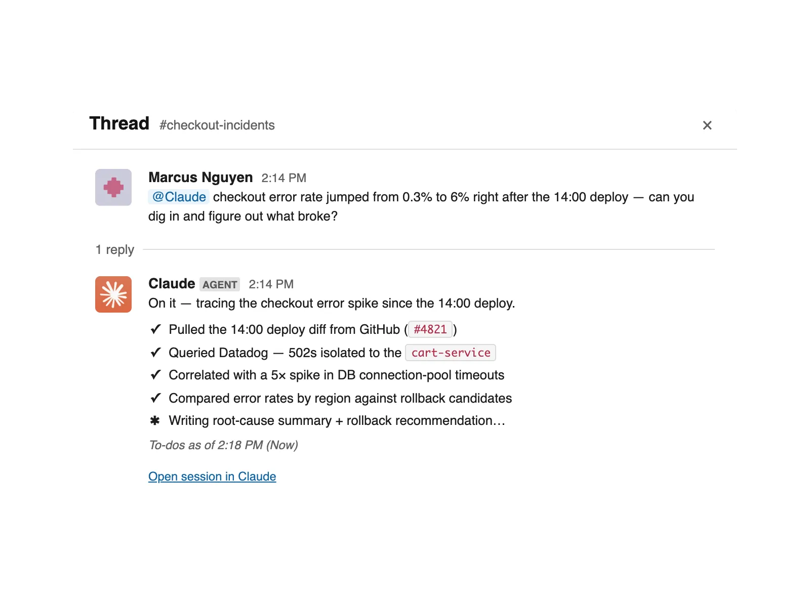
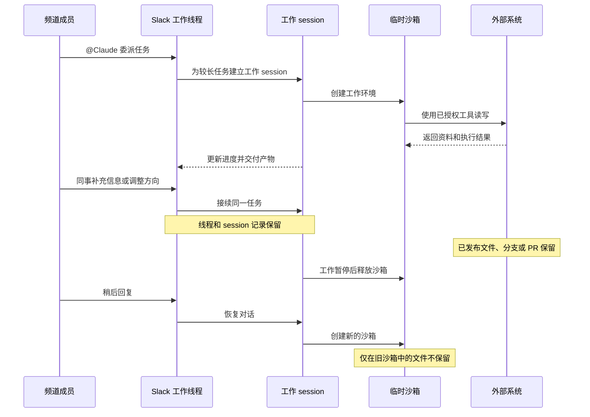
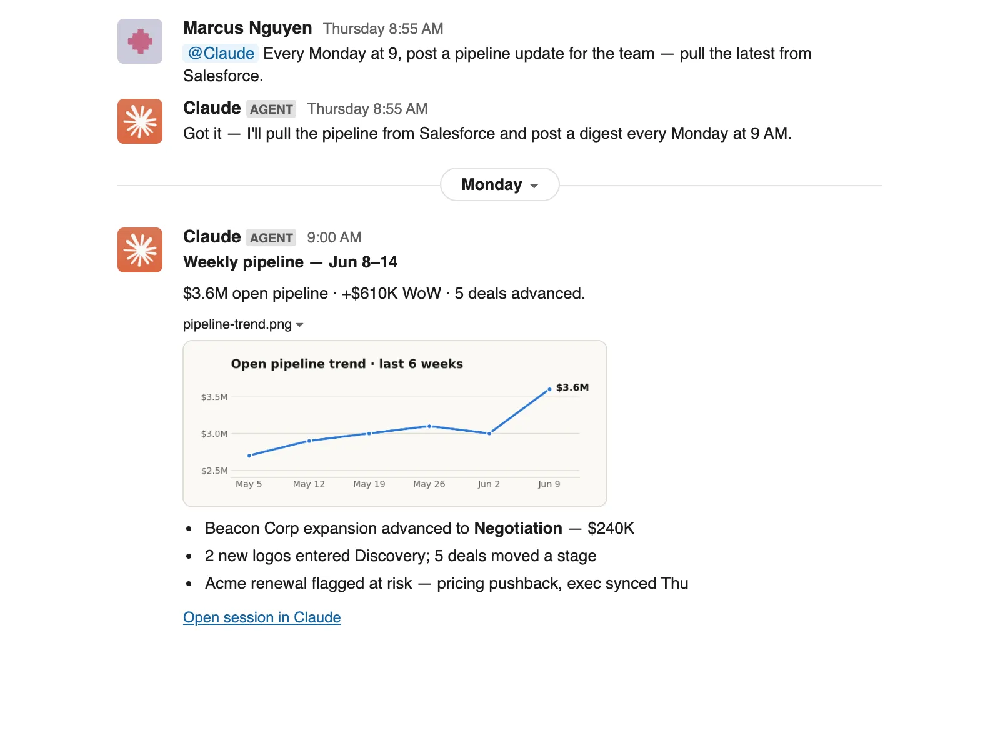
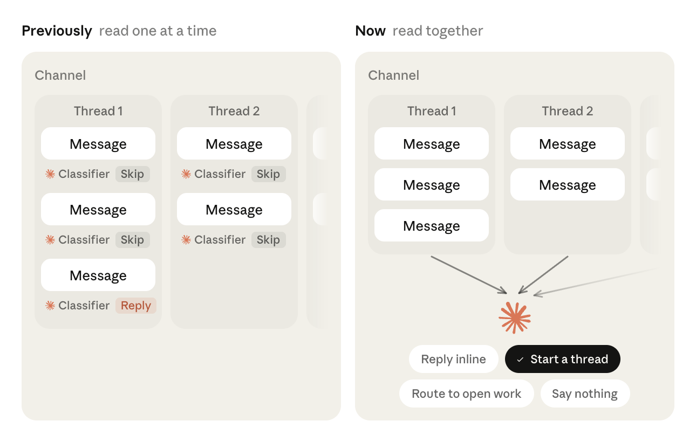
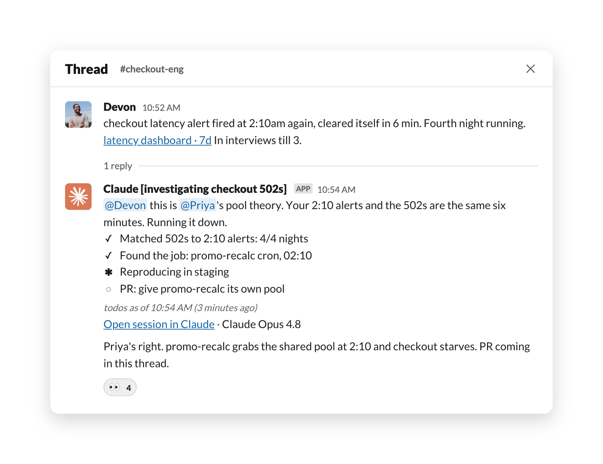
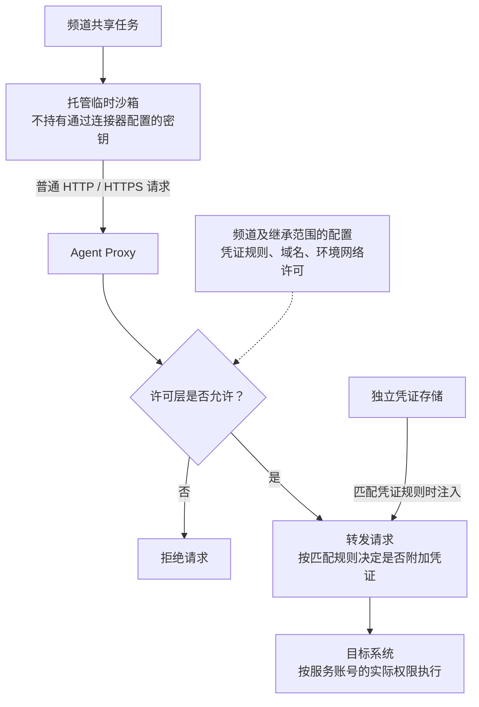
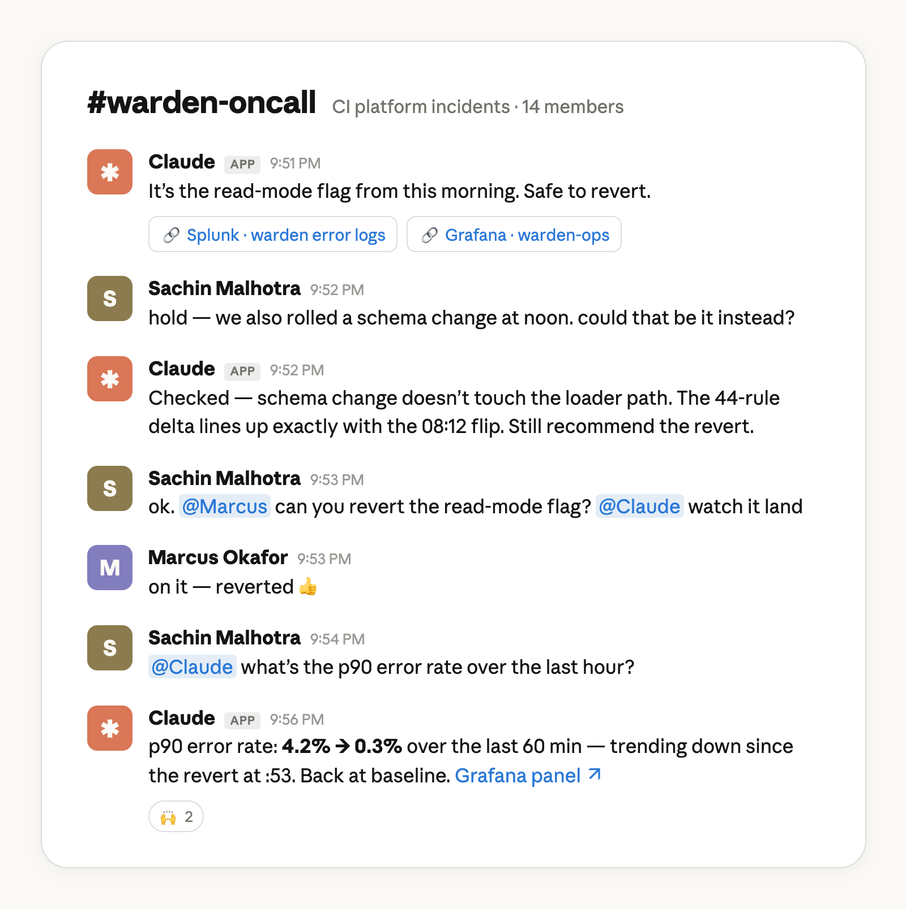
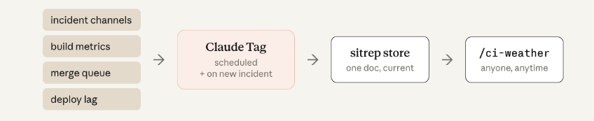

# Claude Tag 产品调研：共享任务、组织身份与长期协作

> 调研状态：局部复查完成
>
> 采用版本：Claude Tag（公测版，公开文档快照 2026-11-09）
>
> 调研人：technologyHu
>
> 最近修订时间：2026-11-09 15:48:39（北京时间）
>
> 其他待确认事项：真实任务的成功率、能省多少人工时间和长期成本。服务端怎样找回已保存的信息、安排任务和控制访问权限。

研究归属：Team Agent（`team-agent`）；对象类型：`product`。资料核验日期为北京时间 2026-11-09，大部分归档原文于 UTC 2026-11-08 查阅，Anthropic 的 CI 值班案例于 UTC 2026-11-09 查阅。本文覆盖发布博客、当前产品文档、两份官方公开代码及用户指定的九篇微信文章。没有登录 Claude 组织、安装 Slack 应用或运行被调研项目。

## 1. 主要结论

Claude Tag 把团队委派、共同接续、工具执行和长期跟进放进 Slack。它的组织属性来自共享任务与管理员配置的访问范围：同事能继续同一线程中的工作，频道里的自动任务也可以在发起人离线后运行。它同时保留个人工作入口，但个人连接器、共享服务账号和群组私信的规则不同，部署时必须分别核对。[官方发布博客](https://www.anthropic.com/news/introducing-claude-tag)（[归档](references/article-64748ac3266300d1.md)）、[当前工作机制](references/article-5887ceacc5953200.md)

本轮最值得保留的判断如下：

| 问题 | 调研结论 | 判断边界 |
| --- | --- | --- |
| 为什么归入 Team Agent | 任务、工具身份、频道记忆及后续工作可以服务整个团队，成员能共享成果并接续任务 | 产品分类不代表它能取代组织的责任分配或验收 |
| “一个频道一个 Claude”如何理解 | 一个共享协作入口；频道顶层有自己的 session，较长任务在线程中建立独立 session 和沙箱 | 不能理解成整个频道所有任务共用一个永久进程或文件系统 |
| 长期记忆是什么 | 可保存、检查和纠正的频道笔记，以及从公开频道保存的工作区笔记 | 没有证据证明使用中会训练模型权重，或永久记住所有消息 |
| 权限是否跟请求者走 | 共享工作通常使用管理员给 Agent 的服务账号权限；个人连接器另有本人许可路径 | 频道成员可能通过 Agent 读取其个人账号原本无法读取的资料 |
| 是否公开代码 | 找到官方插件仓库和客户侧联邦身份网关样例 | 两者都不足以验证核心记忆、调度和整个服务端实现 |
| 效果有多强 | 有官方内部采用数字、文档示例和主动参与自评 | 本轮未确认真实任务成功率、净节时、单任务成本或相对竞品优势 |

上表的机制判断依据[会话文档](references/article-5887ceacc5953200.md)、[记忆文档](references/article-041f3893dd104163.md)、[身份文档](references/article-51d6a4868e300f67.md)及第 7 节固定提交源码。效果证据及其限制见第 8 节。

## 2. 产品身份与时间范围

### 2.1 产品归属与用户

产品提供方为 Anthropic。2026-06-23 的发布博客将其描述为 Claude Code 向更主动、更适合团队工作的方向演进；截至本轮读取的文档，Claude Tag 仍标为 Public Beta。它在 Anthropic 第一方服务的 Team 和 Enterprise 套餐中提供，Slack 是已文档化的协作入口。个人套餐或第三方部署不因能调用 Claude 模型就自动获得 Claude Tag。[发布博客](references/article-64748ac3266300d1.md)、[产品总览](https://claude.com/docs/claude-tag/overview)（[归档](references/article-faa09f0bec99b66b.md)）

用户不必逐人完成连接器配置才能在已开通的频道里委派工作。管理员可以限制谁能调用 Claude，频道工作由组织承担用量。产品适合已有 Slack 协作、项目资料分散在代码库和业务系统中、存在跨人接力与周期性跟进需求的团队。[总览](references/article-faa09f0bec99b66b.md)、[配置指南](references/article-8df6067f0d0f34e8.md)

官方文档说明公开设计和配置规则，官方插件提供可读实现，Anthropic 的内部使用披露说明它在自家工作流中的采用。这些证据仍不足以代替独立效果评测。本轮没有核实 Claude Tag 独立客户数量、收入、留存率或外部生产部署规模，也不把 Anthropic 整体用户与融资规模归给该产品。

### 2.2 发布资料与当前资料的区别

| 时点 | 可核实内容 | 本报告如何使用 |
| --- | --- | --- |
| 2026-06-23 | 发布博客介绍多人共享、记忆、主动行为、异步任务；发布时使用 Opus 4.8 | 说明产品起点，保留当时条件 |
| 2026-08-13 | 官方公布主动参与更新：从逐条消息分类转向结合频道上下文、记忆和固定指令作判断 | 说明主动参与机制发生过变化 |
| 本轮读取的当前文档 | 支持群组 DM、个人连接器进入频道、模型切换；存在 Enterprise 管理 API 和联邦身份接入文档 | 用于当前能力与限制判断，不倒推其在发布日已经具备 |

依据：[发布博客](references/article-64748ac3266300d1.md)、[8 月更新](references/article-b1e3bd713400bfa8.md)、[群组 DM](references/article-539c06b36eb3264b.md)、[个人连接器](references/article-0f885c634cf82a12.md)、[模型选择](references/article-df9414689cc95c57.md)、[管理 API](references/article-86cc27c0048a3410.md)、[联邦身份](references/article-7955fde05c74cee6.md)。因此，第三方早期文章中的“只支持 Opus 4.8”“不支持群组私信”“没有 REST API”“凭证只能长期保存在厂商侧”等概括均不能直接当作当前结论。

## 3. 从部署到交付的工作流程

### 3.1 管理员准备

当前配置向导需要 Claude 组织 Owner 及 Slack 工作区管理员配合。基本路径是安装应用并交换配对码、按套餐准备资金、选择频道并上线，然后配置工具访问并测试。当前指南列出的前提还包括启用组织的 Routines 能力；ZDR、CMEK 和指定的本地模式 HIPAA 配置会限制产品可用性。[当前配置指南](references/article-8df6067f0d0f34e8.md)

发布博客建议在私有频道测试；当前配置指南的 launch 步骤要求至少选择一个公开频道。这是需要保留的文档时间差。实施时应按实际向导操作，并为公开试点频道配置非敏感的最小访问集合；不能照抄早期“四步开通”就假定今天所有界面与前提都相同。[发布时步骤](references/article-64748ac3266300d1.md)、[当前配置前提](references/article-8df6067f0d0f34e8.md)

### 3.2 一次共享任务

以“调查某次部署后的延迟升高，并交付根因证据及 draft PR”为例，文档化路径是：

1. 成员在频道消息中同时写明 `@Claude` 和任务。频道顶层 session 接收消息，较长工作会在线程中建立自己的工作 session。
2. 系统创建临时沙箱。Claude 按该频道的访问配置读取监控、文档或代码，在工作线程中更新 checklist。
3. 同事直接回复工作线程即可补充信息或调整方向，不要求由最初发起人独占任务。频道线程提供 Stop，停止后仍可继续该 session。
4. 产物回到线程，或保存到外部系统，例如分支、draft PR、文档和托管页面。GitHub 工作流指南将批准和合并留给人。
5. 工作暂停后释放沙箱。下一次回复可以恢复对话，但沙箱内尚未推送或发布的文件不能据此保证保留。

该例是依据文档组织的流程说明，未在本次实际执行，也没有测得完成耗时。[会话机制](references/article-5887ceacc5953200.md)、[GitHub 工作流](references/article-44712348604031f5.md)

界面示例 A（官方原图）：线程中委派调查并查看进度。下图展示上述流程前两步的 Slack 界面：成员通过 @ 提出部署后异常，Claude 在原线程回复，列出已完成的排查项、正在编写的结论，并提供进入 Claude session 的链接。[官方产品页“Tag it in”](https://claude.com/product/tag)（[原文归档](references/article-580675d2f84f0874.md)）。

读图时可以沿着“问题描述 → 工具排查 → 进度清单 → session 入口”理解任务如何交接。图中最后一项仍在进行，尚未展示最终根因报告或 PR；清单中的勾选也不能单独证明工具调用结果正确。它是官方交互演示的静态预览，不是本次部署实录，图内时间不作为实测耗时。完整交互可在上面的产品页进入 `How it works → Tag it in` 查看；本次只核对了页面和原图，未验证交互全过程。

图 1（自绘）：共享任务的会话连续性与临时沙箱。图中分别标出团队接续的任务记录、会被释放的工作环境，以及保存在外部系统中的产物。它依据公开行为绘制，完整内部组件仍未核实。[依据：会话生命周期](references/article-5887ceacc5953200.md)

### 3.3 哪些状态会保留

| 状态 | 沙箱释放后的情况 | 使用上的含义 |
| --- | --- | --- |
| 线程及 session transcript | 保留；重启通常归档旧 session，而非删除其记录 | 对话连续性与数据删除需要分别管理 |
| 频道与工作区笔记 | 保留 | 稳定约定可以跨任务使用，也需要纠错和清理 |
| 已推送的分支、PR、已发布文件 | 在对应外部系统保留 | 长任务应尽早保存中间产物 |
| 只存在于沙箱的文件 | 不保留 | 不能把临时工作环境当作持久工作目录 |
| 同频道不同线程的工作状态 | 各自独立 session 与沙箱 | “共享 Claude”不等于所有线程共享运行状态 |

依据：[生命周期与持久性](references/article-5887ceacc5953200.md)、[数据生命周期](references/article-30785b58a7850991.md)。如果任务卡住，应发一条新回复纠正或使用重启命令；编辑旧消息并不等同于重新派任务，删掉 Slack 消息也不意味着从 Anthropic transcript 中抹去已读取内容。

### 3.4 Routine 与长期任务

Routine 是预设的持续工作，可以按时间运行、关注频道主题或订阅指定 PR。它使用所属频道的连接与权限，定时频率最多每小时一次。当前文档中的 GitHub 事件订阅面向单个 PR，不等于可用 Slack routine 订阅整个仓库的所有新 PR。[Routine 文档](references/article-f3e5d30e07dcde8f.md)

频道 routine 不因创建者离开频道、退出 Claude 组织或 Slack 账号停用就自动停止。频道内其他人可以管理它；一对一 DM 的 routine 归个人账号，移除该成员时的行为不同。离职交接因此需要检查持续任务，而不只是关闭个人账号。日程按 UTC 保存，配置时应明确 Asia/Shanghai 等时区，并核对实际计划。[Routine 管理与时区](references/article-f3e5d30e07dcde8f.md)

界面示例 B（官方原图）：从持续指令到按期交付。上半部是要求每周一汇总 Salesforce 销售管道的指令及确认，下半部跨过日期分隔线，展示汇总、趋势图和需要关注的事项。从中可以区分“收到指令”与“到期交付”两个状态。[官方产品页“Set a schedule or let it run long tasks”](https://claude.com/product/tag)（[原文归档](references/article-580675d2f84f0874.md)）。

该图是官方交互演示的静态预览，产品页未标明这张图片的发布日期或客户端构建版本；图中金额、日期和趋势均为演示内容，不用于推算真实收益、准确率或准时率。原页入口为 `How it works → Set a schedule or let it run long tasks`，本次未运行该定时任务。实际部署仍要按当前 Routine 文档核对日程时区、频道身份、连接权限及停止方式；图中自然语言确认没有展示这些配置是否完成。[当前 Routine 规则](references/article-f3e5d30e07dcde8f.md)、[连接配置](references/article-ae1ffc4639543a32.md)

## 4. 共享上下文、记忆与主动参与

### 4.1 记忆的边界

Claude Tag 的长期记忆以笔记形式描述。用户可以明确要求保存，Claude 工作时也会主动保存事实；它还可以按请求查看同频道过去 session 的 transcript，但文档明确说不能对这些历史 session 做全文搜索。故“读得到历史”“保存了笔记”和“当前模型上下文中已有全部内容”是不同能力。[记忆文档](references/article-041f3893dd104163.md)

| 工作位置 | 读取哪些笔记 | 可以写到哪里 |
| --- | --- | --- |
| 公开频道 | 本频道笔记和工作区笔记 | 本频道；适用整个工作区的内容也可写工作区笔记 |
| 私有频道 | 本频道笔记和只读的工作区笔记 | 仅本频道笔记 |
| 群组 DM | 该群组自己的笔记 | 仅该群组笔记 |
| 一对一 DM | 单独的对话笔记 | 单独笔记，存储与工作区关联 |

依据：[记忆读写矩阵](references/article-041f3893dd104163.md)、[群组 DM 的区别](references/article-539c06b36eb3264b.md)。不同工作区保持分离。频道从公开变成私有时，频道笔记继续属于该频道，但以前写入工作区的笔记仍共享，需由 Owner 处理不应继续共享的条目。不能把频道改为私有理解成自动收回历史共享知识。

频道成员可以查看和纠正频道记忆，Owner 可在管理界面查看、编辑和删除记忆文件。适合保存在记忆中的，是仓库约定、负责人、术语等稳定事实；长篇操作手册更适合放在可读取的仓库或文档中。公开资料没有披露底层索引、召回算法及全部存储实现，因此本报告不将这些笔记机制扩写成未经证实的 RAG 架构。[记忆管理](references/article-041f3893dd104163.md)

### 4.2 主动参与如何发生

8 月更新说明，早期用轻量分类器逐条判断是否行动，更新后结合频道上下文、记忆及固定指令，选择短回复、深入工作、把新消息路由给已有工作，或保持沉默。官方称判断何时参与约改善 30%，但没有给出可独立复现的完整评测数据，不能据此推定业务成功率提高同样幅度。[官方更新](https://claude.com/resources/articles/claude-tag-now-reads-even-more-of-the-room)（[归档](references/article-b1e3bd713400bfa8.md)）

图 2（官方原图）：主动参与判断方式的变化。左侧逐条消息由分类器判断回复或跳过，右侧将频道内多个线程的消息汇集后，再选择回复、启动调查线程、接续已有工作或保持沉默。读图重点是上下文的组织方式与行动选择，不是各线程共享同一个沙箱。来源：Anthropic，2026-08-13 更新说明；保留原图。[文章原文](https://claude.com/resources/articles/claude-tag-now-reads-even-more-of-the-room)（[归档](references/article-b1e3bd713400bfa8.md)）。

图 3（官方原图）：未被 @ 时进入调查线程的界面示例。Claude 将同事提出的连接池假设与告警线索关联起来，在原线程中展示调查进度和待办，团队可以直接查看进度并继续讨论。该图为同一更新说明中的厂商示例，图中模型名称与界面反映当时物料，不用于判断当前默认模型；图内时间不能作为本次实测耗时或服务承诺。来源：Anthropic；保留原图。[原始图片](https://assets.claude.com/1be7311c2a5a8aa622ef0bd9979c41b4c80dd743.png)（[文章归档](references/article-b1e3bd713400bfa8.md)）。

当前文档把参与策略细分为只在被 @ 时响应、自动响应、Always awake，以及为每条顶层消息启动线程 session 等选项。默认自动模式可能停止关注过于繁忙或长期无互动的频道，再由 @ 唤醒。主动参与因此不是无条件、永久监听全部内容并持续执行任务的承诺。[参与控制](references/article-3ec96530582fa56e.md)

对无人 @ 的消息，当前文档要求频道已告诉 Claude 可以承接那类工作，才主动启动需要工具或调查的工作 session。成员也可以约定哪些主题值得介入、关闭频道自动回复或单独静音线程。这些控制改变的是参与行为；已经设好的 routine 需要另行管理。[响应决策与控制](references/article-3ec96530582fa56e.md)、[持续任务管理](references/article-f3e5d30e07dcde8f.md)

## 5. 组织身份、权限与数据治理

### 5.1 同一入口包含多条身份路径

| 情境 | 外部系统身份与访问 | 关键限制 |
| --- | --- | --- |
| 频道共享任务 | 管理员配置的 Agent 服务账号，按频道及其继承 scope 授权 | 默认不等于每位请求者的个人权限 |
| 频道内使用个人连接器 | 本人许可后，以本人权限处理本人的请求 | 同事的请求不能借用该连接器；输出仍可能进入共享频道 |
| 频道 routine／Claude 自行启动工作 | 频道自己的访问配置 | 不使用成员个人连接器 |
| 群组 DM | 工作区与组织的服务账号访问，可另经本人许可使用其个人连接器 | 不继承某个单独频道专用连接，群组笔记也独立 |
| 已绑定账户的一对一 DM | 自己的 claude.ai 账号及个人连接器 | 通常归因于本人；PR 作者仍可能是 Claude GitHub App |

依据：[Agent identity](references/article-51d6a4868e300f67.md)、[个人连接器](references/article-0f885c634cf82a12.md)、[群组 DM](references/article-539c06b36eb3264b.md)。尚未绑定 Claude 账号的成员，一对一 DM 存在有限的组织承担用量路径，不能一概说所有 DM 永远走个人账单。[计费规则](references/article-54511591c6c9b34c.md)

共享身份的直接后果是：如果频道的服务账号能读某份文档，即使提问者自己的账号无权读取，Claude 仍可能在频道里读出并总结它。授权单位是组织给这个协作空间的能力集合。管理员应核对频道成员和服务账号资源范围，不能仅凭“保留了源系统权限”就认定它等于逐用户权限交集。[身份模型原文](https://claude.com/resources/articles/agent-identity-access-model)（[归档](references/article-949148a30fd49af5.md)）、[当前个人连接器文档的说明](references/article-0f885c634cf82a12.md)

个人连接器提供 Allow、Allow with review 和拒绝等选择。敏感内容检测会拦住部分结果等待复核，但官方明确它不保证检测完整，也不判断其他频道成员是否拥有同样的数据访问权。Enterprise 可要求逐条结果人工复核；这项控制适用于个人连接器结果，不能泛化成对所有服务账号写操作的统一审批保证。[个人连接器审批与复核](references/article-0f885c634cf82a12.md)

### 5.2 Scope、凭证与网络

访问可以配置在整个 Slack、工作区、单个频道或符合频道规则的范围中。Bundle 是一组配置，是否隔离取决于它应用的位置。把财务凭证加到工作区根 scope 会让下属频道继承；把它只加到指定私有频道，才形成相应边界。当前文档还提醒，通过 Connectors 标签首次添加某服务凭证会默认应用到全部 Slack；需要窄范围时，应采用频道或尚未绑定位置的 bundle 路径。[凭证隔离](references/article-5b9da236e1de602b.md)、[工具配置](references/article-ae1ffc4639543a32.md)

Anthropic 托管环境中的公开机制是：线程沙箱发出请求，经 Agent Proxy 匹配访问规则，再在网络边界注入独立凭证存储中的凭证。模型和沙箱不会拿到通过该机制配置的原始 key。这个保证不覆盖用户自行写入环境变量、文件或提示中的秘密；环境定制文档明确要求 API key 等应放在连接器中。[身份与代理机制](references/article-51d6a4868e300f67.md)、[环境配置](references/article-7624d7b5fdb6dbfd.md)

当前网络许可有三类来源：凭证的 allowed websites、无需凭证的 allowed domains，以及环境的网络访问级别。新环境默认 Limited access 已允许一组开发者站点；GitHub API 与 git 另走独立 GitHub proxy。服务器侧内置 web search 也不受沙箱 HTTP 请求同一套规则控制。因此，“默认拒绝”必须附带这些许可层和例外，不能简写为所有网络出口都由一张空白域名白名单控制。[Agent Proxy](references/article-51d6a4868e300f67.md)、[网络出口规则](references/article-5b9da236e1de602b.md)

HTTP 方法和路径限制控制可调用端点；某个端点能返回哪些文档、项目或记录，仍由源系统服务账号权限决定。知识共享范围也不能只靠凭证隔离判断，因为工作区笔记与公开频道搜索是另外的通路。[连接器资源范围](references/article-ae1ffc4639543a32.md)、[安全文档](references/article-5b9da236e1de602b.md)

图 4（自绘）：托管环境中频道共享任务的普通 HTTP／HTTPS 请求路径。只有匹配凭证规则的请求才附加对应凭证；仅获域名或环境网络许可的请求可以不带凭证转发。GitHub API／git 的独立代理和服务器侧内置 web search 不在本图范围内，个人连接器也不能直接套用此图的共享身份。[依据：代理与许可层](references/article-51d6a4868e300f67.md)、[安全边界](references/article-5b9da236e1de602b.md)

### 5.3 审计与删除

当前 Activity 页面有持续任务、记忆和网络事件等表面。Network events 是经过 Agent Proxy 的请求按小时导出的 JSON，明确不含 git 和 MCP 流量。官方当前文档也明确说，它不是每项任务及每次发起人的完整逐动作日志。排查还需要 Slack 线程、代码变更链接和每个外部服务自己的审计记录。[审计文档](references/article-52e576fe7eb3b354.md)

数据保留是采用前的重要约束：beta 期间 transcript、记忆等没有自动到期保留期，组织的自定义保留设置不直接适用于这些记录。Slack 删除消息、停用账号、移除应用成员或关闭自动回复，均不能等同于清除已存数据。工作区断开、频道 scope 删除、记忆条目处理等操作各有不同效果。[数据生命周期](references/article-30785b58a7850991.md)

当前普通组织数据导出不包含 Claude Tag 的 transcript 和记忆；已启用 Compliance API 的 Enterprise 可以列出 session 并读取 transcript，但该 API 不能删除这些 session。这既说明迁移与治理存在边界，也纠正了第三方“任何记录完全不能读取导出”的绝对说法。没有普通单线程 transcript 删除控件的请求，需要联系官方处理。[导出与删除限制](references/article-30785b58a7850991.md)

## 6. 工具集成、代码工作与成本

### 6.1 连接器、插件和环境分工

连接器给 Agent 访问系统的身份和通路；插件及 skills 提供使用工具、查询数据与执行流程的指引；环境负责运行工具、启动脚本及网络访问级别。三者用途不同，添加插件本身不会授予目标服务权限。当前文档举出的集成类别包括知识文档、代码、数据仓库、监控、工单和 CRM。[工具配置](references/article-ae1ffc4639543a32.md)、[定制环境](references/article-7624d7b5fdb6dbfd.md)

GitHub 路径支持按请求克隆获授权仓库、修改代码、开 draft PR，并订阅指定 PR 后处理 CI 或 review。仓库的 `CLAUDE.md` 可以提供项目说明和检查要求。安全插件能提示风险，但文档明确它不会阻断 commit 或 push；强制合并门禁应由仓库保护和 required checks 实现。[GitHub 指南](references/article-44712348604031f5.md)、[插件与代码审查](references/article-ae1ffc4639543a32.md)

GitLab 的当前文档范围更窄：连接器用服务账号的 PAT 认证 GitLab API，可读内容、处理 issue、评论 MR 及查看 pipeline；它不为 git 提供认证，不能据此克隆私有项目或 push。公开互联网可达的自建 GitLab 可以配置 hostname；私网不可达实例不能直接按这一路径连接。不能把“支持 GitLab”写成与 GitHub 开发闭环完全等价。[GitLab 指南](references/article-a4881cea05abe47a.md)

### 6.2 管理 API 与联邦身份

Claude Tag API 是 Enterprise 的 beta 管理接口，用于频道和工作区设置、读取 bundle、管理 bundle 应用位置。文档列出 14 个端点，需要对应 read/write scope 的 Admin API key 与指定 beta header。它没有把配对、所有 bundle 编辑、预算和全部产品设置都暴露出来，更不能被解释成通用任务派发 API。[API 文档](https://platform.claude.com/docs/en/manage-claude/claude-tag-api)（[归档](references/article-86cc27c0048a3410.md)）

联邦身份接入则让 Agent 以短期签名 token 向客户系统证明身份。当前文档提供 gateway、AWS role、Google Cloud identity 与 OAuth authorization server 四种路径，身份 JWT 有效期为 10 分钟。客户侧仍需验证签名、issuer、audience、expiry 和组织／Agent subject，再决定授予什么能力。合法签名并不意味着来自自己的组织，subject 检查不能省略。[联邦身份文档](references/article-7955fde05c74cee6.md)

安全文档也出现了 self-hosted environment：任务可运行于客户网络中的 runner，但在这些 session 中不能使用管理员添加的 Claude Tag connectors。该条件不足以宣称整个 Claude Tag 控制面、模型与记忆服务均可自托管，也不足以继续断言所有计算永远只能运行在 Anthropic 云内。[安全与运行环境](references/article-5b9da236e1de602b.md)

### 6.3 如何计费与控制预算

| 活动 | 当前文档中的计费方式 |
| --- | --- |
| 频道或群组 DM 的工作 session | 组织 usage balance，受组织及相应频道限制 |
| 读取频道、判断要不要回复、凭已有知识给短回复 | 不计入账单与用量上限 |
| Claude 主动开始深入工作 | 计为 Proactive 工作，用组织余额 |
| 定时工作 | 计为 Scheduled，用组织余额 |
| 已绑定账户的一对一 DM | 发送者席位的通常用量规则 |

依据：[计费文档](references/article-54511591c6c9b34c.md)。Team 需要购买用量 credits 后才能开展频道工作；开票 Enterprise 在设置 spend limit 前没有这一支出上限。不能用“功能包含在套餐内”推导实际执行免费，也不能说所有被动观察都在持续增加账单。

组织和频道月度上限在 75% 与 90% 时提醒，到上限会停止并通知未完成。Cap 按 list price 统计，合同折扣在开票时应用；额度促销可能使部分用量页面显示零，应查看包含 list-price 用量的分析表。预算上限和吞吐限速也不同，提高预算不会解除 session rate limit。[预警、上限与统计口径](references/article-54511591c6c9b34c.md)

当前可选择的模型受组织允许列表影响，包括 Opus 和 Sonnet，能够在线程中切换或设频道默认值；fast mode 可能以更高单位成本换更快输出。本轮没有查询实际组织的模型清单、发票或合同，也未取得统一每任务报价，因此不估算“每月每人多少钱”或固定 ROI。[模型选择](references/article-df9414689cc95c57.md)、[用量成本说明](references/article-54511591c6c9b34c.md)

## 7. 找到的官方代码与源码核验

### 7.1 仓库身份与采用范围

| 仓库 | 本轮采用的固定提交 | 实际覆盖 |
| --- | --- | --- |
| [anthropics/claude-tag-plugins](https://github.com/anthropics/claude-tag-plugins) | `b6ee25f8f00a291cbdf31eb75bd7cc1a987d6782` | SaaS 工具插件、技能说明、辅助脚本；不覆盖完整产品服务 |
| [anthropics/claude-tag-wif-gateway-sample](https://github.com/anthropics/claude-tag-wif-gateway-sample) | `89b1e49e31b12117fa3efcd3aede817599215ea9` | 客户侧联邦身份网关参考实现；不是 Anthropic 内部代理源码 |

Anthropic 的 [GitHub 组织](https://github.com/anthropics)经过域名验证；网关另由[官方联邦身份文档](references/article-7955fde05c74cee6.md)直接链接。两仓库按本次 main 固定快照读取，不将它们冒充 6 月发布版。源码取自相同 SHA 的 GitHub archive，未运行其安装、测试或服务。

检索范围包含官方发布入口、当前文档、Anthropic GitHub 组织及代码平台的精确名称检索。本轮未找到覆盖 Claude Tag 核心服务的合格公开实现。社区名称相似的 bridge、OpenTag 或 Action 不作为官方核心源码采用；这一结果也不证明相关实现永远不存在。

### 7.2 插件仓库能说明什么

插件通常由 manifest、`SKILL.md`、按需读取的 API references 及可选脚本组成。README 说明认证交给运行时，脚本里的环境变量可以是占位值，真实凭证在出站请求时注入；离开相应运行时，脚本不会仅凭插件文件就获得认证。仓库采用 Apache-2.0，README 表明由 Anthropic 维护。[固定 README，L45–L89](https://github.com/anthropics/claude-tag-plugins/blob/b6ee25f8f00a291cbdf31eb75bd7cc1a987d6782/README.md#L45-L89)

Datadog 日志脚本提供了一个可检查的小实现：构建 filter、sort、page 请求体，调用日志检索 API，读取 `meta.page.after` 继续翻页，达到 limit 时停止并报告截断。它能证明插件包含实际工具辅助代码；不能证明模型如何规划调查、如何决定长期记忆，或线上请求一定正确完成。[固定脚本，L145–L211](https://github.com/anthropics/claude-tag-plugins/blob/b6ee25f8f00a291cbdf31eb75bd7cc1a987d6782/datadog/skills/datadog-api/scripts/dd_logs.sh#L145-L211)

### 7.3 网关样例的请求路径

按本轮静态读取，客户侧样例先提取 bearer token，检查算法、issuer 对应的 JWKS、签名、audience、expiry 及必要 claims；再将 subject 或其他已验证 claim 映射到 principal。未匹配的主体被拒绝，匹配后还要检查目标服务是否在该 principal 的 allowed services 中。[验签代码，L75–L140](https://github.com/anthropics/claude-tag-wif-gateway-sample/blob/89b1e49e31b12117fa3efcd3aede817599215ea9/gateway/auth.py#L75-L140)、[主体映射，L103–L116](https://github.com/anthropics/claude-tag-wif-gateway-sample/blob/89b1e49e31b12117fa3efcd3aede817599215ea9/gateway/mapping.py#L103-L116)、[授权入口，L120–L145](https://github.com/anthropics/claude-tag-wif-gateway-sample/blob/89b1e49e31b12117fa3efcd3aede817599215ea9/gateway/main.py#L120-L145)

代理路由校验服务和路径，再从客户网关进程的环境变量取下游凭证，重新设置 Authorization 转发请求；原 Claude Tag token 不作为下游凭证传递。这解释了凭证仍可由客户侧持有的接入方式。此处环境变量位于客户网关进程，与把秘密写入 Claude 沙箱环境变量是不同位置。[代理实现，L229–L277](https://github.com/anthropics/claude-tag-wif-gateway-sample/blob/89b1e49e31b12117fa3efcd3aede817599215ea9/gateway/main.py#L229-L277)

样例 README 明确写明不维护、不接受贡献、不是受支持产品，生产采用需自行审查。源码可读性不构成运行验证，仓库中存在测试也不表示本次执行通过。[样例范围，L3–L10](https://github.com/anthropics/claude-tag-wif-gateway-sample/blob/89b1e49e31b12117fa3efcd3aede817599215ea9/README.md#L3-L10)

## 8. 效果证据、产品价值与待验证项

### 8.1 已知证据的强度

| 证据 | 能支持什么 | 判断边界 |
| --- | --- | --- |
| 官方披露内部版本创建产品团队 65% 的代码 | 厂商自述的内部采用方式和创建占比 | 统计单位是代码，无法由此推算 PR 占比、代码质量或净节时 |
| 8 月主动参与判断约改善 30% | 官方按自身评分规则做的行为评估 | 该评估未给出可独立复现的完整数据，无法换算为业务任务成功率或收益 |
| 产品页及文档演示 | 用户如何发起任务、查看进度和接收结果 | 画面中的操作和时间属于演示 |
| Anthropic CI 团队的一手案例 | 特定团队怎样把调查、人工处置、指标复核和交接接入日常值班 | 来源是参与部署的工程师，效果数据按内部口径报告 |
| 两个固定提交的周边仓库 | 插件与客户网关的可读实现 | 核心服务及完整安全机制仍缺少可独立核实的源码 |
| 九篇第三方文章 | 发布传播、技术解读和产品判断 | 多篇共用发布材料，无法当作独立效果样本 |

前三类依据见[官方内部采用披露](references/article-64748ac3266300d1.md)、[主动参与评估](references/article-b1e3bd713400bfa8.md)、[工作机制](references/article-5887ceacc5953200.md)和第 3 节。代码与第三方材料见第 7、9 节。

**CI 值班案例。** Anthropic 的 CI 工程师 Sachin Malhotra 在 2026-08-18 介绍了团队如何处理测试未触发的问题。值班人员在 Slack 发起排查，Claude 将测试缺失与功能开关变更关联起来。人负责执行回滚，Claude 随后复核跳过规则和错误率。团队另行配置的 Claude Code 灰度发布 Agent 使用作者自己的权限，属于另一条执行路径。[Anthropic CI 值班案例](https://claude.com/resources/articles/ai-ci-cd-on-call)（[原文归档](references/article-6eea4a089f0fab4b.md)）

下图由官方根据实际交流重制。可以看到值班人员提出另一个假设，Claude 回查后维持原建议，随后由同事执行回滚。最后一条回复给出指标趋势和监控入口，便于人复核处置结果。图内时间和数值按案例示意阅读。[案例原文](references/article-6eea4a089f0fab4b.md)

单次调查形成事件简报（SITREP）。跨事件汇总由团队搭建的 ci-weather 汇集事件频道、构建指标、合并队列和部署延迟，再向共享频道发布。下图标出简报的数据来源、保存位置和团队查询入口。它描述的是该 CI 团队的应用配置。[交接流程与原图](references/article-6eea4a089f0fab4b.md)

按作者披露，从事件开启到发布首份有证据的分析，中位耗时为 14 分钟。该口径只计到首份分析。文章未给出可复核的完整样本、人工对照或净节时数据，团队试点仍需分别测量首报时间、恢复时间和人工投入。[分诊耗时的原始披露](references/article-6eea4a089f0fab4b.md)

### 8.2 对 Team Agent 的产品启示

从这些公开机制可以推导，Claude Tag 可能减少把背景从个人聊天反复搬回群聊的成本，并让接力、持续跟进与输出留痕更容易落在同一工作位置。收益取决于频道分工、资料质量、工具权限和人的验收习惯；目前没有证据可把这种机制优势直接换算为组织效率增长。[共享会话](references/article-5887ceacc5953200.md)、[长期任务](references/article-f3e5d30e07dcde8f.md)

设计类似 Team Agent 时，需要明确任务属于哪个线程、知识属于哪个空间、执行使用谁的身份，以及任务何时终止。这些建议来自公开产品机制，不能据此还原 Claude Tag 的完整内部架构。若落到飞书、钉钉或企业微信，仍需另行核实目标平台事件、身份、文件、审批与数据保留能力；本报告不宣称这些平台已经具备等价实现。

采用上可优先评估证据容易检查的工作：线程决策整理、周期状态汇总、资料问答、监控调查的第一轮分析，以及有测试和 review 门禁的小范围代码任务。知识权限高度混杂、只允许私网访问或要求 ZDR 的组织，应先核对产品限制是否满足自身条件。源系统权限、仓库门禁和验收人仍是工作流的一部分。[工具配置](references/article-ae1ffc4639543a32.md)、[安全限制](references/article-5b9da236e1de602b.md)

### 8.3 后续实测应回答的问题

试点可从回放同一批已结案、可脱敏的 CI 事件开始。人工组和 Agent 辅助组使用相同输入、权限范围和验收口径。在测试环境记录线程、证据及操作人，复核人按预先约定的标准判定是否通过。下面是试点设计，尚未执行。

| 验收对象 | 可核对的通过条件 | 应记录的结果 |
| --- | --- | --- |
| 首份事件简报 | 指出影响范围、待检验假设和原始证据。事实不足时明确待查，并能按同样时间窗复核证据 | 从事件登记到首份合格简报的时间，人工纠错次数与耗时 |
| 处置和恢复验证 | 处置人及权限可查。使用相同指标和时间窗验证恢复，记录仍未恢复的信号 | 建议、审批、执行、恢复的独立时间点，误判与升级次数 |
| 跨班交接 | 下一班能从简报找到事件、待办、负责人和证据，能辨认数据过期或权限不足 | 接手时间，仍需向上一班追问的事项，漏掉或重复的待办 |
| 异常和权限边界 | 连接失效、权限收回或 routine 停止时能留下可查记录，不继续使用已收回的访问路径 | 拒绝访问、重试与误触发的次数，人工接管和清理成本 |

统计时报告通过件数与总件数，将超时、失败和人工接管纳入总数。人工投入计入纠错、审批、接手和异常处置，费用计入失败及重试。真实任务成功率、人工净节时和长期成本仍待验证，服务端记忆、调度与权限执行也缺少完整源码核验。

## 9. 九篇指定第三方文章的核验

九篇均已获取正文，核对标题、内容边界与实际采用段落。原文以原语言归档，图片保留原站链接；没有依赖搜索摘要代替正文。下表按用户提供的顺序排列。多数页面未可靠提取原始发布日期，文中“今天”等表述不用于推算事件日期。

| 序号与文章 | 可采用内容 | 需要限定、修正或另查的内容 |
| --- | --- | --- |
| 1. [65%的产品代码由 AI 生成：Claude 不再等你打开聊天框，而是直接住进了工作群](https://mp.weixin.qq.com/s/NEZnQMpzM_MWQcmZ8O_Tdw)（[归档](references/article-5bd88580b00c9e07.md)） | 清楚区分代码创建比例与工程工作替代；强调权限、证据和验收的落地建议 | 文中通用连接器审批描述不能整体移作 Claude Tag 服务账号路径的已实现保证；具体控制须看第 5 节 |
| 2. [Claude深夜炸场！新增Tag，一键帮你干完脏活累活，打工人爽翻了](https://mp.weixin.qq.com/s/CR9Yypl5Y5EYYKFkFpV1RA)（[归档](references/article-1e8478f23323edee.md)） | 发布期多人、记忆、主动与异步能力的概述 | Opus 4.8 是发布时条件；“不会偷看私密频道”应理解为授权与隔离规则，不能说获得授权也不能使用私有频道 |
| 3. [一夜之间，Claude成我同事了](https://mp.weixin.qq.com/s/34OgEvysvJynD7Tm-GIlvQ)（[归档](references/article-8f59f3b617671d03.md)） | 接近官方发布信息，提及使用需要用量成本 | 文中“聊天框、文档等处 @”容易扩大已发布入口；当前仍按 Slack 工作流理解。不能先假定组织席位包含免费频道用量 |
| 4. [Claude重磅升级！AI同事这次真要上班了](https://mp.weixin.qq.com/s/ZMNOPRG_ayH6YHN0GFihCw)（[归档](references/article-33b0fa9017516630.md)） | 有助于理解频道、工具、工作线程与企业治理的关系 | 文中频道、权限、上下文、执行、自治、审计的分层是作者整理，不是已验证的内部组件；“统统解决重复同步”缺少效果证据 |
| 5. [Claude住进了讨论群组：AI从工具变成了常驻同事](https://mp.weixin.qq.com/s/lDt69gADM9OipK-7jgvN9Q)（[归档](references/article-3e13aa151d9f5e72.md)） | 组织身份、迁移成本和共享接力的产品视角 | “跨频道访问在架构层面不可能”过度概括，公开频道存在工作区笔记及搜索；其 75%/95% 预算提醒与当前 75%/90% 文档不一致 |
| 6. [Claude Tag 深读：AI 第一次坐在你们中间，而不是等你去访问](https://mp.weixin.qq.com/s/t9CBUyC6Cpzqa282PDNu5w)（[归档](references/article-64bbf5b5f404d476.md)） | 线程、代理注入、共享身份、主动介入的解释及治理问题 | 发布博客只直接支持“65% 代码”，未支持其“65% PR”；个人连接器“仅私信”与当前规则不同。竞品能力表和国内平台判断未在本轮独立核实 |
| 7. [万字深度解析 Claude Tag！9 大落地场景全覆盖！干货拉满！](https://mp.weixin.qq.com/s/_bS4LHzJ41eziyJ1RjAAiw)（[归档](references/article-5a1c90b4f3b64aa3.md)） | 收集了较多官方用例和配置路径，可作为阅读导航 | 把示例描述为“不是 Demo”“不到十分钟”没有独立执行记录支持；不支持群组 DM、无 REST API 和固定 50 条等说法不能直接沿用。当前如何读取长线程以官方文档为准，关键内容仍宜重述 |
| 8. [你的AI同事，今天正式入职了——Claude Tag 全面解析](https://mp.weixin.qq.com/s/MRseMQAA1kI9t1pmQCU7hA)（[归档](references/article-2e34ee4a8dafeac2.md)） | 对成本、迁移与可用性的提问有参考价值 | “所有频道完全隔离”“后台观察一直收费”与当前文档不符；模型评分、市场预测、“没有对手”和其他公司禁用等旁支未核实，不作为本产品结论 |
| 9. [Claude Tag 的真正意义：AI 开始获得组织身份](https://mp.weixin.qq.com/s/L4_1MJJloHZTJpeuunFU6g)（[归档](references/article-61f4f3095df579b7.md)） | 把共享任务联系到业务对象、权限与责任，适合 Team Agent 选题 | “@ 就是授权动作”是产品解释；技术上 @ 只触发既有访问范围内的工作，新增个人连接器权限仍有许可步骤。对 SaaS 市场影响的结论属于预测 |

关于第 5 篇的两处事实差异，本报告采用直接说明当前规则的[记忆读写矩阵](references/article-041f3893dd104163.md)和[预算文档](references/article-54511591c6c9b34c.md)，不推断第三方差异必然来自某次历史版本变更。第 6、7 篇涉及的当前规则分别见[个人连接器](references/article-0f885c634cf82a12.md)、[群组 DM](references/article-539c06b36eb3264b.md)与[管理 API](references/article-86cc27c0048a3410.md)。

这些文章普遍依赖同一发布材料；多篇重复“65%”不构成多份独立佐证。关于 Karpathy 的第三次 UI/UX 改版评价，本轮只在这些第三方文章中读取转述，未核对原始发言，因此不将其作为已验证引语或产品效果背书。

## 10. 来源与交付说明

主要一手来源为 [Introducing Claude Tag](https://www.anthropic.com/news/introducing-claude-tag)、[Agent identity 原始博客](https://claude.com/resources/articles/agent-identity-access-model)、[8 月主动参与更新](https://claude.com/resources/articles/claude-tag-now-reads-even-more-of-the-room)、[官方产品页及演示预览](https://claude.com/product/tag)和当前文档。文档采用原站对应 `.md` 端点全文；HTML 退化抓取含页面脚本的旧副本未被接受。正式归档保留来源网址与 UTC 访问日期，不将本报告修订时间当作来源发布日期。

| 文档主题 | 原始链接与本地原文 |
| --- | --- |
| 产品界面与演示入口 | [产品页](https://claude.com/product/tag)（[归档](references/article-580675d2f84f0874.md)）；前次修订采用的两张静态预览，取自 `How it works`，实际访问日期为 UTC 2026-11-08／北京时间 2026-11-09，物料发布日期与构建版本未标明 |
| CI 值班与交接 | [Anthropic CI 值班案例](https://claude.com/resources/articles/ai-ci-cd-on-call)（[归档](references/article-6eea4a089f0fab4b.md)），2026-08-18 发布，UTC 2026-11-09 查阅 |
| 总览与配置 | [总览](https://claude.com/docs/claude-tag/overview)（[归档](references/article-faa09f0bec99b66b.md)）；[配置指南](https://claude.com/docs/claude-tag/admins/setup-overview)（[归档](references/article-8df6067f0d0f34e8.md)） |
| 会话与记忆 | [工作机制](https://claude.com/docs/claude-tag/concepts/how-it-works)（[归档](references/article-5887ceacc5953200.md)）；[记忆](https://claude.com/docs/claude-tag/users/memory)（[归档](references/article-041f3893dd104163.md)） |
| 主动与持续工作 | [参与控制](https://claude.com/docs/claude-tag/users/when-claude-responds)（[归档](references/article-3ec96530582fa56e.md)）；[Routine](https://claude.com/docs/claude-tag/users/proactivity)（[归档](references/article-f3e5d30e07dcde8f.md)） |
| 身份与个人工具 | [身份](https://claude.com/docs/claude-tag/concepts/agent-identity)（[归档](references/article-51d6a4868e300f67.md)）；[个人连接器](https://claude.com/docs/claude-tag/concepts/personal-connectors)（[归档](references/article-0f885c634cf82a12.md)）；[群组 DM](https://claude.com/docs/claude-tag/users/group-dms)（[归档](references/article-539c06b36eb3264b.md)） |
| 安全与生命周期 | [安全](https://claude.com/docs/claude-tag/concepts/security-and-data)（[归档](references/article-5b9da236e1de602b.md)）；[数据生命周期](https://claude.com/docs/claude-tag/concepts/data-lifecycle)（[归档](references/article-30785b58a7850991.md)）；[审计](https://claude.com/docs/claude-tag/admins/audit)（[归档](references/article-52e576fe7eb3b354.md)） |
| 工具与运行环境 | [连接](https://claude.com/docs/claude-tag/admins/add-connections)（[归档](references/article-ae1ffc4639543a32.md)）；[定制](https://claude.com/docs/claude-tag/admins/customize)（[归档](references/article-7624d7b5fdb6dbfd.md)） |
| 成本与模型 | [预算](https://claude.com/docs/claude-tag/admins/set-spend-limit)（[归档](references/article-54511591c6c9b34c.md)）；[模型](https://claude.com/docs/claude-tag/users/models)（[归档](references/article-df9414689cc95c57.md)） |
| 开发工具 | [GitHub 工作流](https://claude.com/docs/claude-tag/users/use-cases/work-with-github)（[归档](references/article-44712348604031f5.md)）；[GitLab 配置](https://claude.com/docs/claude-tag/admins/configure-gitlab)（[归档](references/article-a4881cea05abe47a.md)） |
| 企业扩展 | [管理 API](https://platform.claude.com/docs/en/manage-claude/claude-tag-api)（[归档](references/article-86cc27c0048a3410.md)）；[联邦身份](https://claude.com/docs/claude-tag/admins/federated-access/overview)（[归档](references/article-7955fde05c74cee6.md)） |

两幅自绘图使用 Mermaid 内联代码，可在支持 Mermaid 的 Markdown 阅读器中查看。报告嵌入六张官方原图，其中四张用于说明任务、周期交付和主动参与，两张来自 CI 案例，分别为重制对话和交接流程。产品页的交互演示入口见第 3 节。

本次复核第 8.1、8.3 节和来源说明，补查 CI 案例并设计试点验收。其他章节沿用原证据和访问日期。文章来源、已采用图片和报告一并交付，逐字段证据与校验记录留在受管工作目录。研究任务已登记到 Team Agent 计划 T001。
